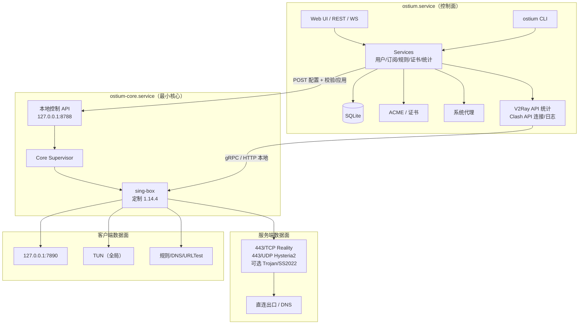

# Ostium v0.1.0 锁定实施方案

> 版本：v0.1.0 基线（确定性方案）  
> 日期：2026-11-12  
> 作者：苏浅玥（Cynthia）  
> 状态：v0.1.0 已发布；v0.1.1 安全/正确性补丁已按 `V0.1.1_PLAN.md` 实施
> 仓库：<https://github.com/ThzxxArt/Ostium>
> PyPI 分发名：`ostium-ctl`
> Python 导入名 / CLI：`ostium`
> 数据面：sing-box v1.14.4 + Ostium 定制构建（`with_v2ray_api`）

> **v0.1.1 修订（2026-11-13）**
>
> - 服务端管理 UI 默认 `127.0.0.1`；非回环明文需显式 `allow_insecure_bind`。
> - 配置应用改为重启子进程并验证；失败回滚，不再依赖 SIGHUP 假成功。
> - 交付范围新增 Windows setup、macOS DMG、Linux DEB/AppImage、SBOM 与不可变发布。
> - IP allowlist、自动备份/保留策略、stats epoch、Alembic 启动迁移均已有真实实现。
> - 详细任务、证据与外部 blocker 见 `V0.1.1_PLAN.md`、`V0.1.1_DECISIONS.md`、
>   `AUDIT_REPORT.md` 与 `MANUAL_TASKS.md`。本文件保留 v0.1.0 设计基线。

---

## 0. 锁定结论

Ostium 是一个 **Python 3.13 + FastAPI + Vue 3** 编写的双端一体私人代理控制台。服务端和客户端使用同一套代码、同一个安装包、同一套 Web UI 和 CLI。

数据面使用 **sing-box v1.14.4** 的 Ostium 定制构建：

- 保留官方默认能力：Reality、Hysteria2、Trojan、Shadowsocks 2022、TUN、DNS、规则集、Clash API。
- 额外启用 `with_v2ray_api`，用于每用户流量统计和配额。
- 关闭 `with_naive_outbound`，不引入 cronet/Chromium 网络栈；v0.1.0 不提供 NaiveProxy。
- 内核源码不修改，只做构建标签组合；Ostium 以 GPL-3.0-or-later 分发。

**进程模型锁定为两个服务：**

1. `ostium.service`：控制面/Web UI/CLI/数据库/ACME/统计/系统代理。客户端以普通用户运行；服务端以 `ostium` 用户运行。
2. `ostium-core.service`：最小化核心服务，只负责校验配置、写运行时配置、启动/监管 sing-box、暴露本地控制 API。服务端以 `ostium` 用户 + `CAP_NET_BIND_SERVICE` 运行；客户端以 root/SYSTEM（Linux 用专用用户 + `CAP_NET_ADMIN`）运行，用于 TUN。

**用户只安装 Ostium 一个应用**。两个服务由同一个安装器注册，用户不需要单独安装、配置或升级 sing-box。

**本方案没有待选项。** 下面所有版本、端口、路径、协议、功能、测试门禁和排期都是 v0.1.0 的锁定基线。Phase 0 只做技术验证，不重新选型；验证失败按发布阻断缺陷处理，不把功能推到后续版本。

---

## 1. 命名与发布坐标

| 项目 | 锁定值 |
|---|---|
| GitHub 仓库 | `ThzxxArt/Ostium` |
| PyPI 分发名 | `ostium-ctl`（已确认可用） |
| Python 导入名 | `ostium` |
| CLI 命令 | `ostium` |
| 服务名 | `ostium.service`、`ostium-core.service` |
| Docker 镜像 | `ghcr.io/thzxxart/ostium` |
| 许可证 | GPL-3.0-or-later |
| 文档许可证 | CC BY-SA 4.0 |
| 首个版本 | `0.1.0` |
| 内核标识 | `sing-box 1.14.4-ostium.1` |
| API 版本 | `/api/v1` |
| 配置格式 | Ostium Profile v1 |
| 数据库 schema | v1 |

---

## 2. v0.1.0 功能冻结清单

### 2.1 服务端

- [x] Linux 一键安装脚本、systemd 两个服务、Docker 镜像。
- [x] 初始化向导：域名、线路、端口、管理员密码、TOTP。
- [x] 线路：VLESS + Reality（TCP 443）、Hysteria2（UDP 443）、Trojan（TCP 可选）、Shadowsocks 2022（可选备用）。
- [x] 多用户：新增、禁用、删除、到期、备注、凭据轮换。
- [x] 每用户流量统计：V2Ray API，5 秒采样，日/月汇总。
- [x] 每用户配额：总量/月配额、到期自动禁用、超限自动禁用、管理员重置。
- [x] 每用户订阅：Ostium JSON、Base64、Clash YAML、sing-box JSON 四种格式。
- [x] 标准分享链接：VLESS、Hysteria2、Trojan、SS2022；二维码。
- [x] 管理 Web UI：总览、线路、用户、订阅、连接、规则、证书、日志、任务、设置、系统、审计。
- [x] 内置 ACME HTTP-01：申请、续期、到期提醒；手动证书上传；自签证书。
- [x] 实时流量/连接/日志；WebSocket 事件；Prometheus 可选指标。
- [x] 备份/恢复：数据库、配置、证书、主密钥；口令加密。
- [x] 应用/内核升级与回滚；`ostium update`。
- [x] 诊断包导出（脱敏）；审计日志；Webhook 告警。
- [x] 公网管理 UI 可选开启，强制 TLS + TOTP + 限速 + 可选 IP 允许列表。
- [x] 服务端出口安全：阻断云元数据/回环/链路本地/私有网段（可配置）、SMTP 25。

### 2.2 客户端

- [x] Windows 10 22H2+/11 x64 安装器；macOS 14+（arm64/x64）DMG；Linux x64/arm64 DEB/AppImage。
- [x] 客户端 Web UI：首页、配置、订阅、分流、网络、统计、日志、设置、诊断。
- [x] 混合代理 127.0.0.1:7890（SOCKS5 + HTTP）。
- [x] 系统代理：Windows WinINET、macOS networksetup、Linux GNOME/KDE；崩溃/退出恢复。
- [x] TUN 全局模式：Windows Wintun、macOS utun、Linux TUN；IPv4/IPv6、TCP/UDP、DNS 接管。
- [x] TUN 严格路由、自动路由、局域网排除、核心停止后清理路由。
- [x] 分流预设：智能（国内直连）、全局代理、全局直连、自定义。
- [x] 规则：域名后缀/关键字/正则、IP CIDR、端口、进程名、GeoSite/GeoIP、规则集。
- [x] 规则测试、规则集更新、规则集失败保留旧版本。
- [x] DNS：TUN 下 FakeIP + 远程 DoH + 国内直连 DNS；混合模式明确提示 DNS 覆盖限制。
- [x] 多配置、多线路、URLTest 自动选路、手动切换。
- [x] 订阅 URL 导入与定时刷新；标准分享链接导入；二维码导入/展示。
- [x] 开机自启、自动连接、自动重连、网络切换恢复。
- [x] 系统代理与 TUN 互斥；切换时清理旧状态。
- [x] 客户端本地 API 仅 127.0.0.1，token 登录，Origin/CSRF/TrustedHost 防护。

### 2.3 双端共用

- [x] 同一 Python 包、同一 SPA、同一 CLI。
- [x] REST + WebSocket API；OpenAPI；TypeScript 类型生成。
- [x] SQLite + Alembic；字段级加密；WAL。
- [x] 管理员账号、Argon2id、TOTP、会话、API token、审计。
- [x] 长任务系统：内核安装/升级、配置应用、ACME、备份、规则更新、诊断。
- [x] 中文/英文 UI 与关键文档。
- [x] 深色/浅色/跟随系统主题；桌面、平板、手机响应式。
- [x] “极光控制台”设计系统：统一色彩、字体、间距、圆角、阴影、图表、动效。
- [x] 可安装 PWA（静态资源离线壳；API/操作不离线）。
- [x] 全局命令面板（Cmd/Ctrl+K）、键盘快捷键、全局搜索。
- [x] 首次使用向导：服务端 4 步、客户端 3 步，3 分钟内完成连接。
- [x] 一键连接/断开、快速切线路、网络体检、复制订阅/二维码。
- [x] 表格批量操作、筛选/保存视图、空状态/骨架屏/错误恢复。
- [x] 浏览器通知（连接断开/恢复、证书到期、配额告警，需用户授权）。
- [x] WCAG 2.2 AA、键盘操作、焦点可见、减少动效、屏幕阅读器标签。
- [x] 视觉回归测试（1440/1024/390）+ axe 可访问性检查。
- [x] 安装、卸载、升级、回滚、备份、恢复、诊断。
- [x] GitHub Actions：CI、跨平台构建、安全扫描、发布、SBOM、签名/校验和。
- [x] Docker 服务端镜像（amd64/arm64）。
- [x] 完整文档：部署、客户端、TUN、ACME、订阅、CLI、API、安全、排障。

### 2.4 明确不做（技术边界，不是延期）

| 不做项 | 原因 |
|---|---|
| NaiveProxy | 客户端 outbound 需要 cronet/Chromium 网络栈、平台库和 CGO/特殊构建；不是配置开关，跨平台交付成本过高。v0.1.0 用 Reality/Hysteria2/Trojan/SS2022 覆盖。 |
| 独立 kill switch | 需要 Windows WFP、macOS pf、Linux nftables 三套防火墙集成；v0.1.0 用 TUN `strict_route` + 路由清理，核心退出后不保证阻断直连。 |
| 手机原生 App | Python Web 客户端无法直接跑在 iOS/Android；通过订阅 URL/标准链接交给第三方客户端。 |
| 多节点服务端编排 | 不是单机私人应用的核心需求；客户端支持多 profile/URLTest 故障转移。 |
| 公网 SaaS/多租户/RBAC | 私人使用；单管理员 + API token 足够。 |
| DNS-01 / TLS-ALPN-01 | ACME 只做 HTTP-01 + 手动证书；避免引入 DNS 服务商 API 和 443 端口冲突。 |
| WireGuard / AnyTLS / TUIC / VMess | v0.1.0 聚焦已验证的四种协议，减少组合爆炸。 |
| CDN/域名前置 | 合规与 ToS 风险高；不纳入。 |
| 静默自动更新 | 更新需用户确认；避免供应链风险。 |
| Windows ARM64 | v0.1.0 只发 Windows x64；ARM64 不在构建矩阵。 |
| 多管理员/RBAC | 单管理员 + API token；减少权限模型复杂度。 |
| 桌面托盘/浏览器扩展 | Web/PWA 已覆盖安装与快捷访问；不做原生托盘和浏览器扩展。 |

> 以上是 v0.1.0 的确定性边界。爸爸如果要求把其中任何一项纳入，属于范围变更，需要重排期；玥玥不会在实施中偷偷改成“后续版本”。

---

## 3. 总体架构



### 3.1 为什么拆两个服务

- **权限隔离**：客户端 TUN 需要 root/SYSTEM；Web/API/数据库不应以 root 运行。
- **稳定性**：UI 重启、证书更新、应用升级不影响隧道；核心崩溃由 systemd/服务管理器拉起。
- **最小攻击面**：`ostium-core` 不跑 Web UI、不连数据库、不接受任意命令，只接受受限配置。
- **确定性**：服务端和客户端共用同一套“UI → 核心 API → sing-box”的配置应用路径。

### 3.2 服务职责

**`ostium.service`（控制面）**

- FastAPI、SPA、CLI、SQLite、Alembic。
- 用户、订阅、规则、证书、ACME、备份、审计、任务。
- 统计采集：V2Ray API gRPC + Clash API。
- 系统代理切换。
- 生成 sing-box 配置，调用核心 API 应用。
- 证书续期；UI HTTPS 监听重启。
- 告警/webhook。
- 不直接绑定 443，不直接操作 TUN。

**`ostium-core.service`（核心）**

- 读取/校验配置；调用 `sing-box check`。
- 写运行时配置（0600），启动/重启/停止 sing-box。
- 原子替换运行时配置，然后重启子进程并验证存活；失败回滚。
- 暴露 127.0.0.1:8788 的最小 API。
- 采集核心 stdout/stderr，写入日志文件；保留最近日志。
- 不连接数据库，不提供 Web UI，不执行 shell。
- 管理核心二进制版本/校验。

### 3.3 进程与启动顺序

```text
systemd / launchd / Windows SCM
├─ ostium-core.service
│   ├─ ostium core-run
│   └─ sing-box (child)
└─ ostium.service
    ├─ uvicorn (FastAPI + SPA)
    └─ background tasks
```

- `ostium-core` 启动时加载 `last-good.json`；没有配置则空闲等待。
- `ostium` 启动后读取核心状态；若配置哈希不一致，生成并推送新配置。
- `ostium` 崩溃/重启：核心继续用最后配置运行，隧道不断。
- `ostium-core` 崩溃：服务管理器重启，加载 `last-good.json`；UI 检测并提示。
- 配置应用失败：核心保留上一版，返回错误；UI 展示核心日志和 diff。
- 卸载：先停 UI，再停核心，恢复系统代理，删除服务。

### 3.4 端口与地址

| 组件 | 地址 | 说明 |
|---|---|---|
| 服务端代理入口 | `0.0.0.0:443/tcp` | Reality / Trojan |
| 服务端 Hysteria2 | `0.0.0.0:443/udp` | 可选 |
| 服务端 SS2022 | `0.0.0.0:8388/tcp+udp` | 默认关闭，显式开启 |
| 服务端管理 UI | `127.0.0.1:8443` 默认；公网时 `0.0.0.0:8443` | HTTPS |
| 服务端 ACME | `0.0.0.0:80/tcp` | 申请/续期时 |
| 客户端 Mixed | `127.0.0.1:7890` | SOCKS5 + HTTP |
| 客户端 UI | `127.0.0.1:8787` | HTTP 回环 |
| 核心控制 API | `127.0.0.1:8788` | token |
| Clash API | `127.0.0.1:19090` | 随机 secret |
| V2Ray API | `127.0.0.1:19091` | gRPC，仅回环 |
| 客户端 TUN | `ostium0` / `Ostium` | 虚拟网卡 |

所有内部 API 只绑定回环；公网只暴露 443/8443（按需）/80（ACME）。

### 3.5 目录

**服务端 Linux：**

```text
/etc/ostium/config.toml
/var/lib/ostium/
  ostium.db
  master.key
  core/
  certs/
  runtime/
    last-good.json
    core.token
    clash.secret
  logs/
  backups/
```

**客户端 Linux：**

```text
~/.config/ostium/config.toml
~/.local/share/ostium/
  ostium.db
  master.key
  certs/
  runtime/
  logs/
~/.local/state/ostium/
/var/lib/ostium-core/          # root 核心服务
  core.token
  last-good.json
  logs/
```

**Windows：**

```text
%ProgramData%\Ostium\                 # 服务端/系统核心
%LOCALAPPDATA%\Ostium\                # 用户 UI
```

**macOS：**

```text
/Library/Application Support/Ostium/      # 核心/系统服务
~/Library/Application Support/Ostium/     # 用户 UI
```

### 3.6 核心 API（内部）

只监听 `127.0.0.1:8788`，Bearer token；token 文件：

- 服务端：`/var/lib/ostium/runtime/core.token` 0600。
- 客户端：`/var/lib/ostium-core/core.token` 0640 root:ostium；UI 用户在 `ostium` 组。
- Windows：`%ProgramData%\Ostium\core.token` ACL 仅 UI 用户/管理员可读。

端点：

| 方法 | 路径 | 说明 |
|---|---|---|
| GET | `/v1/health` | 进程/核心状态 |
| GET | `/v1/status` | 版本、PID、配置哈希、监听、错误 |
| POST | `/v1/apply` | 应用配置；body 含 `config`、`sha256`、`role` |
| POST | `/v1/reload` | 重新加载 last-good |
| POST | `/v1/stop` | 停止 sing-box（保留服务） |
| GET | `/v1/logs?tail=500` | 最近核心日志（脱敏文本） |

**安全约束：**

- 最大 body 2 MiB；JSON 严格解析；请求超时 30s。
- 只接受 role 与自身角色一致的配置。
- 顶层只允许 `log`、`dns`、`inbounds`、`outbounds`、`route`、`experimental`、`ntp`。
- 服务端入站只允许 `vless`、`hysteria2`、`trojan`、`shadowsocks`；监听端口只允许配置中的代理端口。
- 客户端入站只允许 `tun`、`mixed`、`socks`、`http`；`mixed/socks/http` 必须绑定 `127.0.0.1`；TUN 必须使用配置的接口名。
- 出站允许 `direct`、`block`、`vless`、`hysteria2`、`trojan`、`shadowsocks`、`selector`、`urltest`、`dns`。
- `experimental` 只允许 `clash_api`、`v2ray_api`、`cache_file`；禁止 `external_ui` 下载、任意 `service`。
- `clash_api.external_controller` 必须是 `127.0.0.1`；`v2ray_api.listen` 必须是 `127.0.0.1`。
- 证书/密钥路径必须位于允许目录；拒绝 `..`、符号链接逃逸、绝对路径越界。
- 调用固定路径的 `sing-box check`；不执行 shell；参数数组固定。
- 失败时保留 last-good，绝不写入半成品。

---

## 4. 技术栈（锁定）

### 4.1 后端

| 组件 | 锁定版本 | 用途 |
|---|---|---|
| Python | 3.13（测试 3.13/3.14） | 运行时 |
| uv | 0.11.14 | 依赖/环境 |
| hatchling + hatch-vcs | 最新稳定 | 构建/版本 |
| FastAPI | 0.162.5 | API |
| Uvicorn[standard] | 0.54.0 | ASGI |
| Pydantic | 2.14.3 | 校验 |
| pydantic-settings | 2.16.2 | 配置 |
| SQLAlchemy | 2.1.8 | ORM |
| Alembic | 1.20.1 | 迁移 |
| aiosqlite | 0.22.1 | SQLite |
| Typer | 0.29.1 | CLI |
| Rich | 15.0.0 | CLI 输出 |
| structlog | 26.1.0 | 日志 |
| cryptography | 50.0.2 | 加密/证书 |
| argon2-cffi | 25.1.0 | 密码哈希 |
| pyotp | 2.10.0 | TOTP |
| segno | 1.6.6 | 二维码 |
| httpx | 0.28.1 | 出站 HTTP/Clash API |
| psutil | 7.2.2 | 系统指标 |
| orjson | 3.13.0 | JSON |
| msgspec | 0.22.0 | 事件/日志 |
| platformdirs | 4.14.5 | 路径 |
| tenacity | 9.2.1 | 重试 |
| filelock | 4.2.10 | 锁 |
| packaging | 26.3 | 版本比较 |
| tomli-w | 1.2.0 | TOML 写入 |
| acme | 5.10.0 | ACME |
| josepy | 2.3.0 | ACME JOSE |
| grpcio | 1.85.1 | V2Ray API gRPC |
| protobuf | 7.36.2 | gRPC 消息 |
| PyYAML | 6.0.3 | Clash 订阅 |

开发/质量：pytest 9.2.0、pytest-asyncio 1.4.1.post1、pytest-cov、hypothesis 6.170.15、respx、ruff 0.17.4、mypy 2.4.1、pre-commit、pip-audit、cyclonedx-bom、PyInstaller 6.22.3、grpcio-tools 1.85.1。

> 依赖在 `uv.lock` 中锁定；上表是 `pyproject.toml` 的初始约束。升级依赖需要单独 PR + 回归测试，不随功能开发顺手升级。

### 4.2 前端

| 组件 | 锁定版本 |
|---|---|
| Vue | 3.5.45 |
| TypeScript | 7.0.2 |
| Vite | 8.3.8 |
| Naive UI | 2.45.3 |
| Pinia | 4.1.0 |
| Vue Router | 5.5.0 |
| TanStack Vue Query | 5.107.1 |
| ECharts / vue-echarts | 6.1.0 / 8.3.2 |
| vue-i18n | 11.4.18 |
| zod | 4.6.7 |
| vee-validate | 4.15.1 |
| CodeMirror / vue-codemirror | 6.0.2 / 6.1.1 |
| qrcode.vue | 3.11.0 |
| VueUse | 15.0.0 |
| lucide-vue-next | 1.0.0 |
| @fontsource-variable/inter | 5.3.0 |
| vite-plugin-pwa | 2.0.0 |
| jsqr | 1.4.0 |
| fuse.js | 7.5.0 |
| Vitest | 5.1.0 |
| Playwright | 1.65.0 |
| @axe-core/playwright | 4.14.0 |
| ESLint | 10.14.0 |
| Prettier | 3.10.0 |

Node 24.19.0、npm 12.0.2；`package-lock.json` 锁定。

### 4.3 数据面

| 项目 | 锁定值 |
|---|---|
| sing-box 源码 | tag `v1.14.4` |
| Go | 1.25.5 |
| 构建标签 | `with_gvisor,with_quic,with_dhcp,with_wireguard,with_utls,with_acme,with_clash_api,with_v2ray_api,with_tailscale,with_ccm,with_ocm,with_cloudflared,with_usbip,with_openvpn,with_openconnect,badlinkname,tfogo_checklinkname0`；Windows 额外 `with_purego` |
| 不启用 | `with_naive_outbound` |
| LDFLAGS | `-X runtime.godebugDefault=multipathtcp=0,tlssha1=1 -checklinkname=0` |
| 目标平台 | linux/amd64、linux/arm64、darwin/amd64、darwin/arm64、windows/amd64 |
| 版本字符串 | `1.14.4-ostium.1` |
| 许可证 | GPL-3.0 |

> 定制内核不修改 sing-box 源码，只组合官方构建标签。构建脚本、源码 tag、校验和、SBOM 随 Ostium release 发布，满足 GPLv3。

### 4.4 构建/运行镜像

| 用途 | 镜像 |
|---|---|
| Python 运行时 | `python:3.13.5-slim-bookworm` |
| 前端构建 | `node:24.19.0-bookworm-slim` |
| 内核构建 | `golang:1.25.5-bookworm` |
| 最终 Docker | `debian:13-slim` + Python 3.13 + 前端 + 内核 |

---

## 5. 数据面设计

### 5.1 服务端线路

| 线路 | 协议 | 端口 | 证书/域名 | 默认 |
|---|---|---|---|---|
| Reality | VLESS + Vision + Reality | 443/TCP | 不需要 | 开启 |
| Hysteria2 | Hysteria2 | 443/UDP | 需要证书；可自签 + pin | 开启（有证书时） |
| Trojan | Trojan + TLS | 443/TCP | 需要有效证书 | 关闭 |
| SS2022 | Shadowsocks 2022 | 8388/TCP+UDP | 不需要 | 关闭 |

**Reality：**

- 服务端生成 X25519 密钥对、short ID。
- `handshake.server` 默认候选：`www.apple.com:443`、`www.microsoft.com:443`、`www.cloudflare.com:443`；初始化时做 TLS 1.3/HTTP2 连通性检查。
- `server_name` 与 `handshake.server` 一致。
- 客户端 `utls.fingerprint=chrome`，`flow=xtls-rprx-vision`。
- 公开文档明确：Reality/uTLS 不是“隐身”，只是提高主动探测成本。

**Hysteria2：**

- QUIC + BBR；适合高 RTT/丢包。
- 证书：ACME 自动、手动上传、自签 + `certificate_public_key_sha256` 固定。
- 服务端设置 `masquerade` 为普通网站响应，避免空白端口。
- UDP 443 与 Reality TCP 443 共存。
- 系统调优：UDP 缓冲区 16MB 起。

**Trojan：**

- 有效 TLS 证书；443/TCP 与 Reality 互斥，作为“兼容模式”单选。
- 用于旧客户端/备用。

**Shadowsocks 2022：**

- 默认不开放端口；需要显式启用并配置防火墙允许。
- 方法：`2022-blake3-aes-128-gcm`。
- 作为应急/兼容线路。

### 5.2 用户、配额、订阅

**用户字段：**

| 字段 | 说明 |
|---|---|
| `name` | 唯一名称；同时作为 sing-box user name / V2Ray stats key |
| `enabled` | 启用/禁用 |
| `expires_at` | 到期时间；为空不限 |
| `quota_bytes` | 配额字节；0 不限 |
| `quota_cycle` | `total` 或 `monthly` |
| `cycle_started_at` | 月度周期起点 |
| `used_bytes` | 累计已用（DB + 当前统计 epoch） |
| `subscription_token` | 订阅 token（加密存储 + 哈希索引） |
| `note` | 备注 |

**凭据：**

- VLESS UUID v4 随机。
- Hysteria2/Trojan 密码 32 字节随机。
- SS2022 密钥 16 字节 base64。
- 轮换：生成新凭据 → 应用配置 → 旧连接被重载关闭；订阅 URL 可保留或同时轮换。

**统计：**

- 定制内核启用 `experimental.v2ray_api`。
- `stats.users` 包含所有启用用户。
- UI 每 5 秒调用 gRPC `GetStats`（每用户上行/下行）。
- 计数器因核心子进程重启重置时，检测到数值下降，开启新 epoch，累计值继续累加；两次采样之间的少量流量可能丢失，误差 < 5 秒。
- 每 60 秒批量写 `traffic_user_daily`；避免高频写库。
- 在线状态：最近 60 秒该用户计数有增长。
- 配额检查每 30 秒；超限/到期将用户置为禁用，应用配置；活动连接因重载关闭。
- 管理员可重置周期/累计用量，不轮换凭据。

**配额边界：**

- UI 服务停机时配额不执行；核心继续运行。这是两服务架构的已知边界，文档写明。
- 核心重载造成的计数丢失最多一个采样周期；私人使用可接受。
- 不承诺运营商级计费精度。

**订阅：**

| 格式 | 路径 | 内容 |
|---|---|---|
| Ostium | `/sub/{token}?format=ostium` | Ostium Profile v1 JSON |
| Base64 | `/sub/{token}?format=base64` | 每行一个标准 URI，整体 base64 |
| Clash | `/sub/{token}?format=clash` | Clash Meta YAML |
| sing-box | `/sub/{token}?format=singbox` | sing-box outbounds JSON |

- Token 32 字节随机；URL 仅在创建/轮换时展示；服务端存哈希 + 加密副本。
- 禁用/到期/超配额用户返回 403；不泄露用户是否存在。
- 限速：每 IP 60 次/分钟；`Referrer-Policy: no-referrer`；不记录 token 到日志。
- 客户端支持“从 URL 导入”，可设置每日自动刷新；保留上次成功配置。
- 标准 URI 必须与 sing-box 参数一致；用集成测试逐项校验。

### 5.3 客户端模式

| 模式 | 入口 | 权限 | 覆盖 |
|---|---|---|---|
| 混合代理 | 127.0.0.1:7890 | 普通用户 | 支持代理的应用 |
| 系统代理 | OS 代理设置 → 7890 | 普通用户 | 遵守系统代理的应用 |
| TUN | 虚拟网卡 | 核心服务 root/SYSTEM | 全局 TCP/UDP/ICMP |

- 系统代理与 TUN 互斥；切换时先清理旧模式。
- TUN 失败不回退到系统代理，避免“以为全局其实没有”的错觉；UI 显示错误。
- 混合模式明确提示：不接管 DNS、不覆盖不遵守代理的应用、无 kill switch。

### 5.4 TUN 参数（锁定）

| 参数 | 值 |
|---|---|
| 接口名 | `ostium0`（Linux/macOS）、`Ostium`（Windows） |
| 地址 | `172.19.0.1/30`、`fdfe:dcba:9876::1/126` |
| MTU | 1500（高级设置可改 9000） |
| Stack | `gvisor`（跨平台一致；高级可切 `system`/`mixed`） |
| DNS | `dns_mode: hijack` |
| 路由 | `auto_route: true`、`strict_route: true` |
| 局域网 | `route_exclude_address` 排除 RFC1918/链路本地 |
| 自动接口 | `route.auto_detect_interface: true` |
| IPv6 | 开启；可按 profile 关闭 |
| 清理 | 停止/崩溃后由核心/安装器清理路由、DNS、虚拟网卡 |

**权限：**

- Windows：Windows 服务 LocalSystem；Wintun DLL 随安装包分发。
- macOS：LaunchDaemon root；utun。
- Linux：`ostium-core` 系统用户 + `CAP_NET_ADMIN`、`CAP_NET_RAW`，`DeviceAllow=/dev/net/tun`。

**kill switch 边界：**

- TUN `strict_route` 防止运行时的常见泄漏。
- 核心退出后路由会被移除，系统可能恢复直连；v0.1.0 不提供独立防火墙 kill switch。
- UI 在 TUN 页面明确显示该边界。

### 5.5 分流与 DNS

**规则模型：**

- `action`: `proxy` / `direct` / `block`
- 域名：`domain`、`domain_suffix`、`domain_keyword`、`domain_regex`
- IP：`ip_cidr`
- 端口：`port`、`source_port`
- 规则集：`geosite`、`geoip`、自定义 `.srs`
- 进程：`process_name`（平台支持时）
- 网络：`tcp` / `udp` / `quic`

**预设：**

1. **智能分流**：局域网直连 → 国内域名/IP 直连 → 广告阻断 → 其余代理。
2. **全局代理**：局域网直连 → 其余代理。
3. **全局直连**：排障。
4. **自定义**：首条匹配生效，拖拽排序。

**DNS：**

- TUN：FakeIP + 远程 DoH（走代理）+ 国内直连 DNS。
- 混合：应用自行解析；UI 提示 DNS 泄漏与 DoH 绕过风险。
- 规则集更新：HTTPS、ETag/SHA256、原子替换、失败保留旧版本、每周检查。
- 服务端出口规则：阻断云元数据、回环、链路本地、私有网段（可配置）、SMTP 25。

### 5.6 故障转移

- 同一 profile 内多个 endpoint（Reality/Hysteria2/Trojan）生成 `urltest` 组。
- 间隔 180s，容差 50ms。
- 客户端可创建跨 profile 的“最快线路”组。
- 手动切换立即生效；自动切换保留日志。
- 线路健康检查失败 3 次才切换，避免抖动。

---

## 6. 控制面设计

### 6.1 数据库

SQLite + WAL + 外键；Alembic 迁移。

| 表 | 关键字段 |
|---|---|
| `admin_users` | id、username、password_hash、totp_secret_enc、recovery_codes_hash、disabled |
| `sessions` | token_hash、admin_id、ip、ua、expires_at、revoked |
| `api_tokens` | name、token_hash、scopes、expires_at、last_used_at |
| `settings` | key、value_json |
| `proxy_users` | name、enabled、uuid、password_enc、expires_at、quota_bytes、quota_cycle、cycle_started_at、subscription_token_hash、subscription_token_enc、note |
| `traffic_user_daily` | date、user_id、uplink、downlink |
| `stats_epochs` | user_id、epoch、started_at、last_up、last_down |
| `profiles`（客户端） | name、kind、config_enc、subscription_url、last_refresh_at |
| `rules` | priority、enabled、action、match_json、note |
| `rule_sets` | name、url、format、etag、sha256、updated_at、enabled |
| `certificates` | domain、cert_path、key_path、issuer、expires_at、auto_renew、status |
| `jobs` | type、status、progress、message、result_json、error |
| `audit_log` | actor、action、target、ip、ua、detail_json、created_at |
| `alerts` | level、code、message、acknowledged_at |
| `backups` | filename、size、sha256、created_at、encrypted |

**约定：**

- 时间 UTC；ID UUIDv4。
- 敏感字段 AES-256-GCM；AAD 绑定表/记录/字段。
- 主密钥 32 字节，`master.key` 0600；支持轮换。
- 备份：SQLite 在线备份 + 配置 + 证书 + 主密钥；scrypt + AES-256-GCM 口令加密。
- 保留：流量日汇总永久（可配置 365 天）、审计 90 天、任务 7 天、连接元数据默认不落库。
- 每日自动本地备份可选，默认关闭；保留 7 份。

### 6.2 API

公共 API `/api/v1`；核心 API `/v1` 仅本地。

| 分组 | 端点 |
|---|---|
| Auth | `POST /auth/login`、`POST /auth/logout`、`GET /auth/me`、`POST /auth/totp` |
| Status | `GET /status`、`GET /healthz`、`GET /readyz` |
| Services | `GET /services`、`POST /services/{name}/restart` |
| Engine | `GET /engine`、`POST /engine/apply`、`POST /engine/reload` |
| Users | `GET/POST /users`、`PATCH/DELETE /users/{id}`、`POST /users/{id}/rotate`、`POST /users/{id}/reset-usage`、`GET /users/{id}/usage`、`GET /users/{id}/export` |
| Subscriptions | `GET /users/{id}/subscription`、`POST /users/{id}/subscription/rotate` |
| Public Sub | `GET /sub/{token}?format=...`（无管理认证） |
| Profiles | `GET/POST /profiles`、`POST /profiles/import`、`POST /profiles/{id}/refresh`、`GET /profiles/{id}/export` |
| Rules | `GET/POST /rules`、`PATCH/DELETE /rules/{id}`、`POST /rules/test`、`GET/POST /rule-sets` |
| Stats | `GET /stats/overview`、`GET /stats/traffic`、`GET /connections`、`DELETE /connections/{id}` |
| Logs | `GET /logs`、`GET /logs/download` |
| Certs | `GET/POST /certificates`、`POST /certificates/issue`、`POST /certificates/{id}/renew`、`DELETE /certificates/{id}` |
| Jobs | `GET /jobs`、`GET /jobs/{id}`、`POST /jobs/{id}/cancel` |
| System | `GET /system/info`、`POST /system/proxy`、`POST /system/tun`、`GET /system/doctor` |
| Backup | `POST /backups`、`POST /backups/{id}/restore`、`DELETE /backups/{id}` |
| Alerts | `GET /alerts`、`POST /alerts/{id}/ack` |
| Events | `WS /events` |

**约定：**

- 错误 RFC 9457 + `code` + `request_id`。
- 长任务 `202 + job_id`；事件/轮询获取进度。
- 变更操作要求 Origin + CSRF；写操作审计。
- OpenAPI 生成 TS 类型；生产默认仅管理员可访问 `/api/docs`。
- 公共订阅端点单独限速，不挂管理会话。

### 6.3 认证与管理面安全

- 单管理员账号；初始化生成一次性密码，首次登录强制修改。
- Argon2id：64MB / 3 次 / 并行 4（可调）。
- TOTP 可选；公网 UI 强制。
- 会话：HttpOnly、SameSite=Strict、HTTPS Secure；空闲 12h、绝对 7d。
- 登录限速：IP + 用户名；5 次失败锁 15 分钟；审计。
- CSRF：双提交 token + Origin/Referer + SameSite。
- TrustedHost：域名、IP、localhost；防 DNS rebinding。
- 安全头：CSP、HSTS（HTTPS 域名）、`frame-ancestors 'none'`、`nosniff`、`no-referrer`。
- CSP：`script-src 'self'`；`style-src 'self' 'unsafe-inline'`（Naive UI CSS-in-JS）。
- API token：SHA256 哈希、scope、过期、可撤销。
- 公网 UI 可选 IP 允许列表（CIDR）；fail2ban 日志格式。
- 客户端 UI 同样启用 Origin/CSRF/TrustedHost；本地 token 文件 0600。

### 6.4 ACME 与证书

- 使用 `acme==5.10.0` + `josepy==2.3.0`；HTTP-01。
- 域名 A/AAAA 必须指向服务器；端口 80 可达。
- UI 服务绑定 80 执行 challenge；服务端 UI 需 `CAP_NET_BIND_SERVICE`。
- 证书目录：`/var/lib/ostium/certs/<domain>/fullchain.pem`、`privkey.pem`（0600）。
- ACME 账户密钥加密存储；支持 Let's Encrypt staging 测试。
- 续期：每日检查，剩余 <30 天续期；失败告警。
- UI HTTPS：证书更新后重启 UI 服务；核心独立，隧道不断。
- Hysteria2/Trojan：sing-box `certificate_path`/`key_path`，文件变更自动重载。
- 手动上传：PEM 证书链 + 私钥；校验域名/有效期/链。
- 自签：用于 Hysteria2 客户端 pin；UI 公网不推荐。
- 不支持 DNS-01/TLS-ALPN-01（明确边界）。

### 6.5 统计与告警

- V2Ray API：每用户上行/下行；5s 采样。
- Clash API：实时连接、总流量、内存、日志。
- 统计任务与 UI/核心分离；核心重载/重启后重新对齐 epoch。
- 告警：核心不可用、证书 <14 天、配额超限、磁盘 <10%、登录爆破、ACME 失败。
- Webhook：通用 JSON POST；可选 HMAC 签名；超时/重试/脱敏。
- Prometheus `/metrics`：仅回环/token；连接数、流量、用户数、核心状态、任务失败。
- 日志：JSON；默认 journald + 文件；10k 行环形缓冲；脱敏。
- 诊断包：版本、平台、脱敏配置、最近日志、端口/路由/DNS/证书检查、服务状态；用户可预览。

### 6.6 任务系统

- 类型：内核安装/升级、配置应用、ACME 申请/续期、规则集更新、备份/恢复、诊断、订阅刷新。
- `jobs` 表持久化；进程重启后 `running` → `interrupted`。
- 进度事件；协作式取消；幂等键；错误摘要；不写密钥。
- 配置应用是事务：校验 → 写临时 → `sing-box check` → 原子替换 → 重启子进程并验证 → 失败回滚。

### 6.7 升级与回滚

- SemVer；v0.1.0 起提供 DB 迁移。
- `ostium update`：检查 → 下载 → 校验 → 备份 → 停 UI（核心继续）→ 安装 → 迁移 → 启动 → 健康检查；失败回滚上一版。
- 内核升级：Ostium 清单固定版本；`sing-box check` 新配置；失败回滚。
- 核心升级时 UI 提示短暂断线；UI 升级不影响隧道。
- 不静默自动更新；用户确认。
- 桌面安装包提供“检查更新/下载安装包”，不自动执行。

---

## 7. Web UI 与体验设计

### 7.1 设计目标

- **第一眼**：现代、精致、大气，有明确品牌感，不是“Naive UI 默认皮肤”。
- **第一分钟**：一眼知道是否连接、走哪条线路、哪里有问题、下一步点哪里。
- **第一次使用**：服务端 4 步、客户端 3 步，3 分钟内完成连接。
- **日常使用**：常用操作不超过 3 次点击；键盘用户可用快捷键完成。
- **默认简单**：新手只看到必要选项；高级参数收进“高级模式”。
- **移动可用**：服务器管理可在手机上完成；客户端窄屏不横向滚动。
- **可访问**：键盘、读屏、对比度、减少动效都达标，不只是“看起来能用”。

设计代号：**Aurora Console（极光控制台）**。深空底色、极光青/蓝点缀、克制的玻璃质感、清晰的数据层级。避免霓虹堆叠、过度动画、满屏渐变。

### 7.2 视觉系统

#### 色彩

| Token | 深色（默认） | 浅色 | 用途 |
|---|---|---|---|
| `--bg` | `#060911` | `#F4F7FC` | 页面底色 |
| `--surface` | `rgba(13,21,36,.78)` | `#FFFFFF` | 卡片/面板 |
| `--surface-2` | `#101A2B` | `#EDF2FA` | 次级区块 |
| `--border` | `rgba(148,163,184,.16)` | `rgba(15,23,42,.10)` | 边框/分隔 |
| `--text` | `#EDF3FF` | `#0F172A` | 主文本 |
| `--text-2` | `#A7B6CE` | `#475569` | 次文本 |
| `--text-3` | `#6F819B` | `#64748B` | 弱文本/占位 |
| `--accent` | `#5EEAD4` | `#0F766E` | 主操作/选中 |
| `--accent-strong` | `#2DD4BF` | `#0D9488` | 悬停/强调 |
| `--accent-2` | `#60A5FA` | `#2563EB` | 辅助/信息 |
| `--success` | `#34D399` | `#047857` | 成功/已连接 |
| `--warning` | `#FBBF24` | `#B45309` | 警告/降级 |
| `--danger` | `#FB7185` | `#BE123C` | 危险/错误 |
| `--info` | `#60A5FA` | `#1D4ED8` | 中性信息 |

**用色规则：**

- **80/15/5**：80% 中性表面，15% 文本/结构，5% 强调色。强调色只给主操作、选中、关键数据。
- 状态色必须同时有图标和文字，不单靠颜色表达。
- 正文对比度 ≥ 4.5:1，大字号 ≥ 3:1；浅色主题下不用亮薄荷绿做小字。
- 不用纯黑/纯白；深色底加轻微蓝调，浅色底加轻微冷灰。
- 玻璃质感只用于侧栏、顶栏、浮层和首页 hero；表格/表单用实色半透明，保证可读性和性能。
- 背景使用静态的极光径向渐变 + 2% 噪点/网格；不做持续动画。`prefers-reduced-transparency` 或低性能设备自动回退为纯色。

#### 字体

| 角色 | 字体/字号 | 行高 | 字重 |
|---|---|---|---|
| Display | Inter Variable 30px | 38px | 600 |
| H1 | Inter 24px | 32px | 600 |
| H2 | Inter 18px | 26px | 600 |
| Body | Inter 14px | 22px | 400 |
| Body strong | Inter 14px | 22px | 600 |
| Small | Inter 12px | 18px | 500 |
| Micro | Inter 11px | 16px | 500 |
| Mono | ui-monospace / SFMono / Menlo | 20px | 400 |

- **Inter Variable 自托管**（`@fontsource-variable/inter`），中文回退到 `PingFang SC`、`Microsoft YaHei`、`Noto Sans CJK SC`。
- 数字统一 `font-variant-numeric: tabular-nums`，流量/延迟/配额不跳动。
- 中文正文行高 1.6；标题 1.25。
- 除徽标/辅助信息外不小于 12px；日志正文 12.5px。
- 不加载外部字体/CDN；字体子集化，避免首屏膨胀。

#### 间距、圆角、阴影

| Token | 值 | 用途 |
|---|---|---|
| Spacing base | 4px | 8/12/16/20/24/32/40/48 |
| Radius sm | 8px | 标签/小按钮 |
| Radius md | 12px | 输入/按钮 |
| Radius lg | 16px | 卡片/表格容器 |
| Radius xl | 24px | Hero/大面板 |
| Shadow 1 | `0 1px 2px rgba(0,0,0,.20)` | 悬浮 |
| Shadow 2 | `0 8px 24px rgba(0,0,0,.24)` | 弹层/抽屉 |
| Focus ring | `0 0 0 3px rgba(94,234,212,.35)` | 键盘焦点 |

- 卡片内边距 20～24px；页面区块间距 20～24px；不在卡片里再套卡片。
- 边框优先于重阴影；阴影只用于层级，不用于装饰。
- 主按钮高度 40～44px；表格行高 52px（舒适）/44px（紧凑）。

#### 图标、插画、图表

- 图标：**Lucide**，1.5px 线宽，18/20/24px 三档。
- 空状态/错误状态用自绘 SVG 抽象“门/极光/轨道”，不引入图库照片。
- 图表：ECharts 定制主题；2px 线、渐变面积（12% 透明度）、水平虚线网格、无纵向网格；Tooltip 用玻璃浮层。
- 环形图只用于配额/健康度；时间序列一律折线/面积图。
- 数字大、单位小；峰值/当前值标注克制；颜色与线路/状态一致。

#### 主题与动效

- 深色默认；支持浅色和跟随系统；首次加载无闪烁。
- 固定品牌强调色，不开放任意取色，避免破坏一致性。
- 动效 150～220ms，`cubic-bezier(.2,.8,.2,1)`；页面进入淡入+8px 上移；图表 300ms。
- 减少动效：`prefers-reduced-motion` 时关闭呼吸/位移/图表动画。
- 不做持续旋转/闪烁；连接状态用轻微呼吸光，不是警报灯。

#### 品牌资产

- Logo：抽象“门/圆环”符号；Wordmark：Ostium。
- Favicon、PWA 192/512、maskable、Apple Touch Icon、社交预览图。
- 深色/浅色两套 SVG；安装包/README/GitHub 社交图统一。
- 品牌资产放 `assets/brand/`，前端通过 `web/public/icons/` 使用。

### 7.3 布局与导航

```text
┌──────────────┬──────────────────────────────────────────────┐
│ Sidebar 248  │ Topbar 64                                    │
│ Logo         │ 面包屑 · 全局搜索/命令 · 状态 · 通知 · 主题 · 用户 │
│ Nav groups   ├──────────────────────────────────────────────┤
│              │ Page header（标题/说明/主操作）                │
│              │ Content grid 12 cols · max 1600 · gap 20      │
│ Status footer│                                              │
└──────────────┴──────────────────────────────────────────────┘
```

- 侧栏 248px，可折叠到 76px；折叠状态记忆。
- 顶栏 64px；状态胶囊始终可见：`已连接 / 连接中 / 降级 / 未连接`。
- 内容最大 1600px；桌面内边距 32px，平板 24px，手机 16px。
- 断点：≥1440 宽屏、1024～1439 标准、768～1023 平板、<768 手机、<480 紧凑。
- 手机：侧栏变抽屉；底部导航保留 4 个主入口（总览/连接/分流/设置），其余进“更多”。
- 服务端导航分组：总览、线路、用户、订阅、连接、分流、证书、日志、系统、设置；客户端：首页、配置、分流、网络、统计、日志、设置。
- 页面标题统一：标题 + 一句说明 + 主操作 + 次操作；不在页面里重复面包屑。
- 深链接：用户/连接/规则详情可直接分享 URL；筛选条件进 query，刷新不丢。
- 最多两级导航；不搞“标签页里再套标签页”。

### 7.4 页面设计

**服务端：**

| 页面 | 设计/体验重点 |
|---|---|
| 初始化 | 55/45 分屏：左侧极光品牌视觉，右侧 4 步表单；每步可返回；实时校验；最后一步直接生成第一个订阅 |
| 总览 | 一个“Server Pulse”Hero：大状态环、运行时长、入站健康、实时速率；右侧健康堆叠卡；下方流量图、在线用户、告警流 |
| 线路 | 每条线路一张卡：协议徽标、端口、证书/密钥状态、启停、复制订阅；“推荐”标签只给默认线路 |
| 用户 | 头像首字母、在线点、配额环形/进度条、到期、最后在线；点击开右侧抽屉；支持批量启用/禁用/导出 |
| 订阅 | 四种格式卡片（Ostium/Base64/Clash/sing-box），每张有复制、二维码、说明；token 默认打码 |
| 连接 | 实时表：用户、入站、目标、规则、链路、上下行、时长；可暂停；移动端变卡片列表 |
| 分流 | 预设分段控件 + 优先级列表；拖拽手柄明显；每条规则用动作色（代理/直连/阻断）；右侧规则测试 |
| 证书 | 域名卡片 + 到期环；ACME/手动/自签标签；续期按钮；失败时展示可操作原因 |
| 日志 | 终端质感但可读：等宽字体、级别 chip、搜索高亮、暂停/跟随、下载；不解析 ANSI 颜色注入 |
| 任务 | 抽屉式任务中心：进度、阶段、日志链接、取消；失败可复制诊断 |
| 设置 | 左侧分组锚点 + 右侧表单；脏状态吸底保存；高级设置折叠 |
| 系统 | 两个服务卡片（UI/Core）、重启、健康检查、磁盘、版本、诊断包 |
| 审计 | 时间线 + 过滤器；敏感字段脱敏 |

**客户端：**

| 页面 | 设计/体验重点 |
|---|---|
| 首次引导 | 3 步：导入/订阅 → 测试 → 模式；默认推荐“系统代理”；TUN 作为“全局模式”卡片 |
| 首页 | 180～220px 连接 Orb：未连接灰蓝、连接中青色脉冲、已连接极光呼吸；下方线路选择、延迟、速率、模式 chips |
| 配置 | Profile 卡片：协议徽标、延迟 sparkline、当前线路、订阅刷新时间；拖拽排序；空状态引导导入 |
| 分流 | 四张模式卡（智能/全局/直连/自定义）；自定义规则列表 + 测试；国内直连开关 |
| 网络 | 三张模式卡：混合端口/系统代理/TUN；每张写明覆盖范围、权限、限制；TUN 显示“全局/需要管理员” |
| 统计 | 大数字 + 面积图；今日/本周/本月；按 profile 拆分；无数据时给解释 |
| 日志 | 实时流、级别、搜索、暂停、导出；连接失败时自动定位到相关行 |
| 设置 | 自启、自动连接、重连、通知、主题、语言、更新、备份；危险项单独分组 |
| 诊断 | 检查清单：端口/DNS/路由/TUN/系统代理/核心/证书；每项 pass/warn/fail + “修复”按钮 |

**空/加载/错误状态：**

- 空状态：一句解释 + 一个主操作 + 文档链接；不出现“暂无数据”四个字就结束。
- 加载：与最终布局一致的骨架屏；不用全屏 spinner。
- 错误：`发生了什么 / 为什么 / 怎么办 / 复制诊断` 四段式；不暴露堆栈。
- 长任务：进度抽屉，不阻塞整个页面；可离开页面继续。
- 无权限/未初始化/服务降级：各有独立页面和恢复动作。

### 7.5 易用性与便捷性

- **3 分钟上手**：服务端推荐 Reality；客户端默认系统代理；所有“测试连接/测延迟”就地可点。
- **智能默认**：根据平台推荐模式；根据是否有域名推荐证书方式；根据线路可用性推荐入口。
- **一键操作**：连接/断开、切线路、复制订阅、打开日志、重启核心、网络体检。
- **全局命令面板**：`Cmd/Ctrl+K` 搜索页面、用户、规则、动作；支持最近使用和键盘上下选择。
- **导入方式**：剪贴板、文件拖拽、二维码图片、摄像头扫码（HTTPS/localhost）、订阅 URL、手动填写。
- **复制/二维码**：所有订阅、分享链接、命令、诊断 ID 都有复制按钮；复制后 1.5s 反馈。
- **网络体检**：一键检查 DNS、端口、TLS、延迟、核心、TUN、系统代理；结果给“修复”入口。
- **渐进披露**：默认只显示常用项；“高级模式”才显示 MTU、Stack、端口、原始 JSON、diff。
- **批量操作**：用户启用/禁用/轮换/导出；规则启用/删除；连接批量关闭。
- **安全确认**：删除用户/线路、开启公网 UI、恢复备份、轮换凭据必须二次确认；确认文案说明后果。
- **状态记忆**：主题、侧栏折叠、表格密度、每页数量、最近页面；筛选进 URL。
- **浏览器通知**：连接断开/恢复、证书将到期、配额告警；首次开启才请求权限，不在加载时弹。
- **PWA**：可安装到桌面/手机主屏；离线只显示壳和最后状态，不假装能操作。
- **错误可恢复**：每个错误至少有一个动作（重试/回滚/查看日志/复制诊断/打开文档）。
- **内联帮助**：Reality/Hysteria2/TUN/配额等关键概念有“为什么推荐/限制是什么”的 tooltip 或折叠说明。
- **快捷切换**：顶栏状态胶囊点开可切线路、切模式、重连、打开诊断。
- **订阅自动刷新**：每日一次；失败保留上次成功配置并提示时间。
- **不打断**：长任务不锁全屏；保存成功用轻提示；只有危险/失败才用持久横幅。
- **可撤销/可恢复**：非破坏性操作乐观更新，失败回滚；破坏性操作靠确认 + 审计，不搞假撤销。

**键盘快捷键：**

| 快捷键 | 动作 |
|---|---|
| `Cmd/Ctrl+K` | 打开命令面板 |
| `G` 然后 `D/U/C/R/L/S` | 总览/用户/连接/规则/日志/设置 |
| `C` | 连接/断开（客户端，输入框外） |
| `/` | 聚焦当前页搜索 |
| `?` | 快捷键帮助 |
| `Esc` | 关闭浮层/取消编辑 |

### 7.6 交互规范

- **反馈**：开关/按钮即时 pending；成功 toast 4s；错误持久并可复制；网络状态变化进通知中心。
- **表单**：失焦校验；错误就地显示；保存前摘要；脏状态离开拦截；测试按钮不提交表单。
- **表格**：粘性表头、行悬停、批量选择、列显隐、密度切换；移动端卡片化，不横向滚动。
- **浮层**：详情用右侧抽屉；确认用 modal；不嵌套 modal；`Esc` 关闭；焦点陷阱和返回焦点。
- **动效**：只用于层级/状态变化；不阻塞操作；减少动效时全部关闭。
- **加载**：骨架屏匹配布局；长任务进度；不要在按钮里放无限旋转。
- **通知**：toast（轻）、横幅（持续问题）、通知中心（历史）、浏览器通知（离开页面）四层，不混用。
- **导航**：保留滚动/筛选；浏览器后退可用；不劫持 Ctrl+点击。
- **主题**：切换不刷新；图表/代码编辑器同步换色。
- **i18n**：所有文案走 locale；中文不截断；日期/数字/时区本地化；英文按钮不溢出。
- **触屏**：点击区域 ≥44px；抽屉可手势关闭；不依赖 hover 才显示操作。

### 7.7 可访问性

- 目标 **WCAG 2.2 AA**。
- 全键盘可达；焦点环 3px 高对比；跳过导航链接。
- 语义化标题/表格/表单 label；图标按钮有 `aria-label`。
- 状态变化用 `aria-live` 播报（连接成功/失败/任务完成）。
- 不单靠颜色；错误/成功同时有图标和文字。
- 支持 200% 缩放；不出现内容截断。
- `prefers-reduced-motion`、`prefers-color-scheme`、`forced-colors` 兼容。
- CI 用 `@axe-core/playwright` 扫描关键页；人工键盘走查。

### 7.8 PWA 与离线壳

- `vite-plugin-pwa` 2.0；manifest：名称、短名、主题色、背景色、`display: standalone`、图标 192/512/maskable。
- Service Worker 只缓存静态资源（HTML/JS/CSS/字体/图标），API 和 WebSocket 一律 network-only。
- 离线时显示“Ostium 服务未连接”壳页 + 最后已知状态，不提供假操作。
- 新版本提示“有新版本，刷新后生效”，不自动强制刷新。
- 安装入口放设置/关于，不在首屏弹窗；iOS 提供“添加到主屏幕”说明。
- 卸载/清理：注销 Service Worker 时不破坏本地数据。

### 7.9 前端工程与性能

- SPA + FastAPI 回退 `index.html`；Vite 开发代理 `/api`、`/ws`。
- 生产资源打包进 wheel；无 CDN、外部字体、遥测。
- 设计 token 用 CSS 变量 + Naive UI `themeOverrides`；禁止散落魔法色值。
- 组件库：`OStatCard`、`OStatusPill`、`OConnectOrb`、`OTrafficChart`、`ODataTable`、`OEmptyState`、`OErrorState`、`OJobDrawer`、`OCopyButton`、`OQrModal`、`OPageHeader`、`OSectionCard`、`OFormSection`、`OCommandPalette`。
- 路由懒加载；ECharts/CodeMirror/二维码扫描按需加载；字体子集化。
- 性能预算：首屏 JS < 300KB gzip；LCP < 2.5s（本机/中端）；INP < 200ms；CLS < 0.05；单路由 chunk < 120KB。
- 视觉回归：Playwright 在 1440/1024/390 三个宽度截关键页；深色/浅色各一套基线。
- 可访问性：axe 扫描 + 键盘走查。
- 设计文档：`docs/design-system.md` 记录 token、组件、页面规则；`web/src/design/` 放 token/主题/图表主题。
- 不在生产构建里引入 Storybook/调试面板；组件展示页仅开发环境。

### 7.10 设计验收清单

- [ ] 首屏有一个明确 Hero，信息层级不平均用力。
- [ ] 强调色不超过 5% 面积；状态不只靠颜色。
- [ ] 深色/浅色都经过截图审查，无“浅色版是补丁”的感觉。
- [ ] 1440/1024/390 三档无横向滚动、无文字截断、无重叠。
- [ ] 每个页面都有空/加载/错误/无权限状态。
- [ ] 键盘可完成首次连接、切线路、开关 TUN、提交表单。
- [ ] 中英文切换后布局不破；长文案可换行。
- [ ] 减少动效/强制颜色模式下可用。
- [ ] 首屏 JS/LCP/INP/CLS 达标；低端设备关闭模糊背景仍可用。
- [ ] PWA 可安装、可离线打开壳、更新提示正常。
- [ ] 5 名目标用户可用性测试：服务端 15 分钟内完成部署+首个订阅；客户端 5 分钟内完成导入+连接。
- [ ] 设计 token/组件/页面规则写入文档，后续页面不再“各写各的”。

---

## 8. CLI

| 命令 | 说明 |
|---|---|
| `ostium init --role server\|client` | 初始化向导/非交互 |
| `ostium serve` | 前台运行 UI/控制面 |
| `ostium core-run` | 核心服务入口（内部） |
| `ostium start/stop/restart/status` | 服务管理 |
| `ostium open` | 打开 Web UI（本地一次性登录） |
| `ostium doctor [--fix]` | 全面诊断 |
| `ostium logs [-f]` | 日志，`--source ostium\|core` |
| `ostium core install/update/status/version` | 内核 |
| `ostium user add/list/show/disable/enable/rotate/remove/export` | 用户 |
| `ostium user quota <name> --bytes/--cycle` | 配额 |
| `ostium user subscription <name> [--rotate]` | 订阅 |
| `ostium profile list/import/export/remove/refresh/test` | 客户端配置 |
| `ostium connect/disconnect` | 连接 |
| `ostium proxy on/off/status` | 系统代理 |
| `ostium tun on/off/status` | TUN |
| `ostium rules list/add/remove/test/update` | 规则 |
| `ostium cert list/issue/renew/upload` | 证书 |
| `ostium backup create/restore/list` | 备份 |
| `ostium update [--check]` | 更新 |
| `ostium service install/uninstall` | 两个服务 |
| `ostium diagnostics export` | 诊断包 |

- 所有命令支持 `--json`；人类输出用 Rich。
- 退出码：0 成功、1 通用、2 参数、3 未初始化、4 服务未运行、5 权限、6 核心错误。
- 本地 CLI 通过回环 API + token 文件认证；远程用 API token。
- Shell 补全由 Typer 生成。

---

## 9. 安装与部署

### 9.1 服务端（香港 Linux）

**基线：**

- Ubuntu 24.04 LTS / Debian 13。
- 1 vCPU/1GB 可跑；2 vCPU/2GB 推荐。
- 20GB+ SSD；IPv4/IPv6；1Gbps。
- UTC；chrony/NTP 正常。
- 防火墙：22（限制来源）、80（ACME）、443/TCP、443/UDP、8443（公网 UI 时）。

**安装：**

1. 下载 release 包 + 校验和。
2. 创建 `ostium` 用户/组。
3. 安装 Python wheel（uv/venv）或独立包。
4. 安装定制核心并校验。
5. 写 `config.toml`、生成主密钥、核心 token、Clash secret。
6. 安装 `ostium-core.service`、`ostium.service`。
7. 启动；输出管理员初始密码和访问方式。
8. 初始化向导完成线路/证书/用户。

**systemd：**

- `ostium-core.service`：`User=ostium`、`AmbientCapabilities=CAP_NET_BIND_SERVICE`、`LimitNOFILE=65535`、`Restart=always`、`TimeoutStopSec=30`。
- `ostium.service`：`User=ostium`、`AmbientCapabilities=CAP_NET_BIND_SERVICE`（8443/80）、`Restart=always`。
- 加固：`NoNewPrivileges`、`PrivateTmp`、`ProtectSystem=strict`、`ProtectHome`、`ReadWritePaths`、`RestrictAddressFamilies`。
- 核心服务需要 `ReadWritePaths=/var/lib/ostium/runtime /var/lib/ostium/logs`。
- 验证能力对子进程生效；Phase 0 必测。

**Docker：**

```bash
docker run -d --name ostium \
  --network host \
  -v ostium-data:/var/lib/ostium \
  -v ostium-etc:/etc/ostium \
  -e OSTIUM_ROLE=server \
  ghcr.io/thzxxart/ostium:0.1.0
```

- 服务端建议 host 网络；否则映射 443/tcp、443/udp、8443/tcp、80/tcp。
- 非 root + 能力；只读根文件系统；`/run` tmpfs；健康检查。
- 镜像内置定制核心 + 前端；构建时校验。
- Docker 仅服务端；客户端 TUN 不适合容器。

### 9.2 客户端

| 平台 | 包 | 核心服务 | UI 自启 | 系统代理 | TUN |
|---|---|---|---|---|---|
| Windows 10 22H2/11 x64 | Inno Setup 安装器 | Windows Service LocalSystem | 任务计划/启动项 | WinINET + 注册表 | Wintun |
| macOS 14+ arm64/x64 | DMG | LaunchDaemon root | LaunchAgent | networksetup | utun |
| Linux x64/arm64 | DEB/AppImage | systemd system unit | systemd user unit | GNOME/KDE | TUN + CAP_NET_ADMIN |

- 安装器同时安装 UI 与核心服务；用户只需运行 Ostium。
- 卸载：停服务、恢复系统代理、清理路由/虚拟网卡、删除自启；默认保留数据。
- Windows 未签名会触发 SmartScreen；macOS 未公证会触发 Gatekeeper；发布说明提供校验和与手动放行步骤。代码签名/公证不作为 v0.1.0 功能门槛（需要额外证书成本）。

### 9.3 系统代理

| 平台 | 实现 | 恢复 |
|---|---|---|
| Windows | HKCU Internet Settings + `InternetSetOptionW` | 保存原值；退出/崩溃恢复；启动检测遗留 |
| macOS | `networksetup -setwebproxy/-setsecurewebproxy/-setsocksfirewallproxy` | 逐服务恢复 |
| Linux GNOME | `gsettings org.gnome.system.proxy` | 保存/恢复 |
| Linux KDE | `kwriteconfig6` + DBus | 保存/恢复 |
| CLI 应用 | 输出 `http_proxy/https_proxy/all_proxy` | 用户自行 source |

- 指向 127.0.0.1:7890；分流由 Ostium 规则决定。
- 只绕过 localhost/局域网。
- TUN 开启时自动关闭系统代理。
- 外部修改代理设置时记录并提示，不反复覆盖。

### 9.4 核心服务安装与权限

**服务端：**

- `ostium-core` 以 `ostium` 用户运行；`CAP_NET_BIND_SERVICE` 绑定 443。
- 核心 API token 0600，UI 同用户读取。

**客户端：**

- Windows：服务 LocalSystem；token ACL 给当前用户读取。
- macOS：LaunchDaemon root；token 0640 root:staff。
- Linux：系统用户 `ostium-core` + `CAP_NET_ADMIN`/`CAP_NET_RAW`；`/dev/net/tun` 访问；token 0640 root:ostium；UI 用户在 `ostium` 组。
- UI 不持有 root；核心不接受任意命令。
- 安装/卸载需要管理员权限；日常使用不需要。

### 9.5 备份与恢复

- `ostium backup create --encrypt`：DB、配置、证书、主密钥、核心清单；口令加密。
- 恢复：停两个服务 → 校验 → 恢复 → 迁移 → 启动；失败回滚。
- 备份文件不含核心二进制；恢复后按清单重新校验/下载。
- 建议异地保存；口令丢失无法恢复。
- 发布前必须演练一次完整恢复。

### 9.6 升级

- 服务端：`ostium update`；UI 先行，核心按需；失败回滚。
- 客户端：检查更新 → 下载安装包 → 用户安装；不静默执行。
- 内核：清单固定；`sing-box check`；失败回滚。
- DB 不可逆迁移必须在 release notes 标注；升级前强制备份。

---

## 10. 安全设计

### 10.1 信任边界

| 边界 | 信任方 | 不信任方 |
|---|---|---|
| 公网 → 服务端 443 | 已认证代理用户 | 扫描/探测/未认证连接 |
| 公网 → 管理 UI 8443 | 管理员（TLS+TOTP） | 公网攻击者 |
| UI 用户 → 核心 API | UI 用户（token） | 其他本地用户 |
| 核心 → sing-box | 固定二进制/校验配置 | 任意命令/任意路径 |
| 浏览器 → 本地 UI | 本机用户 + token | 恶意网页/DNS rebinding |
| 供应链 | 固定版本+校验和 | 恶意镜像/篡改包 |

### 10.2 控制面安全

- 管理 UI 默认回环；公网显式开启，强制 TLS + TOTP + 限速 + 可选 IP 允许。
- Argon2id、会话、CSRF、Origin、TrustedHost、CSP、HSTS。
- 登录失败锁定 + 审计 + 可选 webhook。
- API token 最小 scope；可撤销。
- 文件上传：类型/大小/路径校验；证书解析；禁止 zip slip。
- 日志脱敏：UUID、密码、token、私钥、Cookie、Authorization。
- 错误不泄露堆栈/路径/密钥。
- OpenAPI 文档生产默认仅管理员。

### 10.3 核心 API 安全

- 只绑回环；Bearer token；常数时间比较。
- 最大 2MiB；JSON 严格；请求超时；限速。
- 配置 schema 白名单（见 3.6）；拒绝未知字段。
- 角色隔离：客户端配置不能监听公网；服务端配置不能创建 TUN。
- 路径白名单；拒绝符号链接逃逸。
- `sing-box check` 必须通过；失败不落地。
- 固定核心路径；不执行 shell；参数数组固定。
- 核心日志脱敏后返回 UI。

### 10.4 数据面安全

- 使用 sing-box 成熟协议；不自研密码学。
- Reality：TLS 1.3；uTLS 仅提高成本，不承诺隐身。
- Hysteria2：TLS 1.3；自签时 pin 公钥。
- Trojan/SS2022：按协议安全配置；SS2022 使用 AEAD。
- 证书私钥 0600；ACME 账户密钥加密。
- 出口 ACL：阻断云元数据/回环/链路本地/私有网段（可配置）/SMTP 25。
- 连接/握手/空闲超时；最大连接数；fail2ban。
- 不做开放代理；所有入站必须认证。
- 服务端 DNS 可配置；避免不可信 DNS。

### 10.5 TUN/系统权限安全

- 客户端核心 root/SYSTEM，但只接受受限配置；UI 不 root。
- 核心 API token 文件 ACL 限制。
- TUN 路由/DNS 清理；崩溃后由服务管理器/安装器清理。
- 系统代理恢复；启动检测遗留。
- 不提供独立 kill switch；TUN 页面明确说明。

### 10.6 供应链

- sing-box 源码 tag v1.14.4；构建标签固定；不修改源码。
- 构建在 GitHub Actions；Go 1.25.5 固定；产物 SHA256。
- 发布 SBOM、校验和、GitHub attestation/Sigstore（能签尽签）。
- 内核清单固定；不自动追 latest；自定义内核需显式确认。
- Python/npm 依赖锁定；Dependabot/Renovate；pip-audit/npm audit；CodeQL；Trivy。
- PyPI Trusted Publishing（OIDC）；Docker GHCR。
- 发布前检查 GPLv3 NOTICE/源码提供方式。

### 10.7 隐私

- 默认不记录访问内容/URL/DNS 查询。
- 连接元数据默认不落库；可选开启并设置保留时间。
- 流量只保留聚合值。
- 无遥测、无第三方分析、无外部字体/CDN。
- 更新检查可关闭。
- 诊断包脱敏、可预览。
- 订阅 token 不进日志；`Referrer-Policy: no-referrer`。

### 10.8 已知残留风险

- 服务器被入侵/扣押会暴露元数据与在线用户；加密不保护端点。
- Reality/uTLS/Hysteria2 都可能被识别/封锁；没有永久隐身。
- TUN 核心退出后可能恢复直连；无独立 kill switch。
- UI 停机时配额不执行。
- 核心重载/重启会造成统计采样误差和短暂断线。
- 本地 UI 被同用户恶意软件控制时，可控制 VPN 网络配置（但无 root shell）。
- 自签/未签名安装包降低 MITM 敏感度。
- 上游 sing-box/依赖 0-day；需持续跟进。
- 法律/云厂商 AUP 风险由使用者承担。

---

## 11. 性能目标与压测

| 指标 | v0.1.0 目标 |
|---|---|
| 服务端 TCP 吞吐 | 2 vCPU ≥ 200 Mbps（Reality，单流/多流实测） |
| 服务端 Hysteria2 | 2 vCPU ≥ 300 Mbps（网络条件允许） |
| 客户端 TUN 吞吐 | 中端 Windows ≥ 50 Mbps；Linux ≥ 100 Mbps |
| 控制面内存 | 空闲 < 200 MB（不含核心） |
| 核心内存 | 压测记录；无泄漏 |
| 新建连接 | ≥ 500/s（控制面不阻塞） |
| 配置应用 | < 5s（不含核心重启） |
| 启动 | < 10s（不含首次下载） |

- 压测方法：iperf3 经 SOCKS5/TUN；1/10/100 并发；HTTP 下载/上传；DNS QPS；弱网 netem。
- 72h soak：内存/FD/核心重启/配置重载/订阅刷新。
- 发布报告附 CPU/内存/吞吐/延迟，不承诺固定带宽。
- 调优：BBR/fq、UDP 16MB、nofile 65535、conntrack、TUN MTU、规则集精简。

---

## 12. 测试与质量门禁

### 12.1 单元/契约

- 配置生成 golden JSON；`sing-box check` 全量。
- 规则编译/匹配；profile/URI 解析；订阅四种格式。
- 加密/主密钥/备份；路径校验；版本比较。
- 核心 API schema 白名单/角色隔离/大小限制/路径逃逸。
- V2Ray stats 解析/epoch 重置/配额计算。
- ACME 账户/订单/挑战状态机（mock）。
- 前端组件/表单/错误码。

### 12.2 集成

- 真实定制核心起服务端/客户端；Reality/Hysteria2/Trojan/SS2022 回环。
- TCP/UDP/DNS/IPv6/大文件哈希。
- TUN（Linux CI 特权 runner；Windows/macOS 手工矩阵）。
- 两服务 IPC：正常/超时/大配置/非法配置/角色错配/核心崩溃。
- 配置应用/回滚/重启断线范围。
- ACME Pebble（HTTP-01 staging）；证书续期/重启 UI。
- 订阅 URL 四种格式与第三方解析器兼容（至少 v2rayN 格式、Clash YAML 解析）。
- 系统代理设置/恢复/崩溃遗留。
- 安装/卸载/升级/回滚/备份恢复。

### 12.3 E2E

- 服务端初始化 → 建用户 → 订阅 → 客户端导入 → 连接 → 分流 → 日志。
- TUN 开关 → 路由/DNS → 断开清理。
- 配额超限 → 禁用 → 订阅 403。
- 证书申请/续期（staging）→ HTTPS UI。
- 升级/回滚。
- 首次使用向导：服务端 4 步、客户端 3 步、一键连接。
- 命令面板、快捷键、批量操作、二维码导入、订阅刷新。
- 空状态/骨架屏/错误恢复/降级模式。
- 1440/1024/390 三档响应式；深色/浅色截图。
- PWA 安装、离线壳、更新提示。
- 浏览器通知授权与降级（拒绝权限不报错）。
- 中英文切换、长文案、时区/数字格式。

### 12.4 安全测试

- 认证绕过、CSRF、DNS rebinding、Host 头、路径穿越、命令注入、SSRF、限速、日志泄漏。
- 核心 API 未授权、token 错误、超大 body、非法 JSON、未知字段、角色越权。
- TUN 路由/DNS 清理；系统代理恢复。
- 依赖审计、CodeQL、Trivy、secret scanning。
- 订阅 token 暴力/枚举/日志泄漏。

### 12.5 设计与可用性

- Playwright 视觉回归：1440/1024/390 × 深色/浅色，关键页基线截图；差异需人工确认。
- `@axe-core/playwright`：关键页无 serious/critical 问题；人工键盘走查。
- 性能预算：首屏 JS < 300KB gzip、LCP < 2.5s、INP < 200ms、CLS < 0.05。
- 低端设备/关闭模糊背景/减少动效/强制颜色模式走查。
- 5 名目标用户可用性测试：服务端 15 分钟内完成部署+首个订阅；客户端 5 分钟内导入+连接；任务成功率 ≥ 90%。
- 设计验收清单（7.10）逐项签字。
- 中英文、长文案、200% 缩放、手机横竖屏走查。

### 12.6 质量门禁

- `ruff check`、`ruff format --check`、`mypy` strict（core/services/engine）。
- `vue-tsc`、ESLint、Prettier。
- 覆盖率：core/services ≥ 85%，整体 ≥ 70%。
- 集成/E2E 必过；TUN Windows/macOS 手工验收签字。
- 视觉回归/axe/性能预算达标。
- 性能回归 >20% 阻断。
- 无 high/critical 依赖漏洞。
- 发布前：72h soak、备份恢复、升级回滚、ACME staging、GPL 检查。
- 任何已知高危缺陷不得发布。

---

## 13. 仓库结构

```text
Ostium/
├─ pyproject.toml
├─ uv.lock
├─ README.md
├─ LICENSE
├─ NOTICE
├─ SECURITY.md
├─ CONTRIBUTING.md
├─ CHANGELOG.md
├─ docs/
│  ├─ index.md
│  ├─ architecture.md
│  ├─ security/threat-model.md
│  ├─ guides/server.md
│  ├─ guides/client.md
│  ├─ guides/tun.md
│  ├─ guides/acme.md
│  ├─ guides/subscription.md
│  ├─ guides/ui.md
│  ├─ design-system.md
│  ├─ ux.md
│  ├─ reference/cli.md
│  ├─ reference/api.md
│  ├─ reference/profile.md
│  ├─ reference/ports.md
│  ├─ operations/backup.md
│  ├─ operations/upgrade.md
│  ├─ operations/troubleshooting.md
│  └─ adr/
├─ assets/
│  └─ brand/                  # Logo/Wordmark/PWA 图标/社交预览
├─ src/ostium/
│  ├─ __init__.py
│  ├─ __main__.py
│  ├─ cli/
│  ├─ config/
│  ├─ db/
│  ├─ domain/
│  ├─ services/
│  ├─ engine/
│  │  ├─ base.py
│  │  ├─ manager.py
│  │  ├─ core_api.py
│  │  └─ singbox/
│  │     ├─ config_server.py
│  │     ├─ config_client.py
│  │     ├─ manifest.py
│  │     ├─ supervisor.py
│  │     ├─ clash_api.py
│  │     ├─ v2ray_stats.py
│  │     └─ validate.py
│  ├─ api/
│  ├─ acme/
│  ├─ system/
│  ├─ web/
│  └─ util/
├─ protos/
│  └─ v2ray_stats.proto
├─ web/
│  ├─ package.json
│  ├─ package-lock.json
│  ├─ vite.config.ts
│  ├─ public/icons/            # PWA/favicon/apple-touch
│  ├─ src/
│  │  ├─ design/               # tokens/theme/chart theme
│  │  ├─ components/           # Oxxx 组件库
│  │  ├─ layouts/
│  │  ├─ pages/
│  │  └─ stores/
│  └─ tests/
├─ tests/
│  ├─ unit/
│  ├─ integration/
│  ├─ e2e/
│  └─ fixtures/
├─ scripts/
│  ├─ install.sh
│  ├─ build-core.sh
│  ├─ build-core-manifest.py
│  └─ dev.sh
├─ deploy/
│  ├─ systemd/
│  ├─ launchd/
│  ├─ windows/
│  └─ docker/
└─ .github/workflows/
```

- 前端构建产物不进 git；wheel 构建前生成。
- 核心二进制不进 git；release 构建/安装时下载或内置。
- protobuf 生成代码 `v2ray_stats_pb2*.py` 提交，保证可重复构建；`grpcio-tools` 只在开发时用。

---

## 14. CI/CD 与发布物

| 工作流 | 内容 |
|---|---|
| `ci.yml` | ruff/mypy/pytest、前端 lint/type/test/build、wheel、集成测试 |
| `e2e.yml` | Playwright + 真实核心 + Pebble ACME |
| `security.yml` | CodeQL、pip-audit、npm audit、Trivy、Scorecard、secret scanning |
| `core-build.yml` | 从 v1.14.4 构建五个平台核心、校验、SBOM |
| `release.yml` | tag `v0.1.0` → wheel、安装包、Docker、校验和、签名、PyPI、GitHub Release |
| `docs.yml` | MkDocs 构建/部署 |
| `nightly.yml` | TUN Linux、性能、soak、fuzz smoke |

**发布物：**

- `ostium_ctl-0.1.0-py3-none-any.whl`
- `Ostium-0.1.0-windows-x64-setup.exe`
- `Ostium-0.1.0-macos-arm64.dmg`、`Ostium-0.1.0-macos-x64.dmg`
- `Ostium-0.1.0-linux-x64.deb`、`Ostium-0.1.0-linux-arm64.deb`
- `Ostium-0.1.0-linux-x64.AppImage`、arm64
- `ostium-core-1.14.4-ostium.1-<os>-<arch>.tar.gz`（五个平台）
- `ghcr.io/thzxxart/ostium:0.1.0`（amd64/arm64）
- `SHA256SUMS`、SBOM、Sigstore/attestation
- PyPI `ostium-ctl==0.1.0`

**发布门禁：**

- CI 全绿；无高危漏洞。
- TUN Windows/macOS 手工验收完成。
- ACME staging 通过；正式 Let's Encrypt 手工验证一次。
- 备份恢复、升级回滚演练通过。
- 72h soak 通过。
- 设计验收清单、视觉回归、axe、性能预算、5 人可用性测试通过。
- 文档/CHANGELOG/迁移说明完成。
- GPL NOTICE/源码/构建脚本齐全。

---

## 15. 里程碑（12～13 周全职）

> 前提：1 名全职开发者；上游 sing-box 无重大 breaking change；TUN/ACME/定制内核按 Phase 0 验证通过。兼职约 5～6 个月。

### Phase 0：验证周（1 周）

- 建仓库、CI 骨架、项目板。
- 构建定制核心（五平台）并跑 `sing-box check`。
- V2Ray API 每用户统计 smoke。
- TUN 三平台拉起/清理。
- 两服务 IPC + 配置白名单/回滚。
- ACME Pebble HTTP-01。
- Windows/macOS/Linux 系统代理设置/恢复。
- PyInstaller + 核心 + Wintun 打包。
- 输出 ADR 与性能基线。

**Phase 0 是发布阻断验证，不是选型。**

### Phase 1：骨架（1 周）

- Python 包/uv/pyproject/CLI。
- FastAPI/SPA/健康检查。
- SQLite/Alembic/主密钥/设置。
- 管理员初始化/登录/会话/CSRF/TOTP。
- 核心服务 API/配置校验/监管。
- 两个 systemd unit 骨架。
- 前端布局/登录/总览空壳。

### Phase 2：服务端（2 周）

- Reality/Hysteria2/Trojan/SS2022 配置生成。
- 用户/凭据/配额/到期/订阅。
- V2Ray 统计/epoch/配额任务。
- ACME/证书/自签/手动上传。
- 订阅四种格式/二维码/限速。
- 服务端 UI 页面/服务状态/日志/连接。
- 服务端集成测试。

### Phase 3：客户端（2.5 周）

- 配置导入/订阅刷新/多 profile。
- Mixed/系统代理/URLTest。
- TUN 三平台 + 权限 + 清理。
- 规则/规则集/DNS/FakeIP/IPv6。
- 客户端 UI 页面/诊断。
- 客户端集成与手工矩阵。

### Phase 4：设计系统、Web/CLI 完成（3 周）

- 第一周：视觉系统/token/组件库/Logo/PWA 图标；登录、总览、首页三张标杆页。
- 第二周：全部页面/表单/错误/空状态/任务进度；命令面板/快捷键/批量操作。
- 第三周：中英文/主题/响应式/可访问性/视觉回归；CLI 全命令/JSON/补全；诊断包/审计/告警/Webhook；OpenAPI/TS 类型/E2E。
- 设计验收清单逐项过；低于标准不进入 Phase 5。

### Phase 5：安装与加固（1.5 周）

- 服务端安装脚本/systemd/Docker。
- Windows/macOS/Linux 安装器/服务/自启/卸载。
- 备份/恢复/更新/回滚。
- 安全头/限速/日志脱敏/核心 API 安全测试。
- 性能调优。
- 5 人可用性测试 + 视觉/可访问性回归修复。

### Phase 6：发布（1.5 周）

- 文档/CHANGELOG/迁移说明。
- 72h soak/故障注入/ACME staging。
- 发布流水线/签名/SBOM/PyPI/GHCR。
- v0.1.0 发布。

**总计：约 12～13 周全职。** 关键路径：定制核心构建 → 两服务 IPC → TUN → ACME/统计 → 设计系统/Web → 安装器 → 发布。

---

## 16. 风险与对策

| 风险 | 影响 | 对策 |
|---|---|---|
| 两服务 IPC/TUN 权限复杂 | 高 | Phase 0 验证；配置白名单；最小核心 API；安装器自动化 |
| 定制核心构建失败/不可复现 | 高 | 固定 Go/源码/tag/标签；CI 构建；校验和；回滚官方核心（仅无统计） |
| V2Ray 统计重载重置 | 中 | epoch 检测；5s 采样；误差文档化；配额宽松阈值 |
| ACME 端口 80 不可用 | 中 | 明确错误；手动证书上传；不假装成功 |
| TUN 平台差异 | 高 | 三平台手工验收；路由/DNS 清理测试；失败不回退静默 |
| Reality/Hysteria2 被封锁 | 高 | 多线路/URLTest；文档说明；不承诺隐身 |
| 供应链/上游漏洞 | 高 | 固定版本；SBOM；审计；快速升级通道 |
| 管理面暴露 | 高 | 默认回环；TLS+TOTP；限速；IP 允许；审计 |
| 订阅 token 泄漏 | 中 | HTTPS；no-referrer；不入日志；可轮换；限速 |
| 配额在 UI 停机时不执行 | 中 | 文档写明；告警；核心继续服务 |
| 安装器签名/公证缺失 | 中 | 校验和；发布说明；可选签名成本 |
| 工期 12～13 周偏长 | 高 | 功能冻结；Phase 0 阻断；设计系统先行；不做范围蔓延 |
| “精美”与性能/工期冲突 | 高 | token 化 + 组件库；玻璃只用于 chrome；性能预算门禁；三张标杆页先定调 |
| PWA 缓存陈旧/白屏 | 中 | 静态资源版本化；API/WS network-only；新版本提示；卸载 SW 不破坏数据 |
| 低端设备模糊背景卡顿 | 中 | 限制 backdrop-filter 范围；减少透明度/动效回退；静态渐变 |
| 可访问性后期返工 | 中 | 组件层内置键盘/ARIA/焦点；axe 进 CI；每页验收清单 |
| 法律/云厂商 AUP | 高 | 私人使用；不转售；免责声明；阅读 ToS |

---

## 17. 验收标准（v0.1.0 Definition of Done）

- [ ] 全新 Ubuntu 24.04 一条命令安装；两个服务开机自启。
- [ ] 服务端初始化 Reality；创建用户；四种订阅格式可用。
- [ ] Hysteria2 可选开启；证书 ACME/手动/自签至少一种通过。
- [ ] 每用户流量统计准确（与核心总流量误差 < 5%）；配额/到期自动禁用。
- [ ] Windows 11 客户端安装、导入订阅、连接、系统代理、TUN 全部通过。
- [ ] macOS 14+ 客户端安装、连接、系统代理、TUN 通过。
- [ ] Linux 客户端安装、连接、系统代理、TUN 通过。
- [ ] 智能分流：国内直连、海外代理；TUN DNS 无泄漏（测试集）。
- [ ] 切换 TUN/系统代理后旧状态完全清理；卸载后网络恢复。
- [ ] UI 重启/升级不影响隧道；核心崩溃自动恢复。
- [ ] 配置应用失败自动回滚；日志可定位。
- [ ] 备份恢复、升级回滚演练通过。
- [ ] 公网 UI 默认关闭；开启后 TLS+TOTP 生效；登录限速生效。
- [ ] 核心 API 未授权/越权/非法配置全部拒绝。
- [ ] 日志无明文密钥/token；诊断包脱敏。
- [ ] 72h soak 通过；无内存/FD 泄漏。
- [ ] CI 全绿；无高危漏洞；发布物校验和/SBOM 完整。
- [ ] 1440/1024/390 三档视觉验收通过；深色/浅色均无截断/重叠/横向滚动。
- [ ] 首屏 JS <300KB gzip；LCP <2.5s；INP <200ms；CLS <0.05。
- [ ] axe 无 serious/critical；键盘可完成首次连接、切线路、开关 TUN。
- [ ] 命令面板、快捷键、批量操作、网络体检、二维码/订阅刷新可用。
- [ ] PWA 可安装、离线壳正常、更新提示不强制刷新。
- [ ] 5 名目标用户可用性测试达标（服务端 ≤15 分钟，客户端 ≤5 分钟）。
- [ ] 设计 token/组件/页面规则写入文档，不是“每页各写各的”。
- [ ] 文档覆盖安装、客户端、TUN、ACME、订阅、备份、升级、排障、设计系统。
- [ ] GPLv3 NOTICE、源码/构建脚本、许可证齐全。

---

## 18. 香港服务器基线

### 18.1 系统

- Ubuntu 24.04 LTS / Debian 13 最小化。
- 非 root sudo 用户；SSH 仅密钥、限制来源。
- `unattended-upgrades`、chrony、UTC。
- nftables/ufw：默认拒绝；仅 22/80/443/8443（按需）。
- fail2ban：SSH + Ostium 登录。
- 关闭不需要的服务。

### 18.2 sysctl

```ini
net.core.default_qdisc = fq
net.ipv4.tcp_congestion_control = bbr
net.core.rmem_max = 16777216
net.core.wmem_max = 16777216
net.ipv4.tcp_rmem = 4096 87380 16777216
net.ipv4.tcp_wmem = 4096 65536 16777216
net.ipv4.ip_local_port_range = 10240 65000
net.ipv4.tcp_fastopen = 3
fs.file-max = 1000000
```

- `LimitNOFILE=65535`；conntrack 按连接数调整；IPv6 防火墙对齐。
- 云安全组 + 主机防火墙双重配置。

### 18.3 成本

| 项目 | 估算 |
|---|---|
| 香港 VPS | $5～20/月 |
| 域名 | $10～15/年（可选） |
| TLS | Let's Encrypt 免费 |
| 代码签名/公证 | 可选，$99～400/年 |
| 备份存储 | $1～5/月 |

### 18.4 合规

- 香港：个人自用通常较宽松；向公众提供/转售可能涉及电讯/服务条款，需自行确认。
- 中国大陆：未经批准的跨境 VPN 可能违反当地法规；本项目定位个人学习/隐私工具，不提供法律建议。
- 云厂商 AUP：禁止公开代理/滥用；仅私人使用，避免分享账号。
- 本项目不提供法律意见；使用者自行承担合规责任。

---

## 19. 不采用方案说明

### 19.1 纯 Python 数据面

- 需要自研握手、AEAD 帧、多路复用、流控、UDP、TLS/WSS 传输和抗重放；至少 8～12 周，且需独立安全审计。
- Python 的 TLS 指纹、吞吐、TUN 用户态协议栈均不占优。
- 与 sing-box 的成熟协议/跨平台/TUN/规则相比，投入产出比低。
- 因此 v0.1.0 不采用；不是“以后再做”的占位项。

### 19.2 NaiveProxy

- 客户端 outbound 需要 cronet/Chromium 网络栈；Windows/Linux 需 purego + `libcronet`，Apple 需 CGO/Xcode。
- 这不是一个配置开关，而是额外的平台二进制/库分发问题。
- v0.1.0 不纳入；Reality/Hysteria2/Trojan/SS2022 覆盖主要场景。

### 19.3 独立 kill switch

- 需要三套 OS 防火墙集成；TUN `strict_route` 只解决运行时的常见泄漏。
- v0.1.0 明确提供 TUN 严格路由，但不宣称 kill switch。

---

## 20. 参考

- sing-box：<https://sing-box.sagernet.org/>
- sing-box 源码：<https://github.com/SagerNet/sing-box>（tag `v1.14.4`）
- sing-box 构建标签：<https://sing-box.sagernet.org/installation/build-from-source/>
- V2Ray API：<https://sing-box.sagernet.org/configuration/experimental/v2ray-api/>
- Clash API：<https://sing-box.sagernet.org/configuration/experimental/clash-api/>
- TUN：<https://sing-box.sagernet.org/configuration/inbound/tun/>
- FastAPI：<https://fastapi.tiangolo.com/>
- SQLAlchemy：<https://docs.sqlalchemy.org/>
- Vue 3：<https://vuejs.org/>
- Naive UI：<https://www.naiveui.com/>
- ACME：RFC 8555；Let's Encrypt 文档
- RFC 1928（SOCKS5）、RFC 8446（TLS 1.3）

---

> 本方案是 v0.1.0 的锁定基线。实施中如遇上游阻断，按发布阻断缺陷处理并调整实现，不擅自把功能移出 v0.1.0；任何范围变更都需要爸爸明确确认并重排期。
