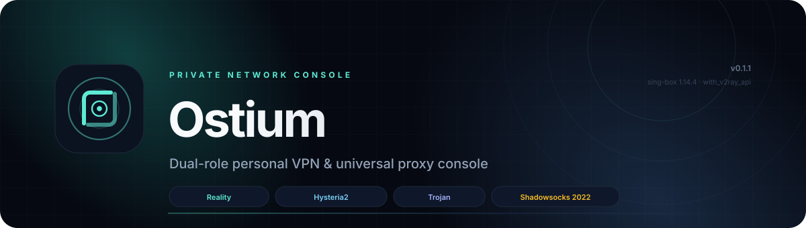
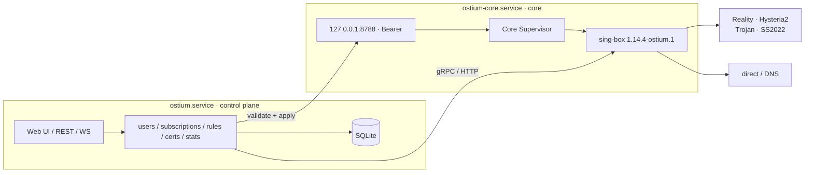

<p align="center">
  
</p>

<h1 align="center">Ostium</h1>

<p align="center">
  <strong>One app, two roles: a private VPN and universal proxy console for servers and devices.</strong><br>
  The same Python package, the same Web UI, the same CLI — one install.
</p>

<p align="center">
  <a href="README.md">简体中文</a> ·
  <a href="README.en.md">English</a> ·
  <a href="https://github.com/ThzxxArt/Ostium/tree/main/docs">Documentation</a> ·
  <a href="https://github.com/ThzxxArt/Ostium/issues">Issues</a>
</p>

<p align="center">
  <a href="https://github.com/ThzxxArt/Ostium/actions/workflows/ci.yml"></a>
  <a href="https://github.com/ThzxxArt/Ostium/actions/workflows/docs.yml"></a>
  <a href="https://github.com/ThzxxArt/Ostium/actions/workflows/security.yml"></a>
  <a href="https://pypi.org/project/ostium-ctl/"></a>
  <a href="https://github.com/ThzxxArt/Ostium/releases/tag/v0.1.1"></a>
  
</p>

<p align="center">
  
  
  
  
  
  
</p>

<p align="center">
  
  
  
</p>

> [!TIP]
> **Current release: v0.1.1.** The easiest install does not require Python:
>
> ```bash
> curl -fsSL https://github.com/ThzxxArt/Ostium/releases/download/v0.1.1/install-online.sh \
>   | sudo bash -s -- install --role server --domain vpn.example.com
> ```
>
> Windows client (admin PowerShell):
>
> ```powershell
> irm https://github.com/ThzxxArt/Ostium/releases/download/v0.1.1/install-online.ps1 | iex
> ```
>
> The admin UI binds `127.0.0.1:8443` by default. Use an SSH tunnel or enable Public UI
> with a valid TLS certificate. Plaintext public binds require an explicit
> `--allow-insecure-bind` and a host firewall.
>
> Parameters, offline install, root mode and no-service mode:
> [one-click install guide](docs/guides/install.md).

---

## Why Ostium

Ostium is not another proxy shell script. It is an installable, upgradeable, backup-friendly
and auditable private-network console.

| | Capability |
|---|---|
| 🧭 **One app, two roles** | Server and client share one package, one SPA and one CLI. Learn once, use both. |
| 🛡️ **Two-service isolation** | `ostium.service` runs the Web/API/database. `ostium-core.service` only validates, starts and supervises sing-box. The UI never holds root/TUN privileges. |
| 📊 **Real traffic accounting** | A custom `sing-box` build with `with_v2ray_api` tracks per-user up/down, daily/monthly totals, quotas and expiry. |
| 🌐 **A real desktop client** | Windows 11, macOS 14+ and Linux with mixed proxy, system proxy, TUN, URLTest and multiple subscriptions. |
| 🎨 **Aurora Console** | Dark-first, responsive, installable PWA with command palette, shortcuts, live connections/logs and a job centre. |
| 📦 **Deliverable** | systemd, launchd, Windows service, Docker, PyInstaller and Inno Setup build/install scripts. |
| 🔐 **Secure defaults** | Argon2id, TOTP, CSRF, Origin/Host checks, AES-256-GCM field encryption, redacted diagnostics and login throttling. |
| 🧪 **Verified** | 507 backend tests (498 regular + 9 live sing-box integration), 160 frontend tests and 69 Playwright cases; 95.6% backend statements / 91.8% branches. |

---

## Features

### Server

- Reality (VLESS + XTLS Vision), Hysteria2, Trojan and Shadowsocks 2022.
- Multi-user lifecycle: create, disable, delete, expiry, notes, credential rotation, usage reset.
- Per-user quotas: total/monthly, automatic disable on expiry or quota exhaustion.
- Subscriptions: Ostium JSON, Base64, Clash Meta YAML, sing-box JSON; share links and QR codes.
- ACME HTTP-01, manual certificate upload, self-signed certificates, renewal and expiry alerts.
- Live traffic, connections, logs, WebSocket events and Prometheus text metrics.
- Backups: SQLite online backup, master key, config and certificates with scrypt + AES-256-GCM.
- Audit log, webhook alerts, redacted diagnostics, IP allow-list and login throttling.
- Public admin UI: mandatory TLS + TOTP; loopback-only by default.

### Client

- Mixed proxy on `127.0.0.1:7890` (SOCKS5 + HTTP).
- System proxy: Windows WinINET, macOS `networksetup`, Linux GNOME/KDE, with crash recovery.
- TUN: Windows Wintun, macOS utun, Linux TUN; IPv4/IPv6, TCP/UDP and DNS capture.
- Routing presets: smart (direct for China), global proxy, direct only and custom rules.
- Rules: domain/suffix/keyword/regex, IP CIDR, port, process name, GeoSite/GeoIP/rule sets.
- DNS: FakeIP + remote DoH + local DNS; clear limitations in mixed mode.
- Multiple profiles, endpoints, URLTest failover and manual selection.
- Subscription refresh, share-link import and QR import/display.
- System proxy and TUN are mutually exclusive; switching cleans up the old state.
- LAN sharing (Allow LAN): exposes the mixed proxy on `0.0.0.0:7890` so phones/tablets can use this computer as a proxy. Trusted networks only; no authentication.

### Shared

- Vue 3 SPA, FastAPI, SQLAlchemy/Alembic, SQLite WAL.
- Chinese/English UI, dark/light themes, desktop/tablet/mobile layouts.
- Command palette (`Ctrl/Cmd + K`), keyboard shortcuts and global search.
- First-run wizards: four server steps, three client steps.
- Browser notifications, PWA offline shell and update prompt.
- Backup, upgrade, rollback, diagnostics and service management.

---

## Architecture



- The **control plane** runs unprivileged. Only the **core** can bind port 443 or create TUN devices.
- Restarting or upgrading the UI does not interrupt the tunnel; a crashed core is restarted by
  systemd, launchd or the Windows SCM.
- Configurations pass a role/port/path allow-list and `sing-box check`; failures keep the last-good
  configuration and binary.

---

## Requirements

| Role | Requirement |
|---|---|
| Server | Ubuntu 24.04 / Debian 13, 1 vCPU / 1 GB minimum, 20 GB SSD; ports 80/tcp, 443/tcp and 443/udp |
| Windows client | Windows 10 22H2+ / 11 x64; administrator rights for the TUN service |
| macOS client | macOS 14+, arm64/x64; `sudo` for the LaunchDaemon |
| Linux client | x64/arm64; TUN requires root or `CAP_NET_ADMIN` |
| Install environment | One-click installer downloads uv + managed Python 3.13; **no Python required** |
| Development | Python 3.13, uv 0.11+, Node 24.19+ (minimum 22.12), Go 1.25.5 (only for the custom core) |

> The server UI listens on `127.0.0.1:8443` by default. For public access, configure a certificate
> and TOTP first, enable it explicitly in Settings, then restart `ostium.service`.

---

## Installation

| Method | Best for |
|---|---|
| **One-click online install** | Recommended; no Python needed; downloads uv, managed Python and core, registers services |
| **GitHub Release packages** | Offline, intranet, pinned versions, or manual auditing |
| **PyPI / uv / pipx** | CLI, automation and existing Python environments; easiest upgrades |
| **Docker / GHCR** | Containerised servers and immutable infrastructure |
| **Source** | Development, audit, and custom builds |

> The PyPI distribution is **`ostium-ctl`**; the installed command is still **`ostium`**. The
> one-click installer uses the same wheel and custom sing-box core, but also handles managed
> Python, service users, systemd/launchd and privileges.

### Option 1 — One-click online install (recommended, no Python)

Linux server:

```bash
curl -fsSL https://github.com/ThzxxArt/Ostium/releases/download/v0.1.1/install-online.sh \
  | sudo bash -s -- install --role server --domain vpn.example.com
```

Linux / macOS client:

```bash
curl -fsSL https://github.com/ThzxxArt/Ostium/releases/download/v0.1.1/install-online.sh \
  | sudo bash -s -- install --role client
```

Windows client (admin PowerShell):

```powershell
irm https://github.com/ThzxxArt/Ostium/releases/download/v0.1.1/install-online.ps1 | iex
```

The installer:

1. installs missing `curl`/`tar` on Linux;
2. downloads static `uv` and installs a **managed Python 3.13** (system Python is untouched);
3. downloads and verifies the wheel, sing-box core and `SHA256SUMS`;
4. the server creates service users, initialises the database and registers systemd/launchd/Windows services;
5. the server prints a one-time administrator password; Linux/macOS clients have no preset password and complete the client wizard on first UI visit.

#### Run everything as root (no `ostium` user)

```bash
curl -fsSL .../install-online.sh | sudo bash -s -- install --role server --run-as-root
```

No `ostium`/`ostium-core` users are created; both the control plane and core run as root, and the
client UI is installed as a system service. **This removes the default privilege isolation**: a
Web/API vulnerability may affect the whole machine. Use it only on single-user test machines,
temporary environments, or when another isolation layer exists.

#### No systemd

```bash
curl -fsSL .../install-online.sh | sudo bash -s -- install --role server --no-service
```

Files, core and configuration are installed without registering systemd/launchd. Use OpenRC,
runit, s6, supervisord or run both commands manually. Full examples:
[service management](docs/guides/service-manager.md).

#### Offline / intranet

Download the same release's assets into one directory, keeping their filenames:

- `install-online.sh`
- `ostium_ctl-0.1.1-py3-none-any.whl`
- `ostium_ctl-0.1.1.tar.gz` (installer, systemd/launchd files)
- `ostium-core-1.14.4-ostium.1-linux-amd64.tar.gz` (choose the right architecture)
  and its `.sha256`
- `SHA256SUMS`

```bash
# Verify the assets you downloaded (Windows assets are optional on a server)
sha256sum -c SHA256SUMS --ignore-missing

sudo bash install-online.sh install \
  --local-dir . \
  --role server --domain vpn.example.com
```

`--local-dir` accepts both a source checkout and a flat release-asset directory.
The installer verifies the sdist first, then extracts `scripts/install.sh` and
`deploy/` from it; it never executes an unverified source archive.

> A fully isolated host also needs a pre-built wheelhouse or an internal PyPI
> mirror; Python dependencies are not bundled into the release assets.

### Option 2 — Linux server (offline native package)

Download the wheel, sdist, core archive and `SHA256SUMS`, then run the platform
installer from the extracted sdist:

- `ostium_ctl-0.1.1-py3-none-any.whl`
- `ostium_ctl-0.1.1.tar.gz` (contains `scripts/install.sh` and `deploy/`)
- `ostium-core-1.14.4-ostium.1-linux-amd64.tar.gz` (or the matching arm64 archive)
- `SHA256SUMS`

Download: <https://github.com/ThzxxArt/Ostium/releases/tag/v0.1.1>

```bash
sha256sum -c SHA256SUMS --ignore-missing
tar -xzf ostium_ctl-0.1.1.tar.gz

sudo ./ostium_ctl-0.1.1/scripts/install.sh --role server \
  --wheel ./ostium_ctl-0.1.1-py3-none-any.whl \
  --core ./ostium-core-1.14.4-ostium.1-linux-amd64.tar.gz \
  --domain vpn.example.com
```

The same release also ships native packages:

- `ostium_0.1.1_amd64.deb` / `ostium_0.1.1_arm64.deb` (PyInstaller control plane + core, systemd units);
- `Ostium-0.1.1-linux-amd64.AppImage` / `arm64` (single-file client/temporary runtime);
- `Ostium-0.1.1-macos-arm64.dmg` (wheel, darwin core and launchd installer);
- `Ostium-0.1.1-windows-x64-setup.exe`.

If no code-signing certificate is configured, Windows/DMG assets are explicitly labelled
unsigned in the release notes; do not treat them as signed builds.

The installer will:

1. create the `ostium` system user;
2. install to `/opt/ostium` and link `ostium` into `/usr/local/bin`;
3. initialise the database, Reality inbound and administrator;
4. register and start `ostium-core.service` and `ostium.service`;
5. print a one-time administrator password.

Open an SSH tunnel:

```bash
ssh -L 8443:127.0.0.1:8443 root@your-server
```

Browse to <http://127.0.0.1:8443>. **Enable TOTP immediately after the first login.**

Firewall (configure the cloud security group too):

```bash
sudo ufw default deny incoming
sudo ufw allow 22/tcp
sudo ufw allow 80/tcp
sudo ufw allow 443/tcp
sudo ufw allow 443/udp
sudo ufw enable
```

Service status and logs:

```bash
systemctl status ostium-core ostium
journalctl -u ostium -u ostium-core -f
```

### Option 3 — Linux client (offline)

Extract the sdist first, then run:

```bash
sudo ./ostium_ctl-0.1.1/scripts/install.sh --role client \
  --wheel ./ostium_ctl-0.1.1-py3-none-any.whl \
  --core ./ostium-core-1.14.4-ostium.1-linux-amd64.tar.gz
```

Log out and back in so your user picks up the `ostium` group, then start the user UI:

```bash
systemctl --user enable --now ostium
```

Open <http://127.0.0.1:8787>, complete the wizard and import a subscription.

### Option 4 — Windows client (offline)

1. Run `Ostium-0.1.1-windows-x64-setup.exe`.
2. The installer copies the app to `%ProgramFiles%\Ostium`, registers the `OstiumCore` service
   and starts the UI at logon.
3. UI data lives in `%ProgramData%\Ostium`; core data, the token and last-good configuration
   live in `%ProgramData%\OstiumCore` (SYSTEM/Administrators write only).
4. Complete the first-run wizard at <http://127.0.0.1:8787> to create the admin; the installer
   no longer generates or stores a plaintext password.
5. Unsigned builds trigger SmartScreen. Verify `SHA256SUMS` and only choose “Run anyway” if you
   trust the source.

You can also run the PowerShell installer from the installation directory:

```powershell
.\install.ps1
```

### Option 5 — macOS client (one-click online / offline source)

Use the one-click online installer from Option 1. For offline installs, extract the sdist
and point it at the wheel and core archive:

```bash
tar -xzf ostium_ctl-0.1.1.tar.gz
sudo OSTIUM_WHEEL="$PWD/ostium_ctl-0.1.1-py3-none-any.whl" \
  OSTIUM_CORE_TARBALL="$PWD/ostium-core-1.14.4-ostium.1-darwin-arm64.tar.gz" \
  ./ostium_ctl-0.1.1/deploy/launchd/install-macos.sh client
```

The installer registers the `com.ostium.core` LaunchDaemon and `com.ostium.ui` LaunchAgent,
and links the `ostium` command. Unsigned/unnotarised builds trigger Gatekeeper; verify checksums
first.

### Option 6 — Docker server

Use the GHCR image directly:

```bash
OSTIUM_ADMIN_PASSWORD='change-me-now' \
OSTIUM_DOMAIN='vpn.example.com' \
docker compose -f deploy/docker/docker-compose.yml up -d
```

Local build:

```bash
docker build -t ostium:0.1.1 .
docker run -d --name ostium --network host \
  -e OSTIUM_ROLE=server \
  -e OSTIUM_ADMIN_PASSWORD='change-me-now' \
  -e OSTIUM_DOMAIN='vpn.example.com' \
  -v ostium-data:/var/lib/ostium \
  -v ostium-etc:/etc/ostium \
  ostium:0.1.1
```

> Docker uses host networking so it can bind 443/80. Configure the firewall, TLS and off-host
> backups yourself.

### Option 7 — PyPI / uv / pipx (servers, CLI and development)

The PyPI distribution is **`ostium-ctl`**; the import name and CLI remain `ostium`:

```bash
# Recommended: isolated install, no system Python pollution
uv tool install ostium-ctl
# or
pipx install ostium-ctl
# or pin the release
uv tool install "ostium-ctl==0.1.1"
```

Server quick start (isolated venv, avoids PEP 668 and system Python pollution):

```bash
sudo python3.13 -m venv /opt/ostium/venv
sudo /opt/ostium/venv/bin/pip install "ostium-ctl==0.1.1"
sudo /opt/ostium/venv/bin/ostium init --role server --no-input --password 'change-me-now'
sudo /opt/ostium/venv/bin/ostium core install \
  --manifest https://github.com/ThzxxArt/Ostium/releases/latest/download/core-manifest.json
sudo /opt/ostium/venv/bin/ostium serve      # terminal 1: control plane + SPA
sudo /opt/ostium/venv/bin/ostium core-run   # terminal 2: proxy core
```

Upgrade:

```bash
uv tool upgrade ostium-ctl
# or
sudo /opt/ostium/venv/bin/pip install --upgrade "ostium-ctl==0.1.1"
```

> The PyPI wheel contains the complete SPA assets. For production, prefer the native packages:
> they create an unprivileged `ostium` user, register `ostium-core.service`/`ostium.service`
> and handle TUN, low ports and platform service privileges correctly.

### Option 8 — From source

```bash
git clone https://github.com/ThzxxArt/Ostium.git
cd Ostium
uv sync

uv run ostium init --role server --dev --no-input --password 'change-me-now'
uv run ostium serve          # terminal 1: control plane + SPA
uv run ostium core-run       # terminal 2: core service
```

Frontend development:

```bash
cd web
npm ci
npm run dev
```

Build the custom core:

```bash
./scripts/build-core.sh --os linux amd64
```

---

## Service Management

Ostium is not tied to one init system:

| Environment | Default | Notes |
|---|---|---|
| Linux | systemd | `ostium.service` + `ostium-core.service` |
| macOS | launchd | core LaunchDaemon + UI LaunchAgent (root mode: two LaunchDaemons) |
| Windows | SCM | `OstiumCore` service + logon/SYSTEM task |
| Docker | entrypoint | runs both processes in the foreground |
| OpenRC / runit / s6 / supervisord | `--no-service` | install files, start under your supervisor |

```bash
systemctl status ostium-core ostium
journalctl -u ostium -u ostium-core -f
sudo systemctl restart ostium-core ostium
```

The default install creates unprivileged users. `--run-as-root` skips user creation and runs both
services as root. **Root mode removes the control-plane/root isolation**; use it only on
single-user test machines or with another isolation layer. Full examples (OpenRC, runit, s6,
supervisord and root drop-ins): [service management](docs/guides/service-manager.md).

If Nginx already owns 80/443, use `--behind-proxy`: the UI listens on `127.0.0.1:8443`, Nginx
terminates TLS and proxies it, Reality/Trojan move to 9443/tcp and Hysteria2 keeps 443/udp.
Complete config: [Nginx coexistence](docs/guides/nginx.md).

---

## First Run

### Server

1. Open the UI and sign in with the generated administrator account.
2. Go to **Settings → Security**:
   - change the password;
   - enable TOTP and store the recovery codes;
   - optionally create an API token.
3. Go to **Users → Add user** and set quota, cycle and expiry.
4. Open **Subscriptions**, copy any of the four formats or show the QR code.
5. For Hysteria2/Trojan:
   - issue an ACME certificate, upload one, or create a self-signed certificate in **Certificates**;
   - enable the inbound in **Inbounds** and assign the certificate.
6. For a public admin UI:
   - confirm TOTP is enabled;
   - configure the domain and certificate;
   - enable **Settings → Public admin UI**;
   - `sudo systemctl restart ostium` and use HTTPS.

### Client

1. Open <http://127.0.0.1:8787> and complete the three-step wizard.
2. **Profiles → Import**: paste a subscription URL, share link, Clash/sing-box config, or scan a
   QR code.
3. Select a profile and endpoint on **Home**.
4. Start with **System proxy**; switch to **TUN** only when you need full TCP/UDP/DNS capture.
5. Tune routing in **Routing** and use **Diagnostics** when something fails.

---

## Usage

### Server operations

```bash
# Users
sudo -u ostium ostium user list
sudo -u ostium ostium user add alice --quota 100G --cycle monthly
sudo -u ostium ostium user subscription alice
sudo -u ostium ostium user disable alice
sudo -u ostium ostium user rotate alice --subscription

# Backups
sudo -u ostium ostium backup create --password 'a long passphrase'
sudo -u ostium ostium backup list

# Diagnostics
sudo ostium doctor
sudo ostium logs --source core -f
sudo ostium diagnostics export --output /tmp/ostium-diagnostics.tar.gz

# Certificates (local testing)
sudo -u ostium ostium cert issue local.example.com --self-signed
```

### Client modes

| Mode | What it captures | Limits |
|---|---|---|
| Mixed | Apps explicitly configured for `127.0.0.1:7890` | No DNS takeover |
| System proxy | Apps that honour the OS proxy | Some apps bypass it; no DNS takeover |
| TUN | Whole-machine TCP/UDP/DNS | Requires admin/root; no standalone kill switch in the current release |

System proxy and TUN are mutually exclusive. Switching cleans up the old proxy, routes and
virtual interface.

### CLI cheat sheet

| Command | Purpose |
|---|---|
| `ostium init --role server\|client` | Initialise data, config, admin and default inbounds |
| `ostium serve` | Run the control plane / Web UI |
| `ostium core-run` | Run the core service (internal) |
| `ostium status [--json]` | Role, paths, database and core status |
| `ostium open` | Open the local Web UI |
| `ostium doctor [--json] [--fix]` | Local diagnostics |
| `ostium logs [-f] [--source ostium\|core]` | Tail logs |
| `ostium connect` / `disconnect` | Client connect/disconnect |
| `ostium proxy on\|off\|status` | System proxy |
| `ostium tun on\|off\|status` | TUN |
| `ostium update [--check]` | Check for updates (install stays explicit) |
| `ostium diagnostics export` | Export a redacted diagnostics bundle |
| `ostium user ...` | Server-side user management |
| `ostium profile ...` | Client profiles and subscriptions |
| `ostium core install/update/status/version` | Core binary management |
| `ostium backup create/list/restore` | Backup and restore |
| `ostium cert list/issue` | Certificate management |
| `ostium service install/uninstall` | systemd units (Linux root) |

Exit codes: `0` success, `1` general, `2` usage, `3` not initialised, `4` service unavailable,
`5` permission, `6` core error.

### API and automation

- API prefix: `/api/v1`; OpenAPI: `/api/docs`.
- Browsers use a session cookie + CSRF. Automation uses `Authorization: Bearer <API token>`.
- Create scoped `read`/`write` tokens in **Settings → API tokens**.
- Local CLI requests use `<data>/runtime/cli.token` and are restricted to loopback.

```bash
curl -H "Authorization: Bearer $OSTIUM_TOKEN" \
  http://127.0.0.1:8443/api/v1/system/services
```

### Backup and restore

**Recommended:** Settings → Maintenance → Backups → Create / Apply. A restore is staged first and
applies only after both services restart.

CLI restore (stop the services first):

```bash
sudo systemctl stop ostium ostium-core
sudo -u ostium ostium backup restore ./ostium-backup-....ostb --password '...'
sudo systemctl start ostium-core ostium
```

> Backups include the master key. Without the backup password or master key, user passwords,
> subscription tokens and certificate private keys cannot be recovered.

### HTTPS / ACME

1. Point the domain A/AAAA record at the server.
2. Open 80/tcp.
3. Set the ACME email in Settings.
4. Certificates → Issue → ACME.
5. Assign the certificate to a specific Hysteria2/Trojan inbound.
6. Enable TOTP, then enable the public admin UI.
7. Restart `ostium.service`.

The current release supports HTTP-01 only; DNS-01 and TLS-ALPN-01 are intentionally out of scope.
A failed renewal keeps the previous ready certificate and does not downgrade the live TLS endpoint.

---

## Upgrade and Rollback

### One-click upgrade

```bash
sudo bash install-online.sh upgrade
# pin a version
sudo bash install-online.sh upgrade --version 0.1.1
```

The upgrade keeps the database, `master.key`, configuration, certificates, users and
subscriptions; only the venv and core binary are replaced. Existing root mode is preserved.

### Application upgrade (server)

```bash
# 1. Back up first
sudo -u ostium ostium backup create --password '...'

# 2. Stop only the control plane; the core keeps the tunnel alive
sudo systemctl stop ostium

# 3. Install the new wheel
sudo /opt/ostium/venv/bin/pip install --upgrade ./ostium_ctl-0.1.1-py3-none-any.whl

# 4. Start; migrations run at startup
sudo systemctl start ostium
curl -fsS http://127.0.0.1:8443/readyz
```

### Core upgrade

```bash
sudo ostium core install --binary ./sing-box
# or
sudo ostium core install --url https://.../ostium-core-....tar.gz --sha256 <hash>
sudo ostium core update
```

Core install/update replaces the binary; the next apply/restart runs `sing-box check` and
rolls the configuration back on failure. Back up the old binary and verify the new one with
`ostium core version` before upgrading.

### Rollback

1. Stop `ostium.service`.
2. Install the previous wheel.
3. If a migration is incompatible, restore the database from backup.
4. Start and verify `/readyz`, login, subscriptions and core status.

### Client upgrade

Windows/macOS installers replace the app in place and preserve data and profiles. On Linux,
re-run `install.sh --role client`. The installer replaces and restarts the core, so the tunnel is
briefly interrupted; data and profiles are preserved.

> Ostium never silently auto-updates. Every upgrade is downloaded, verified and installed
> explicitly.

---

## Uninstall

One-click uninstall (data preserved by default):

```bash
sudo bash install-online.sh uninstall
# also remove data, configuration and users
sudo bash install-online.sh uninstall --purge
```

### Linux server

```bash
sudo systemctl disable --now ostium ostium-core
sudo rm -f /etc/systemd/system/ostium.service /etc/systemd/system/ostium-core.service
sudo systemctl daemon-reload
sudo rm -f /usr/local/bin/ostium
sudo rm -rf /opt/ostium

# Data is preserved by default. Remove only when you are sure:
# sudo rm -rf /var/lib/ostium /etc/ostium
# sudo userdel ostium
```

### Linux client

```bash
systemctl --user disable --now ostium
sudo systemctl disable --now ostium-core
sudo rm -f /etc/systemd/system/ostium-core.service
rm -f ~/.config/systemd/user/ostium.service
sudo systemctl daemon-reload
systemctl --user daemon-reload

# Restore the system proxy / clean TUN first if the service is still running:
# ostium proxy off
# sudo ostium tun off

sudo rm -rf /opt/ostium
sudo rm -f /usr/local/bin/ostium
# Data remains by default. Remove only when you are sure:
# sudo rm -rf /var/lib/ostium-core /etc/ostium/client.toml ~/.local/share/ostium
```

### Windows

Settings → Apps → Ostium → Uninstall. The uninstaller stops `OstiumCore`, removes the logon task
and attempts to restore the system proxy. Data in `%ProgramData%\Ostium` is preserved by default.

### macOS

```bash
sudo launchctl unload -w /Library/LaunchDaemons/com.ostium.core.plist
sudo launchctl unload -w /Library/LaunchAgents/com.ostium.ui.plist
sudo rm -f /Library/LaunchDaemons/com.ostium.core.plist
sudo rm -f /Library/LaunchAgents/com.ostium.ui.plist
sudo rm -rf /opt/ostium
# Data: /Library/Application Support/Ostium and Ostium UI (remove only when sure)
```

### Docker

```bash
docker compose -f deploy/docker/docker-compose.yml down
# Also remove volumes (irreversible):
# docker compose -f deploy/docker/docker-compose.yml down -v
```

---

## Security

- The admin UI is loopback-only by default. Never expose it without TLS + TOTP.
- Change the password and enable TOTP immediately after first login; store recovery codes. If you lose the authenticator, switch to recovery-code login on the sign-in page.
- Open only the ports you need: 22, 80, 443/tcp and 443/udp. Do not expose 8388/8443 by default.
- Run the control plane as an unprivileged user; only the core needs low ports or TUN privileges.
- Keep encrypted backups off-host. A backup contains the master key and is highly sensitive.
- Subscription tokens are shown once; rotate them immediately if leaked.
- Never paste diagnostics, logs, `.env` files or `master.key` into a public issue.
- Report vulnerabilities privately as described in [`SECURITY.md`](SECURITY.md).

---

## Data Locations

| Platform | Control plane | Core |
|---|---|---|
| Linux server | `/var/lib/ostium`, `/etc/ostium/config.toml` | same |
| Linux client | `~/.local/share/ostium` (UI data and `config.toml`) | `/var/lib/ostium-core`, `/etc/ostium/client.toml` |
| Windows | `%ProgramData%\Ostium` (UI data and user-writable config) | `%ProgramFiles%\Ostium\core`, `%ProgramFiles%\Ostium\service\core.toml` (admin/SYSTEM only) |
| macOS | `/Library/Application Support/Ostium UI` (UI) | `/Library/Application Support/Ostium` |

Key files: `ostium.db`, `master.key`, `config.toml`, `certs/`, `runtime/last-good.json`,
`runtime/core.token`, `logs/` and `backups/`.

---

## Troubleshooting

| Symptom | Check |
|---|---|
| UI does not open | `systemctl status ostium`; confirm `127.0.0.1:8443`; read `journalctl -u ostium` |
| Core not running | `ostium core status`; `ostium logs --source core`; verify the core binary path and permissions |
| Port 443 busy | `ss -lntup \| grep :443`; stop a conflicting nginx/caddy or change the port |
| Subscription 403 | User disabled/expired/over quota; check `status` and `disabled_reason` in Users |
| Subscription 404 | Token rotated or user deleted; copy the subscription link again |
| TUN fails | Requires root/CAP_NET_ADMIN; verify `/dev/net/tun` or Wintun is installed |
| System proxy not restored | `ostium proxy off`; inspect `runtime/system-proxy.json` and the platform commands |
| ACME fails | Is 80/tcp reachable? Does DNS point to this host? Check `last_error` on the certificate |
| Broken after upgrade | Check `/readyz`; roll back the wheel/database; see `AUDIT_REPORT.md` |

Export diagnostics:

```bash
sudo ostium diagnostics export --output /tmp/ostium-diagnostics.tar.gz
```

The bundle redacts tokens, passwords, UUIDs, private keys and share links.

---

## Testing and Quality

```bash
# Backend
uv run ruff check src tests scripts
uv run ruff format --check src tests scripts
uv run mypy src/ostium
uv run pytest -m "not integration" -q

# Live engine integration tests (requires sing-box and the custom core)
# uv run pytest -m integration -q

# Frontend
cd web
npm run lint
npm run typecheck
npm run test:coverage
npm run build
npm run format:check

# E2E / accessibility / visual regression
npx playwright test
```

Current results:

- Backend: **498 passed / 0 skipped** (regular suite) + **9 passed / 0 skipped**
  (live sing-box integration), **95.6%** statements / **91.8%** branches.
- Frontend: **160 passed**, **90.6%** statements / **85.1%** branches /
  **88.3%** functions / **91.8%** lines.
- Playwright: **69 passed**, covering 1440/1024/390, dashboard/users/settings dark/light visual
  baselines, axe on every core page (serious/critical=0), LCP/CLS performance budgets, PWA
  service-worker registration, navigation and the command palette.
- `pip-audit` / production `npm audit`: 0 known vulnerabilities. The full dev
  toolchain audit is also clean after breaking upgrades/overrides.
- Full evidence and per-file audit: [`AUDIT_REPORT.md`](AUDIT_REPORT.md).

---

## Documentation

- [One-click install](docs/guides/install.md)
- [Service management (systemd / OpenRC / runit / s6 / supervisord)](docs/guides/service-manager.md)
- [Nginx coexistence and reverse proxy](docs/guides/nginx.md)
- [Architecture](docs/architecture.md)
- [Server guide](docs/guides/server.md)
- [Client guide](docs/guides/client.md)
- [TUN guide](docs/guides/tun.md)
- [ACME / TLS](docs/guides/acme.md)
- [Subscription formats](docs/guides/subscription.md)
- [Web UI guide](docs/guides/ui.md)
- [CLI reference](docs/reference/cli.md)
- [API reference](docs/reference/api.md)
- [Profile v1](docs/reference/profile.md)
- [Ports and paths](docs/reference/ports.md)
- [Backup and restore](docs/operations/backup.md)
- [Upgrade and rollback](docs/operations/upgrade.md)
- [Troubleshooting](docs/operations/troubleshooting.md)
- [Security model](docs/security/threat-model.md)
- [Design system](docs/design-system.md)
- [UX guidelines](docs/ux.md)

---

## Contributing

Issues, documentation fixes and test improvements are welcome. Before submitting:

1. Read [`CONTRIBUTING.md`](CONTRIBUTING.md).
2. Run the full backend and frontend checks.
3. Never commit keys, certificates, subscription tokens, diagnostics bundles or personal configs.
4. Report security issues privately through the process in [`SECURITY.md`](SECURITY.md).

---

## License

- Code: **GPL-3.0-or-later**, see [`LICENSE`](LICENSE) and [`NOTICE`](NOTICE).
- Documentation: CC BY-SA 4.0.
- The bundled sing-box binary is built from unmodified upstream source and remains GPL-3.0.

Ostium is intended for personal learning, privacy and self-hosted network management. Follow
applicable laws and your hosting provider's AUP. This project does not provide legal advice.
