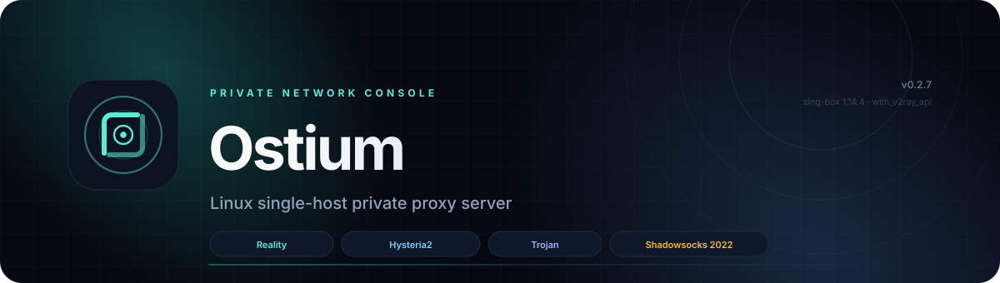
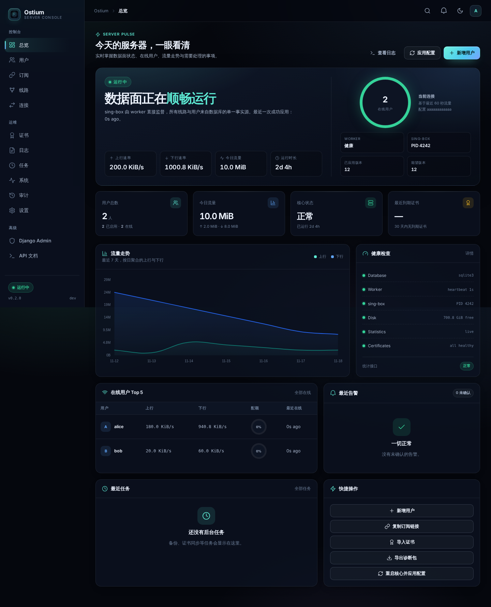
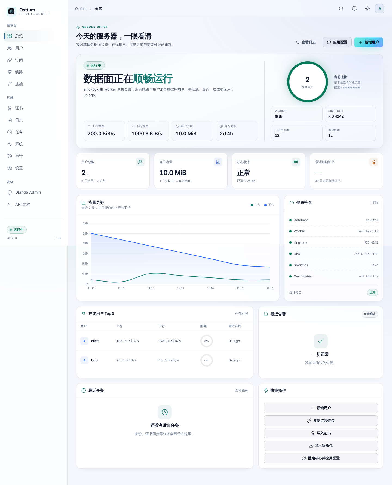
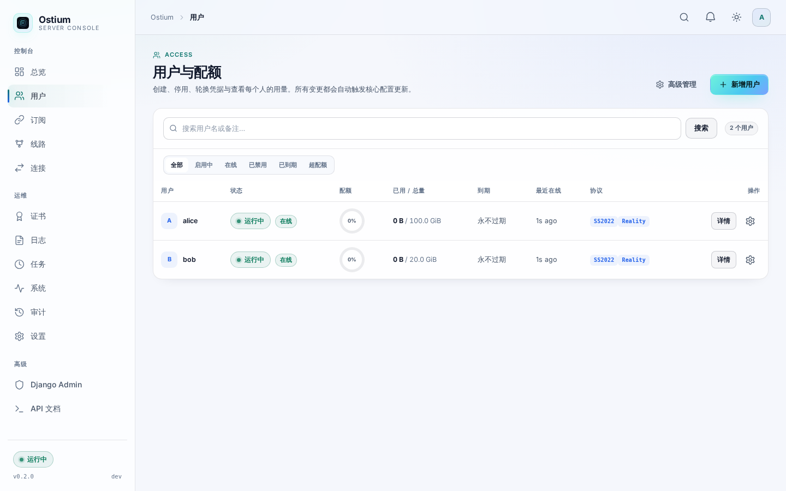
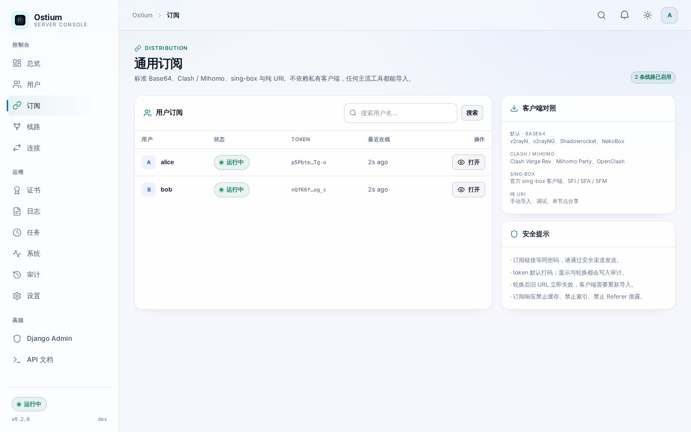
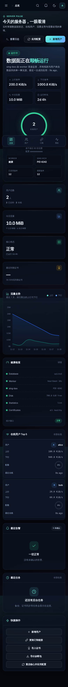
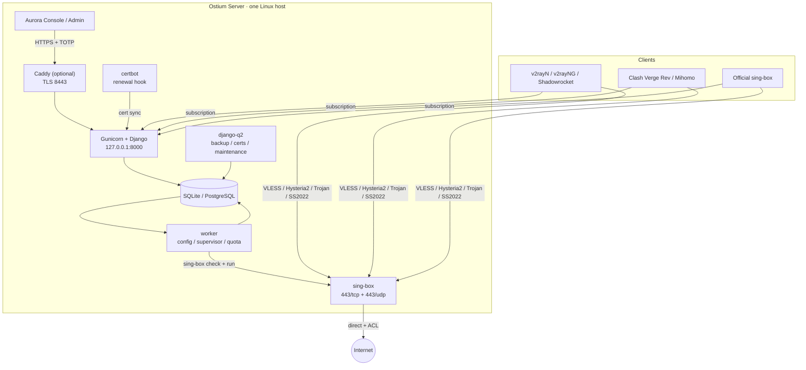

<div align="center">

<a href="https://github.com/ThzxxArt/Ostium">
  
</a>

<br>

### A private proxy server that is ready when you are

**Single host · Single administrator · Django control plane · sing-box data plane · Standard subscriptions · Aurora Console**

<br>

[](https://github.com/ThzxxArt/Ostium/actions/workflows/ci.yml)
[](https://github.com/ThzxxArt/Ostium/actions/workflows/ui.yml)
[](https://www.python.org/)
[](https://www.djangoproject.com/)
[](https://sing-box.sagernet.org/)
[](https://www.kernel.org/)
[](LICENSE)
[](CONTRIBUTING.md)

<br>

[Quick start](#-quick-start) ·
[Screenshots](#-screenshots) ·
[Architecture](#-architecture) ·
[Subscriptions](#-protocols--subscriptions) ·
[Install](#-production-install) ·
[Security](#-security-model) ·
[CLI](#-command-line) ·
[API](#-api) ·
[Docs](docs/index.md)

</div>

---

> [!IMPORTANT]
> **Ostium 0.2.0 is a server-only rewrite.**
> No desktop client, no TUN, no SPA, no 0.1.x migration.
> Old releases live only in git history and the `v0.1.12` tag. Upgrading means a **fresh install, new users, new subscriptions**.

---

## 🌌 Why Ostium

Most proxy panels spend their complexity on clients, node marketplaces and orchestration. Ostium solves one problem:

> **Run a stable, secure and beautiful proxy server on one Linux host, with subscriptions every mainstream client can import.**

It is not an airport panel and it does not require a proprietary client. You manage one server:
create users, enable inbounds, import certificates, hand out subscriptions, and let sing-box quietly own port 443.

| Typical panel problem | Ostium's choice |
|---|---|
| Proprietary subscription formats | **Four standard formats**: Base64 / Clash / sing-box / plain URI |
| Web process runs the core as root | Worker runs unprivileged with only `CAP_NET_BIND_SERVICE` |
| Config written blindly, one typo kills the tunnel | Real `sing-box check`, atomic apply, automatic rollback |
| Node/npm/SPA frontend required | **No Node**: Tailwind standalone + HTMX + Alpine + Chart.js |
| Bespoke auth, jobs, audit, ACME | Mature Django auth/ORM/tasks/audit + certbot/Caddy |
| Upgrade scripts and compatibility shims | 0.2.0 is **zero-compat, zero-migration**; clean install |

---

## ✨ Highlights

| | Capability | Details |
|---|---|---|
| 🛡️ | **Four protocols** | VLESS Reality, Hysteria2, Trojan, Shadowsocks 2022 |
| 🔗 | **Universal subscriptions** | One token renders Base64, Clash/Mihomo, sing-box and plain URI |
| 🎛️ | **Aurora Console** | Dark-first, aurora teal/blue, glass panels, quota rings, traffic charts |
| 🔐 | **Admin security** | TOTP, recovery codes, lockout, rate limits, CSP, CSRF, Argon2id, audit |
| ⚙️ | **Reliable data plane** | Worker supervises sing-box; validate, swap, observe, roll back |
| 📊 | **Real accounting** | V2Ray gRPC every 5s; flush every 60s; quota/expiry/monthly reset |
| 🧾 | **Certificate workflow** | Manual import, self-signed, certbot sync, expiry alerts |
| 💾 | **Encrypted backups** | DB, certs, config and field key in one scrypt + AES-256-GCM archive |
| 🧰 | **Operations** | doctor, redacted diagnostics, Prometheus, django-q2, audit |
| 🐧 | **Linux native** | systemd or Docker Compose; SQLite default, PostgreSQL optional |
| 🚫 | **No client baggage** | No TUN, system proxy, kill switch or private profile |
| 🧼 | **No 0.1.x residue** | `main` contains only the 0.2.0 server |

---

## 🖥️ Screenshots

> Aurora Server Console: dark by default, light and system themes, responsive from desktop to phone.

<table>
  <tr>
    <td width="50%"></td>
    <td width="50%"></td>
  </tr>
  <tr>
    <td align="center"><sub>Dashboard · dark</sub></td>
    <td align="center"><sub>Dashboard · light</sub></td>
  </tr>
  <tr>
    <td width="50%"></td>
    <td width="50%"></td>
  </tr>
  <tr>
    <td align="center"><sub>Users & quotas</sub></td>
    <td align="center"><sub>Subscriptions</sub></td>
  </tr>
</table>

<div align="center">
  
  <br>
  <sub>Mobile · 390px viewport</sub>
</div>

The console includes:

- **Overview** — Server Pulse hero, live rates, daily traffic, online users, health stack, alert timeline.
- **Users** — search, status filters, quota rings, expiry, last seen, protocol badges; batch actions live in Django Admin.
- **User detail** — quota/expiry editing, credential rotation, four subscription cards, QR, 30-day chart, audit.
- **Inbounds** — four protocol cards with enable, port, certificate, Reality keys and apply state.
- **Subscriptions** — masked tokens, reveal/rotate with audit.
- **Connections** — live Clash API sessions, close one or all.
- **Certificates** — expiry rings, source, assigned inbounds, certbot guidance.
- **Logs** — terminal-style viewer with level chips, filtering and download.
- **Jobs / System / Settings / Audit** — the complete operations loop.

---

## 🏗️ Architecture



### Processes

| Process | Responsibility | Exposure |
|---|---|---|
| `ostium-web` | Gunicorn + Django + Admin + API | `127.0.0.1:8000` |
| `ostium-worker` | Generate config, supervise sing-box, stats/quota | 443/tcp, 443/udp |
| `ostium-jobs` | django-q2: backups, certs, maintenance | none |
| `caddy` (optional) | TLS + reverse proxy | 80, 8443 |
| `certbot.timer` | Renew certificates → deploy hook → `ostium cert sync` | 80 |

### Apply pipeline

```text
Admin changes DB
   ↓ desired_revision++
worker reads DB → generates sing-box config
   ↓
sing-box check
   ├─ fail → keep the old process + alert + exponential backoff
   └─ pass → write config.next.json
              ↓ stop old process
              ↓ start new process
              ↓ observe 1.5s
              ├─ fail → restore previous config + alert
              └─ pass → atomic replace config.json
```

**The database is the only source of truth.** No custom core API, no arbitrary JSON endpoint, no `SIGHUP` hot reload.

---

## 🧩 Protocols & Subscriptions

### Inbounds

| Protocol | Transport | Default port | Certificate | Notes |
|---|---|---|---|---|
| **VLESS Reality** | TCP + XTLS Vision | 443/tcp | no | Certificate-free, probe resistant, enabled by default |
| **Hysteria2** | QUIC | 443/udp | yes | Great on lossy/high-latency links; optional salamander obfs |
| **Trojan** | TLS/TCP | 443/tcp | yes | Natural camouflage, broad client support |
| **Shadowsocks 2022** | TCP | 8388/tcp | no | Per-user keys, disabled by default |

### Endpoints

| URL | Body | Clients |
|---|---|---|
| `/sub/<token>` | Base64 URI list | v2rayN, v2rayNG, Shadowrocket, NekoBox |
| `/sub/<token>?target=clash` | Clash / Mihomo YAML | Clash Verge Rev, Mihomo Party, OpenClash |
| `/sub/<token>?target=singbox` | Full sing-box JSON | Official sing-box clients |
| `/sub/<token>?target=uri` | Plain URI | Manual import and debugging |

Aliases: `format=` and `flag=` are equivalent to `target=`; `sing-box` = `singbox`; `clash-meta` = `clash`.

### Headers

```http
Subscription-Userinfo: upload=...; download=...; total=...; expire=...
Profile-Update-Interval: 24
Profile-Title: <user>@<server_name>
Cache-Control: private, no-store
Referrer-Policy: no-referrer
X-Robots-Tag: noindex, nofollow
```

`total=0` means unlimited; `expire=0` means no expiry. Tokens are masked by default; reveal and rotate are POST actions recorded in the audit trail.

---

## 🚀 Quick Start

### 1. Requirements

- Linux (Debian 13 / Ubuntu 24.04+ recommended)
- Python 3.14 (managed by `uv`; validated on 3.14.5)
- Git, curl, OpenSSL

### 2. Install and initialize

```bash
git clone https://github.com/ThzxxArt/Ostium.git
cd Ostium

uv sync --extra dev
uv run ostium migrate
uv run ostium init --username admin --password 'Change-This-Password-2026'
```

`init` creates four inbound records and enables **VLESS Reality**.

### 3. Build the data plane

The official sing-box release **does not include** `with_v2ray_api`; stats would be unavailable. Build with the pinned tags:

```bash
bash scripts/build-core.sh
cp dist/sing-box .cache/bin/sing-box
```

Build tags:

```text
with_quic,with_utls,with_clash_api,with_v2ray_api,badlinkname,tfogo_checklinkname0
```

### 4. Run

```bash
# Terminal A: control plane
uv run ostium web

# Terminal B: data plane
uv run ostium worker

# Terminal C (optional): background jobs
uv run ostium qcluster
```

Open <http://127.0.0.1:8000/> and sign in as `admin`. The first login forces a password change.

> Cannot bind 443 as an unprivileged user?
>
> ```bash
> uv run ostium inbound set-port vless 8443
> uv run ostium apply
> ```

### 5. Create a user and import a subscription

```bash
uv run ostium user add alice --quota 100G --cycle monthly
uv run ostium user subscription alice --reveal
```

Import the Base64 link into v2rayN / Shadowrocket, use `/clash` for Clash, `/singbox` for sing-box.

---

## 📦 Production Install

### systemd (recommended)

```bash
sudo bash install.sh --domain vpn.example.com --with-caddy
```

The installer:

1. Installs runtime dependencies and static `uv` + Python 3.14.
2. Creates `/opt/ostium/venv` and installs the wheel or this source tree.
3. Builds the pinned sing-box source with statistics tags.
4. Creates the `ostium` user, `/var/lib/ostium` and `/etc/ostium/ostium.env`.
5. Generates `OSTIUM_SECRET_KEY` / `OSTIUM_FIELD_KEY` (mode 0640).
6. Runs migrate, collectstatic and init; prints a one-time admin password.
7. Enables `ostium-web`, `ostium-worker`, `ostium-jobs`.
8. Optionally requests a certbot certificate and configures Caddy on 8443.

Without Caddy, use an SSH tunnel:

```bash
ssh -L 8000:127.0.0.1:8000 user@server
# open http://127.0.0.1:8000/
```

Upgrade / uninstall:

```bash
sudo bash install.sh upgrade --from-source
sudo bash install.sh uninstall          # keep data
sudo bash install.sh uninstall --purge  # remove data and user
```

### Docker Compose

```bash
cd deploy/docker
cp ostium.env.example ostium.env
# fill OSTIUM_SECRET_KEY, OSTIUM_FIELD_KEY and your domain
docker compose up -d --build
```

| Service | Role | Ports |
|---|---|---|
| `web` | Gunicorn + Django | internal 8000 |
| `worker` | sing-box supervisor | 443/tcp, 443/udp, 8388/tcp |
| `jobs` | django-q2 | none |
| `caddy` (profile) | TLS reverse proxy | 80, 8443 |
| `postgres` (profile) | PostgreSQL 18 | internal 5432 |

Initialize once:

```bash
docker compose exec web ostium init --username admin
```

### Layout

```text
/opt/ostium/
  venv/                    Python environment
  core/sing-box            pinned data-plane binary
/etc/ostium/
  ostium.env               environment (0640 root:ostium)
/var/lib/ostium/
  ostium.db                SQLite (or PostgreSQL)
  certs/                   certificates and keys (0600)
  runtime/                 config / usage / lock / clash.secret
  logs/                    ostium.log / sing-box.log
  backups/                 encrypted .ostb archives
```

---

## ⚙️ Configuration

Required environment variables:

| Variable | Default | Purpose |
|---|---|---|
| `OSTIUM_SECRET_KEY` | none | Django signing key |
| `OSTIUM_FIELD_KEY` | none | 32-byte base64 field-encryption key |
| `OSTIUM_DATA_DIR` | `./var` | Data directory |
| `OSTIUM_DB_URL` | SQLite | Use `postgres://...` for PostgreSQL |
| `OSTIUM_ALLOWED_HOSTS` | loopback | Host allowlist |
| `OSTIUM_CSRF_TRUSTED_ORIGINS` | empty | Public HTTPS origins |
| `OSTIUM_PUBLIC_BASE_URL` | empty | Public base URL for subscriptions |
| `OSTIUM_BEHIND_PROXY` | `false` | Trust Caddy `X-Forwarded-*` |
| `OSTIUM_REQUIRE_TOTP` | `false` | Enforce admin TOTP |
| `OSTIUM_SINGBOX_PATH` | `.cache/bin/sing-box` | Data-plane binary |
| `OSTIUM_SINGBOX_BINARY_SHA256` | empty | Verify the binary at startup |
| `OSTIUM_CLASH_BIND` | `127.0.0.1:19090` | Clash API bind address |
| `OSTIUM_CLASH_URL` | empty | Web-side Clash API URL |
| `OSTIUM_STATS_BIND` | `127.0.0.1:19091` | V2Ray stats bind address |
| `OSTIUM_BACKUP_PASSWORD` | empty | Automatic backup password |

Runtime settings live in the database and are editable in **Settings**:
`server_name`, `public_host`, `public_base_url`, DNS mode/DoH URL, private egress ACL,
log level, traffic/audit retention, automatic backups, webhook and maintenance mode.

See [Configuration](docs/configuration.md) and [Settings reference](docs/reference/settings.md).

---

## 🔐 Security Model

### Secure defaults

- The console listens on `127.0.0.1:8000` only.
- Public exposure requires **TLS + TOTP**.
- Argon2id passwords, Django sessions/CSRF, CSP, HSTS, clickjacking and MIME protections.
- django-axes login lockout and django-ratelimit throttling.
- Subscription tokens: 32 random bytes; only a SHA-256 hash and an AES-GCM encrypted copy are stored.
- Field encryption binds ciphertext to `app.model:pk:field`; UUID primary keys.
- Egress ACL blocks RFC1918, CGNAT, loopback, link-local, cloud metadata and SMTP 25.
- Clash API / V2Ray stats bind to loopback only; secrets are 0600.
- Logs, audit and diagnostics never contain passwords, private keys or full tokens.

### Public exposure checklist

- [ ] Caddy or another reverse proxy terminates TLS.
- [ ] `OSTIUM_BEHIND_PROXY=true`, `OSTIUM_SECURE_COOKIES=true`.
- [ ] `OSTIUM_REQUIRE_TOTP=true`; admin has a confirmed TOTP device and recovery codes.
- [ ] `OSTIUM_ALLOWED_HOSTS` contains only the real hostname.
- [ ] Firewall allows only 443/tcp, 443/udp, 8443/tcp and SSH.
- [ ] `ostium doctor` has no failures.
- [ ] An encrypted backup exists off-host.

See [Security](docs/security.md) for the full threat model and residual risks.

---

## 🧰 Command Line

`ostium` is a thin wrapper over Django management commands. Human-readable by default; `--json` for automation.

```bash
# Setup / services
ostium init --username admin --domain vpn.example.com
ostium migrate
ostium collectstatic
ostium web
ostium worker
ostium qcluster

# Users
ostium user add alice --quota 100G --cycle monthly --expires 2027-01-01T00:00:00Z
ostium user list --json
ostium user show alice
ostium user disable alice
ostium user enable alice
ostium user rotate alice --subscription
ostium user reset-usage alice
ostium user subscription alice --reveal
ostium user delete alice

# Inbounds
ostium inbound init --enable vless,shadowsocks
ostium inbound list
ostium inbound enable hysteria2 --cert vpn.example.com
ostium inbound rotate-keys vless
ostium inbound set-port shadowsocks 8388

# Certificates
ostium cert import --domain vpn.example.com --cert fullchain.pem --key privkey.pem
ostium cert sync --dir /etc/letsencrypt/live
ostium cert self-signed --domain test.local
ostium cert list

# Operations
ostium backup create --password '...'
ostium backup restore /var/lib/ostium/backups/ostium-backup-....ostb --password '...'
ostium doctor --json
ostium diagnostics export --output /tmp/ostium-diag.tar.gz
ostium status --json
ostium apply

# API keys
ostium token create ci --scope read --expires 90
ostium token list
ostium token revoke <prefix>
```

Exit codes: `0` success, `1` general error, `2` usage/validation error.
Full reference: [CLI](docs/cli.md).

---

## 🔌 API

Base path `/api/v1`; authentication:

```http
Authorization: Api-Key <key>
```

```bash
export OSTIUM_API_KEY=...

# List users
curl -s -H "Authorization: Api-Key $OSTIUM_API_KEY" \
  http://127.0.0.1:8000/api/v1/users

# Create a user
curl -s -X POST \
  -H "Authorization: Api-Key $OSTIUM_API_KEY" \
  -H "Content-Type: application/json" \
  -d '{"name":"alice","quota_bytes":107374182400,"quota_cycle":"monthly"}' \
  http://127.0.0.1:8000/api/v1/users

# Reveal subscription URLs (audited)
curl -s -X POST \
  -H "Authorization: Api-Key $OSTIUM_API_KEY" \
  http://127.0.0.1:8000/api/v1/users/<uuid>/subscription/reveal
```

- `read` keys are GET-only; `write` keys may mutate.
- Errors use RFC 9457 with `type`, `title`, `status`, `detail`, `code`, `request_id`.
- OpenAPI at `/api/schema`; Swagger at `/api/docs` (staff login).
- Pagination: `?page=`, 50 default, 500 max.

See [API](docs/api.md) for every endpoint.

---

## 📈 Operations

### Health

```bash
curl -fsS http://127.0.0.1:8000/healthz     # liveness
curl -fsS http://127.0.0.1:8000/readyz      # DB + worker + sing-box
curl -fsS http://127.0.0.1:8000/metrics     # Prometheus
```

Metrics: `ostium_worker_alive`, `ostium_singbox_running`, `ostium_active_users`,
`ostium_online_users`, `ostium_unacknowledged_alerts`, `ostium_disk_free_bytes`.

### Backups

```bash
ostium backup create --password 'a-long-backup-password'
```

The archive contains a database dump, certificates, the applied config and the field key;
it is encrypted with scrypt + AES-256-GCM. Restore offline: stop web/worker/jobs, restore,
then start the worker.

### Diagnostics

```bash
ostium doctor
ostium diagnostics export --output /tmp/ostium-diag.tar.gz
```

The bundle contains version, doctor results, runtime state, redacted config and log tails;
no tokens, passwords or private keys.

More: [Monitoring](docs/operations/monitoring.md) · [Troubleshooting](docs/operations/troubleshooting.md) · [Backup & restore](docs/operations/backup-restore.md).

---

## 🗂️ Repository Layout

```text
Ostium/
├── manage.py
├── pyproject.toml
├── uv.lock
├── src/ostium/
│   ├── config/            settings / urls / wsgi / asgi
│   ├── accounts/          admin, TOTP, API keys, field encryption
│   ├── proxy/             users, inbounds, traffic, stats epochs
│   ├── certificates/      import / validate / certbot sync
│   ├── subscriptions/     endpoint model, URI/Clash/sing-box renderers
│   ├── engine/            config, supervisor, worker, stats, Clash
│   ├── operations/        runtime state, alerts, audit, backup, doctor, console
│   ├── api/               DRF /api/v1
│   ├── templates/         Aurora Console + Unfold Admin
│   └── static/            Tailwind / HTMX / Alpine / Chart.js / Inter
├── deploy/                systemd / Caddy / certbot / Compose
├── scripts/               build-core / build-css / release gates
├── docs/                  guides, operations, reference, design
└── tests/                 unit / integration / contract / ui / e2e
```

---

## 🧪 Testing & Quality

```bash
# Unit + integration (coverage gate)
uv run pytest -q --cov=src/ostium --cov-report=term

# Real-binary contracts: sing-box check + mihomo -t
uv run pytest tests/contract

# Browser UI + axe (Chromium required)
OSTIUM_UI=1 DJANGO_ALLOW_ASYNC_UNSAFE=true uv run pytest tests/ui

# Static checks
uv run ruff check src tests
uv run ruff format --check src tests
uv run mypy src
uv run djlint src/ostium/templates --check

# Release gates (use production settings and a real-length key)
DJANGO_SETTINGS_MODULE=ostium.config.settings.prod \
OSTIUM_SECRET_KEY="$(openssl rand -hex 48)" \
OSTIUM_FIELD_KEY="MDEyMzQ1Njc4OWFiY2RlZjAxMjM0NTY3ODlhYmNkZWY=" \
OSTIUM_ALLOWED_HOSTS=vpn.example.com \
OSTIUM_PUBLIC_BASE_URL=https://vpn.example.com \
OSTIUM_REQUIRE_TOTP=true \
OSTIUM_SSL_REDIRECT=true \
OSTIUM_DATA_DIR="$(mktemp -d)" \
uv run python manage.py check --deploy
uv run bandit -q -r src -ll
uv run pip-audit
uv run mkdocs build --strict
```

Local validation:

| Gate | Result |
|---|---|
| pytest | **350 passed**, 1 skipped (UI skipped by default) |
| Coverage | **90.27%**, 90% gate |
| Contracts | Four-protocol server/client sing-box and Mihomo Clash configs pass |
| UI | 1440/1024/390, dark/light, 24 screenshots, axe no critical |
| Django deploy check | **0 issues** |
| Ruff / Mypy / Djlint | pass |
| Bandit | 0 High / 0 Medium |
| pip-audit | no known vulnerabilities |

> Local E2E used port 8443 because an unprivileged user cannot bind 443.
> See [E2E evidence](docs/operations/e2e-evidence.md).

---

## 📚 Documentation

| Document | Contents |
|---|---|
| [Getting started](docs/getting-started.md) | Run a development instance |
| [Deployment tutorial (Chinese)](docs/tutorials/from-zero.md) | DNS, Caddy/certbot, systemd/Docker, first login, subscriptions, renewal, troubleshooting |
| [Installation](docs/installation.md) | systemd / Docker / upgrade / uninstall |
| [Configuration](docs/configuration.md) | Environment and runtime settings |
| [Subscriptions](docs/subscriptions.md) | Four formats and client compatibility |
| [Protocols](docs/protocols.md) | Reality / Hysteria2 / Trojan / SS2022 |
| [Certificates](docs/certificates.md) | Import, self-signed, certbot |
| [Architecture](docs/architecture.md) | Processes, data flow, trust boundaries |
| [Security](docs/security.md) | Controls, exposure checklist, residual risks |
| [CLI](docs/cli.md) | Every command |
| [API](docs/api.md) | `/api/v1` endpoints and error format |
| [Operations](docs/operations/) | Backup, upgrade, monitoring, troubleshooting, E2E |
| [Design](docs/design/v0.2.0-final.md) | 0.2.0 final design and decisions |

---

## 🚧 Non-goals

Ostium 0.2.0 deliberately does **not** include:

- Desktop/mobile clients, TUN, system proxy or kill switch.
- Multi-node orchestration, CDN, domain fronting, multi-tenancy or RBAC.
- 0.1.x data migration or old API/subscription compatibility.
- Built-in ACME / DNS-01 / TLS-ALPN-01 (certbot handles this).
- Silent auto-updates or cloud telemetry.

---

## 🤝 Contributing

Issues, documentation fixes and pull requests are welcome. Read [CONTRIBUTING.md](CONTRIBUTING.md) first:

- Server-only: no Node/npm/SPA.
- No 0.1.x compatibility layer or migration tooling.
- Configuration changes must pass a real `sing-box check`.
- UI changes must stay responsive and WCAG 2.2 AA.
- Run the full test and static-check suite before opening a PR.

Report security issues privately as described in [SECURITY.md](SECURITY.md).

---

## 📄 License

Ostium Server is released under **AGPL-3.0-or-later**. See [LICENSE](LICENSE) and [NOTICE](NOTICE).

The distributed sing-box binary is unmodified upstream software under GPL-3.0;
build tags and SBOM are published with release artifacts.
Inter is licensed under the SIL Open Font License 1.1.

---

<div align="center">

<a href="https://github.com/ThzxxArt/Ostium">
  
</a>

<br>

**One Linux box. One administrator. One universal subscription.**

<sub>Ostium Server 0.2.0 · Made for the quiet corner of the internet.</sub>

</div>
