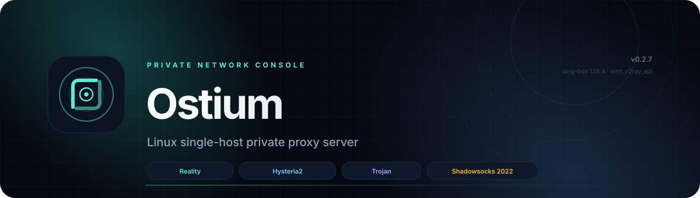
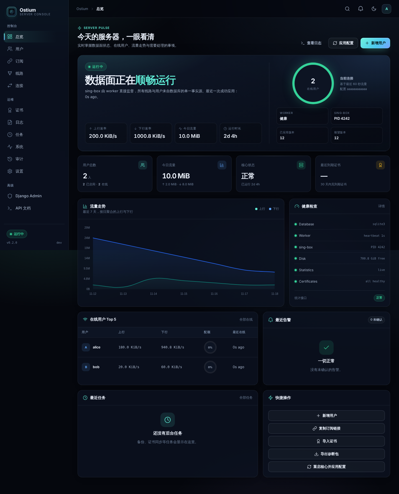
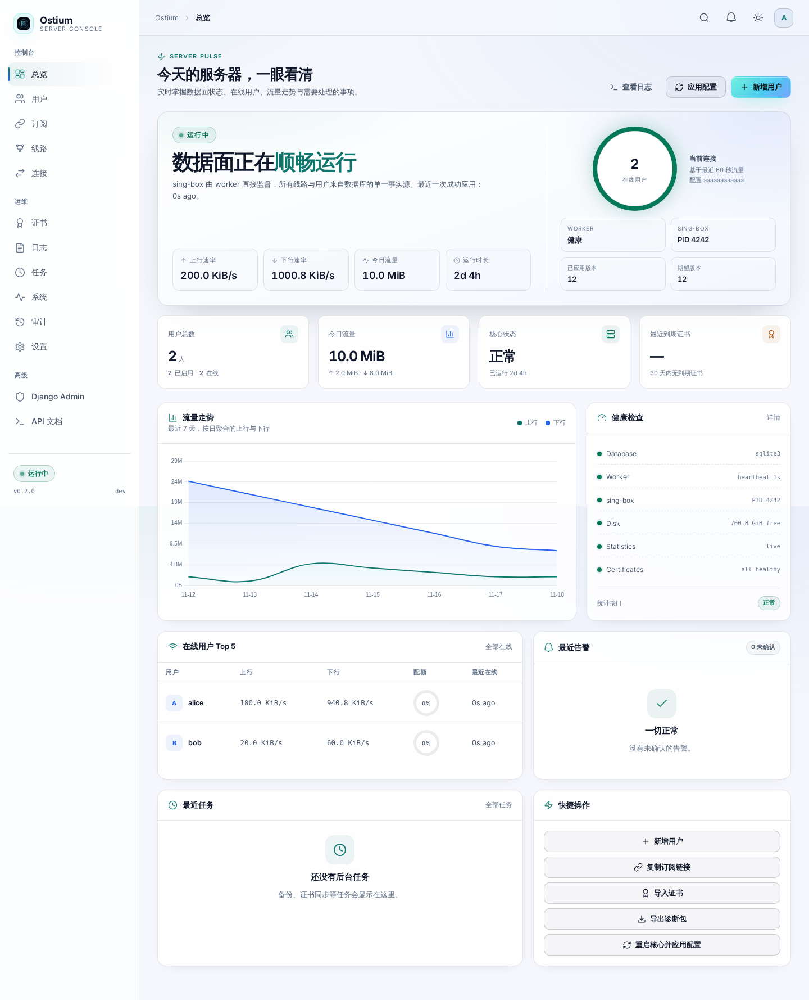
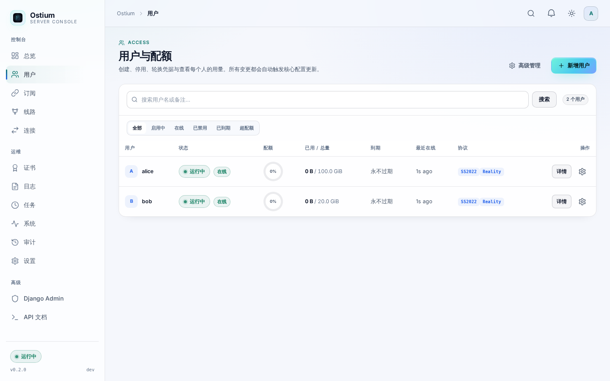
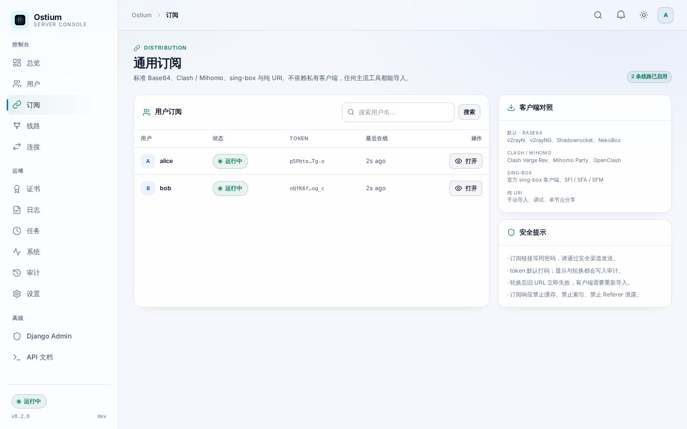
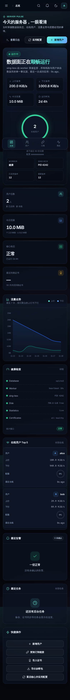
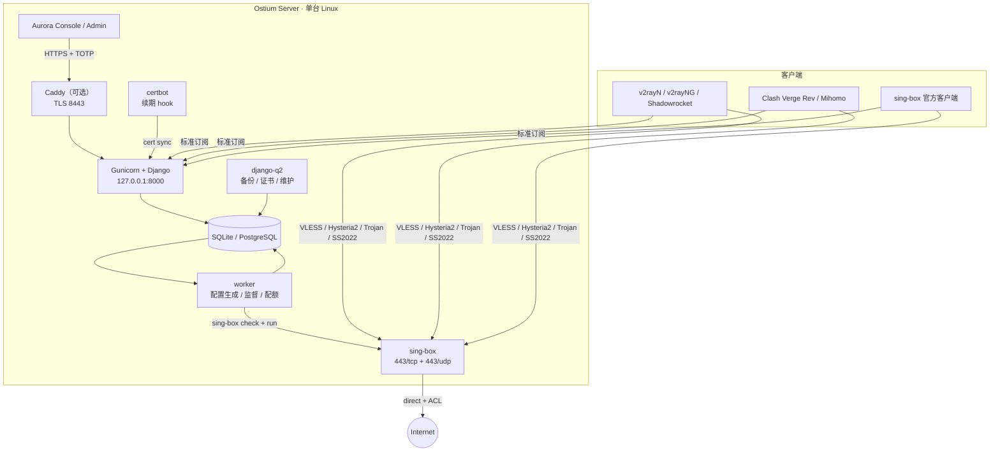

<div align="center">

<a href="https://github.com/ThzxxArt/Ostium">
  
</a>

<br>

### 装完就能用的 Linux 私人代理服务端

**单机 · 单管理员 · Django 控制面 · sing-box 数据面 · 标准订阅 · Aurora Console**

<br>

[](https://github.com/ThzxxArt/Ostium/actions/workflows/ci.yml)
[](https://github.com/ThzxxArt/Ostium/actions/workflows/ui.yml)
[](https://www.python.org/)
[](https://www.djangoproject.com/)
[](https://sing-box.sagernet.org/)
[](https://www.kernel.org/)
[](LICENSE)
[](CONTRIBUTING.md)

<br>

[快速开始](#-快速开始) ·
[界面预览](#-界面预览) ·
[架构](#-架构) ·
[订阅](#-协议与订阅) ·
[安装](#-生产安装) ·
[安全](#-安全模型) ·
[CLI](#-命令行) ·
[API](#-api) ·
[文档](docs/index.md)

</div>

---

> [!IMPORTANT]
> **Ostium 0.2.0 是服务端-only 的完全重写。**
> 没有桌面客户端、没有 TUN、没有 SPA、没有 0.1.x 迁移。
> 旧版本只存在于 git 历史与 `v0.1.12` tag；升级意味着**全新安装、重新建用户、重新发订阅**。

---

## 🌌 为什么是 Ostium

大多数“代理面板”把时间花在客户端、节点市场和复杂编排上。Ostium 只解决一个问题：

> **在一台 Linux 主机上，把服务端做到稳定、安全、漂亮、订阅通用。**

它不试图成为机场面板，也不要求安装任何私有客户端。你管理的是一台自己的服务器：
创建用户、启用线路、导入证书、发出订阅，然后让 sing-box 安静地跑在 443 上。

| 传统面板常见问题 | Ostium 的选择 |
|---|---|
| 私有订阅格式，绑定自家客户端 | **四种标准订阅**：Base64 / Clash / sing-box / 纯 URI |
| Web 进程直接 root 跑核心 | worker 非 root，仅 `CAP_NET_BIND_SERVICE` |
| 配置随手写文件，出错就断网 | 每次应用前 `sing-box check`，失败保留旧配置并回滚 |
| 前端必须 npm / Node / SPA | **无 Node**：Tailwind standalone + HTMX + Alpine + Chart.js |
| 统计、配额、证书各一套自研逻辑 | Django ORM + sing-box V2Ray stats + 成熟认证/任务/审计库 |
| 升级要读迁移脚本 | 0.2.0 **零兼容、零迁移**；干净安装 |

---

## ✨ 核心亮点

| | 能力 | 说明 |
|---|---|---|
| 🛡️ | **四条线路** | VLESS Reality、Hysteria2、Trojan、Shadowsocks 2022 |
| 🔗 | **通用订阅** | 一份 token 同时输出 Base64、Clash/Mihomo、sing-box、纯 URI |
| 🎛️ | **Aurora Console** | 深色优先、极光青/蓝、玻璃质感、配额环、流量图、连接表 |
| 🔐 | **管理面安全** | TOTP、恢复码、登录锁定、限流、CSP、CSRF、Argon2id、审计 |
| ⚙️ | **数据面可靠** | worker 监督 sing-box；配置校验、原子替换、启动观察、失败回滚 |
| 📊 | **真实统计** | V2Ray gRPC 每 5 秒采样；60 秒 flush；配额/到期/月重置 |
| 🧾 | **证书管理** | 手动导入、自签、certbot 同步；到期告警与阻断 |
| 💾 | **加密备份** | DB、证书、配置、字段密钥一体打包；scrypt + AES-256-GCM |
| 🧰 | **运维工具** | doctor、诊断包、Prometheus、django-q2、系统日志、审计 |
| 🐧 | **Linux 原生** | systemd 或 Docker Compose；SQLite 默认，PostgreSQL 可选 |
| 🚫 | **无客户端包袱** | 没有 TUN、系统代理、kill switch、私有 Profile |
| 🧼 | **零 0.1.x 残留** | main 树只有 0.2.0 服务端文件 |

---

## 🖥️ 界面预览

> Aurora Server Console：深色为默认，支持浅色与跟随系统；桌面、平板、手机均可完整操作。

<table>
  <tr>
    <td width="50%"></td>
    <td width="50%"></td>
  </tr>
  <tr>
    <td align="center"><sub>Dashboard · 深色</sub></td>
    <td align="center"><sub>Dashboard · 浅色</sub></td>
  </tr>
  <tr>
    <td width="50%"></td>
    <td width="50%"></td>
  </tr>
  <tr>
    <td align="center"><sub>用户与配额</sub></td>
    <td align="center"><sub>订阅管理</sub></td>
  </tr>
</table>

<div align="center">
  
  <br>
  <sub>移动端 · 390px 首屏</sub>
</div>

界面包含：

- **总览**：Server Pulse Hero、实时速率、今日流量、在线用户、健康堆叠、告警时间线。
- **用户**：搜索、状态筛选、配额环、到期、最后在线、协议徽标、批量操作（Django Admin）。
- **用户详情**：配额/到期编辑、凭据轮换、订阅 4 格式卡片、二维码、30 天流量、审计。
- **线路**：四张协议卡，启停、端口、证书、Reality 密钥、应用状态。
- **订阅**：所有用户 token 打码展示；显示/轮换写入审计。
- **连接**：Clash API 实时会话，可关闭单条或全部。
- **证书**：到期环、来源、分配线路、certbot 提示。
- **日志**：终端质感、级别 chip、过滤、下载。
- **任务 / 系统 / 设置 / 审计**：完整运维闭环。

---

## 🏗️ 架构



### 进程模型

| 进程 | 职责 | 暴露 |
|---|---|---|
| `ostium-web` | Gunicorn + Django + Admin + API | `127.0.0.1:8000` |
| `ostium-worker` | 从 DB 生成配置，监督 sing-box，统计/配额 | 443/tcp、443/udp |
| `ostium-jobs` | django-q2：备份、证书、维护任务 | 无 |
| `caddy`（可选） | TLS + 反向代理 | 80、8443 |
| `certbot.timer` | 证书续期 → deploy hook → `ostium cert sync` | 80 |

### 配置应用流程

```text
管理面修改 DB
   ↓ desired_revision++
worker 读取 DB → 生成 sing-box 配置
   ↓
sing-box check
   ├─ 失败 → 保留旧进程 + 告警 + 指数退避
   └─ 成功 → 写 config.next.json
              ↓ 停旧进程
              ↓ 启新进程
              ↓ 观察 1.5 秒
              ├─ 失败 → 回滚上一版 + 告警
              └─ 成功 → 原子替换 config.json
```

**数据库是唯一事实源。** 没有自研 core API，没有任意 JSON 入口，没有 `SIGHUP` 热重载。

---

## 🧩 协议与订阅

### 支持的线路

| 协议 | 传输 | 默认端口 | 证书 | 特点 |
|---|---|---|---|---|
| **VLESS Reality** | TCP + XTLS Vision | 443/tcp | 不需要 | 无证书、抗探测、默认启用 |
| **Hysteria2** | QUIC | 443/udp | 需要 | 高丢包/高延迟友好，可加 salamander 混淆 |
| **Trojan** | TLS/TCP | 443/tcp | 需要 | 伪装自然，客户端兼容广 |
| **Shadowsocks 2022** | TCP | 8388/tcp | 不需要 | 多用户独立密钥，默认关闭 |

### 订阅端点

| 链接 | 内容 | 适用客户端 |
|---|---|---|
| `/sub/<token>` | Base64 URI 列表 | v2rayN、v2rayNG、Shadowrocket、NekoBox |
| `/sub/<token>?target=clash` | Clash / Mihomo YAML | Clash Verge Rev、Mihomo Party、OpenClash |
| `/sub/<token>?target=singbox` | 完整 sing-box JSON | sing-box 官方客户端 |
| `/sub/<token>?target=uri` | 纯 URI | 手动导入、调试 |

别名：`format=`、`flag=` 等价 `target=`；`sing-box` 等价 `singbox`；`clash-meta` 等价 `clash`。

### 响应头

```http
Subscription-Userinfo: upload=...; download=...; total=...; expire=...
Profile-Update-Interval: 24
Profile-Title: <user>@<server_name>
Cache-Control: private, no-store
Referrer-Policy: no-referrer
X-Robots-Tag: noindex, nofollow
```

`total=0` 表示不限量，`expire=0` 表示不过期。订阅 token 默认打码，显示/轮换都需要 POST 并写入审计。

---

## 🚀 快速开始

### 1. 准备

- Linux（Debian 13 / Ubuntu 24.04+ 推荐）
- Python 3.14（由 `uv` 管理；当前验证版本 3.14.5）
- Git、curl、OpenSSL

### 2. 安装依赖与初始化

```bash
git clone https://github.com/ThzxxArt/Ostium.git
cd Ostium

uv sync --extra dev
uv run ostium migrate
uv run ostium init --username admin --password 'Change-This-Password-2026'
```

`init` 会创建四条线路记录，并默认启用 **VLESS Reality**。

### 3. 构建数据面

官方 sing-box release **不包含** `with_v2ray_api`，统计会不可用。必须用固定标签构建：

```bash
bash scripts/build-core.sh
cp dist/sing-box .cache/bin/sing-box
```

构建标签：

```text
with_quic,with_utls,with_clash_api,with_v2ray_api,badlinkname,tfogo_checklinkname0
```

### 4. 启动

```bash
# 终端 A：管理面
uv run ostium web

# 终端 B：数据面
uv run ostium worker

# 终端 C（可选）：后台任务
uv run ostium qcluster
```

打开 <http://127.0.0.1:8000/>，使用 `admin` 登录。首次登录会强制修改密码。

> 普通用户无法绑定 443 时：
>
> ```bash
> uv run ostium inbound set-port vless 8443
> uv run ostium apply
> ```

### 5. 创建用户并导入订阅

```bash
uv run ostium user add alice --quota 100G --cycle monthly
uv run ostium user subscription alice --reveal
```

把 Base64 链接导入 v2rayN / Shadowrocket；Clash 用 `/clash`，sing-box 用 `/singbox`。

---

## 📦 生产安装

### 一键在线安装（systemd + Caddy）

不需要手动下载 `install.sh`：

```bash
curl -fsSL https://raw.githubusercontent.com/ThzxxArt/Ostium/main/install.sh \
  | sudo bash -s -- --domain vpn.example.com --with-caddy
```

脚本会自动下载对应源码、构建带统计标签的 sing-box、安装 systemd 服务并申请证书。
不使用 Caddy：

```bash
curl -fsSL https://raw.githubusercontent.com/ThzxxArt/Ostium/main/install.sh \
  | sudo bash -s --
```

> 需要先安装 `caddy`、`certbot`，并让域名解析到本机、80 端口可用。
> 更稳妥的做法是先查看脚本内容，再执行：
>
> ```bash
> curl -fsSL https://raw.githubusercontent.com/ThzxxArt/Ostium/main/install.sh \
>   -o /tmp/ostium-install.sh
> less /tmp/ostium-install.sh
> sudo bash /tmp/ostium-install.sh --domain vpn.example.com --with-caddy
> ```

一键安装的完整中文步骤见 [从零部署教程](docs/tutorials/from-zero.md)。

### 方式一：systemd（推荐）

```bash
sudo bash install.sh --domain vpn.example.com --with-caddy
```

安装器会完成：

1. 安装运行时依赖，下载静态 `uv` 与 Python 3.14。
2. 创建 `/opt/ostium/venv`，安装 wheel 或当前源码。
3. 从 pinned 上游源码构建带统计标签的 sing-box 到 `/opt/ostium/core/sing-box`。
4. 创建 `ostium` 用户、`/var/lib/ostium` 与 `/etc/ostium/ostium.env`。
5. 生成 `OSTIUM_SECRET_KEY` / `OSTIUM_FIELD_KEY`，权限 0640。
6. 执行 migrate、collectstatic、init，打印一次性管理员密码。
7. 安装并启动 `ostium-web`、`ostium-worker`、`ostium-jobs`。
8. 可选：certbot 证书 + Caddy 8443 TLS。

不使用 Caddy 时，用 SSH 隧道：

```bash
ssh -L 8000:127.0.0.1:8000 user@server
# 浏览器打开 http://127.0.0.1:8000/
```

升级与卸载：

```bash
# 在线升级（不需要本地 checkout）
curl -fsSL https://raw.githubusercontent.com/ThzxxArt/Ostium/main/install.sh \
  | sudo bash -s -- upgrade --ref main

# 或从本地 checkout 升级
sudo bash install.sh upgrade --from-source

sudo bash install.sh uninstall          # 保留数据
sudo bash install.sh uninstall --purge  # 删除数据与用户
```

### 方式二：Docker Compose

```bash
cd deploy/docker
cp ostium.env.example ostium.env
# 填入 OSTIUM_SECRET_KEY、OSTIUM_FIELD_KEY、域名
docker compose up -d
```

预构建镜像：`ghcr.io/thzxxart/ostium-server:0.2.0`。首次使用可
`docker compose pull`；本地改动可用 `docker compose up -d --build`。

服务：

| 服务 | 作用 | 端口 |
|---|---|---|
| `web` | Gunicorn + Django | 内部 8000 |
| `worker` | sing-box 监督 | 443/tcp、443/udp、8388/tcp |
| `jobs` | django-q2 | 无 |
| `caddy`（profile） | TLS 反代 | 80、8443 |
| `postgres`（profile） | PostgreSQL 18 | 内部 5432 |

首次启动后初始化：

```bash
docker compose exec web ostium init --username admin
```

### 目录布局

```text
/opt/ostium/
  venv/                    Python 环境
  core/sing-box            固定数据面二进制
/etc/ostium/
  ostium.env               环境变量（0640 root:ostium）
/var/lib/ostium/
  ostium.db                SQLite（或使用 PostgreSQL）
  certs/                   证书与私钥（0600）
  runtime/                 config / usage / lock / clash.secret
  logs/                    ostium.log / sing-box.log
  backups/                 .ostb 加密备份
```

---

## ⚙️ 配置

环境变量（生产必填）：

| 变量 | 默认 | 说明 |
|---|---|---|
| `OSTIUM_SECRET_KEY` | 无 | Django 签名密钥 |
| `OSTIUM_FIELD_KEY` | 无 | 32 字节 base64，字段加密密钥 |
| `OSTIUM_DATA_DIR` | `./var` | 数据目录 |
| `OSTIUM_DB_URL` | SQLite | `postgres://...` 可切换 PostgreSQL |
| `OSTIUM_ALLOWED_HOSTS` | 回环 | 域名白名单 |
| `OSTIUM_CSRF_TRUSTED_ORIGINS` | 空 | 公网 HTTPS 源 |
| `OSTIUM_PUBLIC_BASE_URL` | 空 | 订阅/控制台公网基址 |
| `OSTIUM_BEHIND_PROXY` | `false` | 信任 Caddy `X-Forwarded-*` |
| `OSTIUM_REQUIRE_TOTP` | `false` | 强制管理员 TOTP |
| `OSTIUM_SINGBOX_PATH` | `.cache/bin/sing-box` | 数据面二进制 |
| `OSTIUM_SINGBOX_BINARY_SHA256` | 空 | 启动时校验二进制 |
| `OSTIUM_CLASH_BIND` | `127.0.0.1:19090` | Clash API 监听地址 |
| `OSTIUM_CLASH_URL` | 空 | web 访问 Clash API 的地址 |
| `OSTIUM_STATS_BIND` | `127.0.0.1:19091` | V2Ray 统计监听地址 |
| `OSTIUM_BACKUP_PASSWORD` | 空 | 自动备份密码（可选） |

运行时设置保存在数据库，可在控制台「设置」页修改：

`server_name`、`public_host`、`public_base_url`、DNS 模式、DoH URL、私网出口 ACL、日志级别、流量/审计保留天数、自动备份、Webhook、维护模式。

完整参考：[配置](docs/configuration.md) · [设置项](docs/reference/settings.md)

---

## 🔐 安全模型

### 默认安全

- 管理面只监听 `127.0.0.1:8000`。
- 生产公网访问必须 **TLS + TOTP**。
- Argon2id 密码、Django 会话/CSRF、CSP、HSTS、点击劫持与 MIME 防护。
- django-axes 登录锁定，django-ratelimit 限速。
- 订阅 token 32 字节随机；数据库只存 SHA-256 哈希 + AES-GCM 加密副本。
- 字段加密 AAD 绑定 `app.model:pk:field`；UUID 主键。
- 出口 ACL 阻止 RFC1918、CGNAT、回环、link-local、云 metadata、SMTP 25。
- Clash API / V2Ray stats 仅回环；secret 0600。
- 日志、审计、诊断包不记录密码、私钥、完整 token。

### 公网暴露清单

- [ ] Caddy 或其他反向代理已启用 TLS。
- [ ] `OSTIUM_BEHIND_PROXY=true`、`OSTIUM_SECURE_COOKIES=true`。
- [ ] `OSTIUM_REQUIRE_TOTP=true`，管理员已绑定 TOTP 并保存恢复码。
- [ ] `OSTIUM_ALLOWED_HOSTS` 只包含真实域名。
- [ ] 防火墙只放行 443/tcp、443/udp、8443/tcp 与 SSH。
- [ ] `ostium doctor` 无 fail。
- [ ] 已创建并异地保存加密备份。

> 订阅面与出口 ACL 的细节见 [安全文档](docs/security.md)。

---

## 🧰 命令行

`ostium` 是 Django management command 的薄包装；默认人类可读，`--json` 适合自动化。

```bash
# 初始化 / 服务
ostium init --username admin --domain vpn.example.com
ostium migrate
ostium collectstatic
ostium web
ostium worker
ostium qcluster

# 用户
ostium user add alice --quota 100G --cycle monthly --expires 2027-01-01T00:00:00Z
ostium user list --json
ostium user show alice
ostium user disable alice
ostium user enable alice
ostium user rotate alice --subscription
ostium user reset-usage alice
ostium user subscription alice --reveal
ostium user delete alice

# 线路
ostium inbound init --enable vless,shadowsocks
ostium inbound list
ostium inbound enable hysteria2 --cert vpn.example.com
ostium inbound rotate-keys vless
ostium inbound set-port shadowsocks 8388

# 证书
ostium cert import --domain vpn.example.com --cert fullchain.pem --key privkey.pem
ostium cert sync --dir /etc/letsencrypt/live
ostium cert self-signed --domain test.local
ostium cert list

# 运维
ostium backup create --password '...'
ostium backup restore /var/lib/ostium/backups/ostium-backup-....ostb --password '...'
ostium doctor --json
ostium diagnostics export --output /tmp/ostium-diag.tar.gz
ostium status --json
ostium apply

# API Key
ostium token create ci --scope read --expires 90
ostium token list
ostium token revoke <prefix>
```

退出码：`0` 成功、`1` 一般错误、`2` 用法/校验错误。完整列表：[CLI 文档](docs/cli.md)。

---

## 🔌 API

基础路径 `/api/v1`，认证头：

```http
Authorization: Api-Key <key>
```

```bash
export OSTIUM_API_KEY=...

# 用户列表
curl -s -H "Authorization: Api-Key $OSTIUM_API_KEY" \
  http://127.0.0.1:8000/api/v1/users

# 创建用户
curl -s -X POST \
  -H "Authorization: Api-Key $OSTIUM_API_KEY" \
  -H "Content-Type: application/json" \
  -d '{"name":"alice","quota_bytes":107374182400,"quota_cycle":"monthly"}' \
  http://127.0.0.1:8000/api/v1/users

# 显示订阅完整链接（写入审计）
curl -s -X POST \
  -H "Authorization: Api-Key $OSTIUM_API_KEY" \
  http://127.0.0.1:8000/api/v1/users/<uuid>/subscription/reveal
```

- 读 key 只能 GET；`write` key 才能创建/修改/删除。
- 错误遵循 RFC 9457：`type`、`title`、`status`、`detail`、`code`、`request_id`。
- OpenAPI：`/api/schema`，Swagger：`/api/docs`（管理员登录）。
- 分页 `?page=`，默认 50，最大 500。

完整端点：[API 文档](docs/api.md)。

---

## 📈 运维

### 健康检查

```bash
curl -fsS http://127.0.0.1:8000/healthz     # 存活
curl -fsS http://127.0.0.1:8000/readyz      # DB + worker + sing-box
curl -fsS http://127.0.0.1:8000/metrics     # Prometheus
```

指标：`ostium_worker_alive`、`ostium_singbox_running`、`ostium_active_users`、`ostium_online_users`、`ostium_unacknowledged_alerts`、`ostium_disk_free_bytes`。

### 备份

```bash
ostium backup create --password 'a-long-backup-password'
```

备份包含数据库 dump、证书、当前配置、字段密钥；整体 scrypt + AES-256-GCM 加密。
恢复建议离线执行，先停 web/worker/jobs，恢复后重启 worker。

### 诊断

```bash
ostium doctor
ostium diagnostics export --output /tmp/ostium-diag.tar.gz
```

诊断包包含版本、doctor、运行状态、脱敏配置与日志尾部；不包含 token、密码、私钥。

### 告警

`worker_down`、`singbox_down`、`config_apply_failed`、`stats_unavailable`、`certificate_expiring`、`certificate_expired`、`disk_low`、`quota_80/90`、`backup_failed`、`dns_fallback`。

更多：[监控](docs/operations/monitoring.md) · [排障](docs/operations/troubleshooting.md) · [备份恢复](docs/operations/backup-restore.md)

---

## 🗂️ 项目结构

```text
Ostium/
├── manage.py
├── pyproject.toml
├── uv.lock
├── src/ostium/
│   ├── config/            settings / urls / wsgi / asgi
│   ├── accounts/          管理员、TOTP、API Key、字段加密
│   ├── proxy/             用户、线路、流量、统计 epoch
│   ├── certificates/      证书导入/校验/certbot 同步
│   ├── subscriptions/     端点模型、URI/Clash/sing-box 渲染
│   ├── engine/            配置生成、supervisor、worker、stats、Clash
│   ├── operations/        运行时状态、告警、审计、备份、doctor、控制台
│   ├── api/               DRF /api/v1
│   ├── templates/         Aurora Console + Unfold Admin
│   └── static/            Tailwind / HTMX / Alpine / Chart.js / Inter
├── deploy/                systemd / Caddy / certbot / Compose
├── scripts/               build-core / build-css / release gates
├── docs/                  使用、运维、参考、设计文档
└── tests/                 unit / integration / contract / ui / e2e
```

---

## 🧪 测试与质量

```bash
# 单元 + 集成（含覆盖率门槛）
uv run pytest -q --cov=src/ostium --cov-report=term

# 真实二进制契约：sing-box check + mihomo -t
uv run pytest tests/contract

# 浏览器 UI + axe（需 Chromium）
OSTIUM_UI=1 DJANGO_ALLOW_ASYNC_UNSAFE=true uv run pytest tests/ui

# 静态检查
uv run ruff check src tests
uv run ruff format --check src tests
uv run mypy src
uv run djlint src/ostium/templates --check

# 发布门禁（必须使用 prod settings 与真实长度的密钥）
DJANGO_SETTINGS_MODULE=ostium.config.settings.prod \
OSTIUM_SECRET_KEY="$(openssl rand -hex 48)" \
OSTIUM_FIELD_KEY="MDEyMzQ1Njc4OWFiY2RlZjAxMjM0NTY3ODlhYmNkZWY=" \
OSTIUM_ALLOWED_HOSTS=vpn.example.com \
OSTIUM_PUBLIC_BASE_URL=https://vpn.example.com \
OSTIUM_REQUIRE_TOTP=true \
OSTIUM_SSL_REDIRECT=true \
OSTIUM_DATA_DIR="$(mktemp -d)" \
uv run python manage.py check --deploy
uv run bandit -q -r src -ll
uv run pip-audit
uv run mkdocs build --strict
```

本地验证结果：

| 项目 | 结果 |
|---|---|
| pytest | **350 passed**，1 skipped（UI 默认跳过） |
| 覆盖率 | **90.27%**，覆盖门槛 90% |
| 契约 | 四协议 sing-box 服务端/客户端配置、Mihomo Clash 配置 **全绿** |
| UI | 1440/1024/390、深/浅色，24 张截图；axe 无 critical |
| Django deploy check | **0 issues** |
| Ruff / Mypy / Djlint | 通过 |
| Bandit | 0 High / 0 Medium |
| pip-audit | No known vulnerabilities |

> 本地 E2E 使用 8443（普通用户无法绑定 443）；详见 [E2E 记录](docs/operations/e2e-evidence.md)。

---

## 📚 文档

| 文档 | 内容 |
|---|---|
| [快速开始](docs/getting-started.md) | 从源码启动开发实例 |
| [从零部署教程](docs/tutorials/from-zero.md) | DNS、Caddy/certbot、systemd/Docker、首次登录、订阅、续期、排障 |
| [安装](docs/installation.md) | systemd / Docker / 升级 / 卸载 |
| [配置](docs/configuration.md) | 环境变量与运行时设置 |
| [订阅](docs/subscriptions.md) | 四种格式与客户端兼容性 |
| [协议](docs/protocols.md) | Reality / Hysteria2 / Trojan / SS2022 |
| [证书](docs/certificates.md) | 导入、自签、certbot |
| [架构](docs/architecture.md) | 进程、数据流、信任边界 |
| [安全](docs/security.md) | 控制项、公网清单、残余风险 |
| [CLI](docs/cli.md) | 全部命令 |
| [API](docs/api.md) | `/api/v1` 端点与错误格式 |
| [运维](docs/operations/) | 备份、升级、监控、PyPI 发布、排障、E2E |
| [设计](docs/design/v0.2.0-final.md) | 0.2.0 最终方案与决策记录 |

---

## 🚧 非目标

Ostium 0.2.0 明确不做：

- 桌面/手机客户端、TUN、系统代理、kill switch。
- 多节点编排、CDN、域名前置、多租户/RBAC。
- 0.1.x 数据迁移、旧 API/订阅格式兼容。
- 内置 ACME / DNS-01 / TLS-ALPN-01（交给 certbot）。
- 静默自动更新、云端遥测。

---

## 🤝 贡献

欢迎提交 issue、文档修正和代码 PR。开始前请阅读 [CONTRIBUTING.md](CONTRIBUTING.md)：

- 服务端-only，不引入 Node/npm/SPA。
- 不添加 0.1.x 兼容层或迁移工具。
- 配置变更必须通过真实 `sing-box check`。
- UI 变更必须保持响应式与 WCAG 2.2 AA。
- 提交前运行完整测试与静态检查。

安全问题请按 [SECURITY.md](SECURITY.md) 私下报告，不要公开 issue。

---

## 📄 许可证

Ostium Server 以 **AGPL-3.0-or-later** 发布。详见 [LICENSE](LICENSE) 与 [NOTICE](NOTICE)。

内置/分发的 sing-box 为未修改的上游二进制，遵循 GPL-3.0；构建标签与 SBOM 记录在发布资产中。
Inter 字体遵循 SIL Open Font License 1.1。

---

<div align="center">

<a href="https://github.com/ThzxxArt/Ostium">
  
</a>

<br>

**一台 Linux。一个管理员。一份通用订阅。**

<sub>Ostium Server 0.2.0 · Made for the quiet corner of the internet.</sub>

</div>
