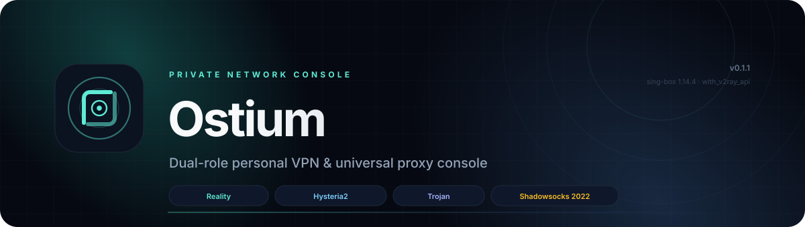
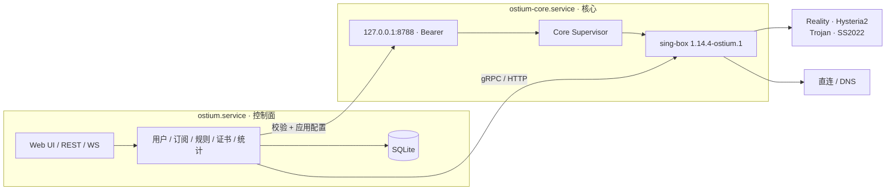

<p align="center">
  
</p>

<h1 align="center">Ostium</h1>

<p align="center">
  <strong>一个应用，两种角色：服务端与客户端一体的私人 VPN / 通用代理控制台。</strong><br>
  同一个 Python 包、同一个 Web UI、同一个 CLI，一条命令完成安装。
</p>

<p align="center">
  <a href="README.md">简体中文</a> ·
  <a href="README.en.md">English</a> ·
  <a href="https://github.com/ThzxxArt/Ostium/tree/main/docs">文档</a> ·
  <a href="https://github.com/ThzxxArt/Ostium/issues">问题反馈</a>
</p>

<p align="center">
  <a href="https://github.com/ThzxxArt/Ostium/actions/workflows/ci.yml"></a>
  <a href="https://github.com/ThzxxArt/Ostium/actions/workflows/docs.yml"></a>
  <a href="https://github.com/ThzxxArt/Ostium/actions/workflows/security.yml"></a>
  <a href="https://pypi.org/project/ostium-ctl/"></a>
  <a href="https://github.com/ThzxxArt/Ostium/releases/tag/v0.1.0"></a>
  
</p>

<p align="center">
  
  
  
  
  
  
</p>

<p align="center">
  
  
  
</p>

> [!TIP]
> **当前稳定版本：v0.1.0。** 最省事的安装方式不需要预装 Python：
>
> ```bash
> curl -fsSL https://raw.githubusercontent.com/ThzxxArt/Ostium/main/scripts/install-online.sh \
>   | sudo bash -s -- install --role server --domain vpn.example.com
> ```
>
> Windows 客户端（管理员 PowerShell）：
>
> ```powershell
> irm https://raw.githubusercontent.com/ThzxxArt/Ostium/main/scripts/install-online.ps1 | iex
> ```
>
> 详细参数、离线安装、root 模式和 no-service 模式见[一键安装指南](docs/guides/install.md)。

---

## 为什么选择 Ostium

Ostium 不是又一个代理脚本，而是一套**可安装、可升级、可备份、可审计**的私人网络控制台。

| | 能力 |
|---|---|
| 🧭 **双端一体** | 服务端和客户端使用同一个包、同一个 SPA、同一个 CLI；学会一次，两端通用。 |
| 🛡️ **两服务隔离** | `ostium.service` 只跑 Web/API/数据库；`ostium-core.service` 只做校验、启动和监管 sing-box。UI 不接触 root/TUN 权限。 |
| 📊 **真实流量账本** | 定制 `sing-box` 开启 `with_v2ray_api`，每用户上行/下行、日/月汇总、配额与到期自动禁用。 |
| 🌐 **全平台客户端** | Windows 11、macOS 14+、Linux；混合代理、系统代理、TUN、URLTest、多订阅。 |
| 🎨 **Aurora Console** | 深色优先、响应式、可安装 PWA，带命令面板、快捷键、实时连接/日志/任务中心。 |
| 📦 **可交付** | systemd / launchd / Windows 服务 / Docker / PyInstaller / Inno Setup 构建与安装脚本齐全。 |
| 🔐 **默认安全** | Argon2id、TOTP、CSRF、Origin/Host 校验、AES-256-GCM 字段加密、诊断包脱敏、登录限速。 |
| 🧪 **可验证** | 391 个后端测试、133 个前端测试、18 个 Playwright 测试；后端 98.34% 语句 / 95.79% 分支。 |

---

## 功能总览

### 服务端

- Reality（VLESS + XTLS Vision）、Hysteria2、Trojan、Shadowsocks 2022。
- 多用户：新增、禁用、删除、到期、备注、凭据轮换、流量重置。
- 每用户配额：总量/月配额、到期禁用、超限禁用、手动重置。
- 订阅：Ostium JSON、Base64、Clash Meta YAML、sing-box JSON；标准分享链接与二维码。
- ACME HTTP-01、手动证书上传、自签证书、续期与到期提醒。
- 实时流量、连接、日志、WebSocket 事件、Prometheus 文本指标。
- 备份/恢复：SQLite 在线备份、主密钥、配置、证书；scrypt + AES-256-GCM。
- 审计日志、Webhook 告警、诊断包、IP 允许列表、登录限速。
- 公网管理 UI：强制 TLS + TOTP，默认仅监听回环。

### 客户端

- 混合代理 `127.0.0.1:7890`（SOCKS5 + HTTP）。
- 系统代理：Windows WinINET、macOS networksetup、Linux GNOME/KDE；崩溃后恢复。
- TUN：Windows Wintun、macOS utun、Linux TUN；IPv4/IPv6、TCP/UDP、DNS 接管。
- 分流：智能国内直连、全局代理、全局直连、自定义规则。
- 规则：域名/后缀/关键字/正则、IP CIDR、端口、进程名、GeoSite/GeoIP/规则集。
- DNS：FakeIP + 远程 DoH + 国内直连 DNS；混合模式明确提示 DNS 覆盖限制。
- 多配置、多线路、URLTest 自动选路、手动切换。
- 订阅 URL 定时刷新、分享链接导入、二维码导入/展示。
- 系统代理与 TUN 互斥；切换时清理旧状态。
- 局域网共享（Allow LAN）：把混合代理开放到 `0.0.0.0:7890`，手机/平板可把本机当代理；仅限可信网络，无认证。

### 双端共用

- Vue 3 SPA、FastAPI、SQLAlchemy/Alembic、SQLite WAL。
- 中英文界面、深浅色主题、桌面/平板/手机三档响应式。
- 命令面板（`Ctrl/Cmd + K`）、快捷键、全局搜索。
- 首次使用向导：服务端 4 步、客户端 3 步。
- 浏览器通知、PWA 离线壳与更新提示。
- 备份、升级、回滚、诊断、系统服务管理。

---

## 架构



- **控制面**以普通用户运行；**核心**才拥有绑定 443、TUN 等权限。
- UI 重启/升级不会中断隧道；核心崩溃由 systemd/launchd/Windows SCM 拉起。
- 配置先经过角色/端口/路径白名单和 `sing-box check`，失败自动保留上一版。

---

## 系统要求

| 角色 | 要求 |
|---|---|
| 服务端 | Ubuntu 24.04 / Debian 13，1 vCPU / 1 GB 起，20 GB SSD；开放 80/tcp、443/tcp、443/udp |
| Windows 客户端 | Windows 10 22H2+ / 11 x64；管理员权限用于安装 TUN 服务 |
| macOS 客户端 | macOS 14+，arm64 / x64；`sudo` 安装 LaunchDaemon |
| Linux 客户端 | x64 / arm64；TUN 需要 root 或 `CAP_NET_ADMIN` |
| 安装环境 | 一键脚本自动下载 uv + 托管 Python 3.13；**无需预装 Python** |
| 开发 | Python 3.13、uv 0.11+、Node 24.19+、Go 1.25.5（仅构建定制核心） |

> 服务端管理 UI 默认只监听 `127.0.0.1:8443`。公网访问请先配置证书与 TOTP，再在设置中显式开启，并重启 `ostium.service`。

---

## 安装

| 安装方式 | 适合场景 |
|---|---|
| **一键在线安装** | 推荐；无需预装 Python，自动下载 uv/托管 Python/核心并注册服务 |
| **GitHub Release 安装包** | 离线、内网、需要固定版本或自己审计文件 |
| **PyPI / uv / pipx** | CLI、自动化、已有 Python 环境；升级最简单 |
| **Docker / GHCR** | 容器化服务端、不可变基础设施 |
| **源码** | 开发、审计、定制构建 |

> PyPI 包名是 **`ostium-ctl`**，安装后的命令仍然是 **`ostium`**。一键安装器内置同样的
> wheel 和 sing-box 定制核心，但会额外处理托管 Python、服务用户、systemd/launchd 和权限。

### 方式一：一键在线安装（推荐，无需 Python）

Linux 服务端：

```bash
curl -fsSL https://raw.githubusercontent.com/ThzxxArt/Ostium/main/scripts/install-online.sh \
  | sudo bash -s -- install --role server --domain vpn.example.com
```

Linux / macOS 客户端：

```bash
curl -fsSL https://raw.githubusercontent.com/ThzxxArt/Ostium/main/scripts/install-online.sh \
  | sudo bash -s -- install --role client
```

Windows 客户端（管理员 PowerShell）：

```powershell
irm https://raw.githubusercontent.com/ThzxxArt/Ostium/main/scripts/install-online.ps1 | iex
```

安装器会：

1. 安装缺失的 `curl`/`tar`（Linux）；
2. 下载静态 `uv`，用它安装**托管的 Python 3.13**，不碰系统 Python；
3. 下载 wheel、sing-box 核心和 `SHA256SUMS`，校验后安装；
4. 服务端创建服务用户、初始化数据库并注册 systemd/launchd/Windows 服务；
5. 服务端打印一次性管理员密码；Linux/macOS 客户端不预置密码，首次打开 UI 完成客户端向导。

#### 全部用 root、不创建 ostium 用户

```bash
curl -fsSL .../install-online.sh | sudo bash -s -- install --role server --run-as-root
```

不创建 `ostium`/`ostium-core` 用户，控制面和核心都以 root 运行；客户端 UI 也安装为系统服务。**这会取消默认的权限隔离**：Web/API 漏洞可能直接影响整机。只建议单用户测试机、临时环境或已有容器/虚拟机隔离时使用。

#### 不用 systemd

```bash
curl -fsSL .../install-online.sh | sudo bash -s -- install --role server --no-service
```

只安装文件、核心和配置，不注册 systemd/launchd；可交给 OpenRC、runit、s6、supervisord 或手动运行。完整示例见[服务管理](docs/guides/service-manager.md)。

#### 离线 / 内网安装

```bash
sudo bash install-online.sh install \
  --local-dir /path/to/release \
  --role server --domain vpn.example.com
```

`--local-dir` 可以是 Release 目录，也可以是源码 checkout。

### 方式二：Linux 服务器（离线原生安装包）

从 GitHub Release 下载三个文件：

- `ostium_ctl-0.1.0-py3-none-any.whl`
- `ostium-core-1.14.4-ostium.1-linux-amd64.tar.gz`（arm64 选对应架构）
- `SHA256SUMS`

下载入口：<https://github.com/ThzxxArt/Ostium/releases/tag/v0.1.0>

```bash
sha256sum -c SHA256SUMS --ignore-missing

sudo ./install.sh --role server \
  --wheel ./ostium_ctl-0.1.0-py3-none-any.whl \
  --core ./ostium-core-1.14.4-ostium.1-linux-amd64.tar.gz \
  --domain vpn.example.com
```

安装器会：

1. 创建 `ostium` 系统用户；
2. 安装到 `/opt/ostium`，并链接 `ostium` 命令到 `/usr/local/bin`；
3. 初始化数据库、Reality 入口和管理员账号；
4. 注册并启动 `ostium-core.service`、`ostium.service`；
5. 打印一次性的管理员密码。

随后用 SSH 隧道访问 UI：

```bash
ssh -L 8443:127.0.0.1:8443 root@your-server
```

打开 <http://127.0.0.1:8443>。**第一次登录后立即启用 TOTP。**

防火墙（同时配置云安全组）：

```bash
sudo ufw default deny incoming
sudo ufw allow 22/tcp
sudo ufw allow 80/tcp
sudo ufw allow 443/tcp
sudo ufw allow 443/udp
sudo ufw enable
```

服务状态与日志：

```bash
systemctl status ostium-core ostium
journalctl -u ostium -u ostium-core -f
```

### 方式三：Linux 客户端（离线）

```bash
sudo ./install.sh --role client \
  --wheel ./ostium_ctl-0.1.0-py3-none-any.whl \
  --core ./ostium-core-1.14.4-ostium.1-linux-amd64.tar.gz
```

安装后注销并重新登录（让当前用户加入 `ostium` 组），然后启动用户 UI：

```bash
systemctl --user enable --now ostium
```

打开 <http://127.0.0.1:8787>，完成客户端向导并导入订阅。

### 方式四：Windows 客户端（离线）

1. 运行 `Ostium-0.1.0-windows-x64-setup.exe`。
2. 安装器会复制程序到 `%ProgramFiles%\Ostium`，注册 `OstiumCore` 服务，并设置登录时启动 UI。
3. 数据保存在 `%ProgramData%\Ostium`。
4. 初始管理员密码：在线安装器会直接打印；离线 setup 会保存到 `%ProgramData%\Ostium\initial-password.txt`，首次登录后请删除该文件。
5. 未签名构建会触发 SmartScreen；请先校验 `SHA256SUMS`，确认来源可信后再选择“仍要运行”。

也可以从安装目录运行 PowerShell：

```powershell
.\install.ps1
```

### 方式五：macOS 客户端（一键在线 / 离线源码）

推荐直接用方式一的一键在线安装。离线时，将 `install-macos.sh`、wheel 和 `ostium-core-*-darwin-*.tar.gz` 放在同一目录，然后：

```bash
sudo ./install-macos.sh client
```

安装器会注册 `com.ostium.core` LaunchDaemon 和 `com.ostium.ui` LaunchAgent，并链接 `ostium` 命令。未签名/未公证构建会触发 Gatekeeper，请先校验校验和。

### 方式六：Docker 服务端

直接使用 GHCR 镜像：

```bash
OSTIUM_ADMIN_PASSWORD='change-me-now' \
OSTIUM_DOMAIN='vpn.example.com' \
docker compose -f deploy/docker/docker-compose.yml up -d
```

本地构建：

```bash
docker build -t ostium:0.1.0 .
docker run -d --name ostium --network host \
  -e OSTIUM_ROLE=server \
  -e OSTIUM_ADMIN_PASSWORD='change-me-now' \
  -e OSTIUM_DOMAIN='vpn.example.com' \
  -v ostium-data:/var/lib/ostium \
  -v ostium-etc:/etc/ostium \
  ostium:0.1.0
```

> Docker 使用 host 网络，以便绑定 443/80；请自行配置防火墙、TLS 和持久化备份。

### 方式七：PyPI / uv / pipx（服务端、CLI 与开发环境）

PyPI 分发名为 **`ostium-ctl`**，导入名和 CLI 仍为 `ostium`：

```bash
# 推荐：隔离安装，不污染系统 Python
uv tool install ostium-ctl
# 或
pipx install ostium-ctl
# 或指定版本
uv tool install "ostium-ctl==0.1.0"
```

服务器快速启动（独立 venv，避免 PEP 668 和污染系统 Python）：

```bash
sudo python3.13 -m venv /opt/ostium/venv
sudo /opt/ostium/venv/bin/pip install "ostium-ctl==0.1.0"
sudo /opt/ostium/venv/bin/ostium init --role server --no-input --password 'change-me-now'
sudo /opt/ostium/venv/bin/ostium serve
```

升级：

```bash
uv tool upgrade ostium-ctl
# 或
sudo /opt/ostium/venv/bin/pip install --upgrade "ostium-ctl==0.1.0"
```

> PyPI 版本包含完整 SPA 静态资源。生产环境仍建议使用原生安装包：它会创建非 root 的
> `ostium` 用户、注册 `ostium-core.service`/`ostium.service`，并正确处理 TUN、低端口和
> 平台服务权限。

### 方式八：源码开发

```bash
git clone https://github.com/ThzxxArt/Ostium.git
cd Ostium
uv sync

uv run ostium init --role server --dev --no-input --password 'change-me-now'
uv run ostium serve          # 终端 1：控制面 + SPA
uv run ostium core-run       # 终端 2：核心服务
```

前端开发：

```bash
cd web
npm ci
npm run dev
```

构建自定义核心：

```bash
./scripts/build-core.sh --os linux amd64
```

---

## 服务管理

Ostium 不绑定单一 init 系统：

| 环境 | 默认方式 | 说明 |
|---|---|---|
| Linux | systemd | `ostium.service` + `ostium-core.service` |
| macOS | launchd | 核心 LaunchDaemon + UI LaunchAgent（root 模式为双 LaunchDaemon） |
| Windows | SCM | `OstiumCore` 服务 + 登录/SYSTEM 任务 |
| Docker | 容器入口 | 前台运行两个进程 |
| OpenRC / runit / s6 / supervisord | `--no-service` | 安装文件，由你的进程管理器启动 |

常用命令：

```bash
systemctl status ostium-core ostium
journalctl -u ostium -u ostium-core -f
sudo systemctl restart ostium-core ostium
```

默认安装创建无特权用户；`--run-as-root` 不创建用户并让两个服务都以 root 运行。**root 模式会取消控制面与 root 的隔离**，只建议单用户测试机或已有其他隔离的环境。完整示例（含 OpenRC/runit/s6/supervisord 和 root drop-in）见[服务管理](docs/guides/service-manager.md)。

如果服务器上已经装了 Nginx、80/443 被占用：用 `--behind-proxy` 让 UI 只听 `127.0.0.1:8443`，Nginx 终止 TLS 并反代；Reality/Trojan 改到 9443/tcp，Hysteria2 保留 443/udp。完整配置见[Nginx 共存指南](docs/guides/nginx.md)。

---

## 首次启动

### 服务端

1. 打开 UI，使用安装器打印的管理员账号登录。
2. 进入 **Settings → Security**：
   - 修改默认密码；
   - 启用 TOTP 并保存恢复码；
   - 可选：创建 API Token。
3. 进入 **Users → Add user**，设置配额、周期、到期时间。
4. 打开 **Subscriptions**，复制四种格式中的任意一种，或展示二维码。
5. 如需 Hysteria2/Trojan：
   - 在 **Certificates** 申请 ACME、上传证书或生成自签证书；
   - 到 **Inbounds** 启用对应入口并分配证书。
6. 如需公网 UI：
   - 确认 TOTP 已启用；
   - 配置域名和证书；
   - 在 **Settings → Public admin UI** 开启；
   - `sudo systemctl restart ostium`，用 HTTPS 访问。

### 客户端

1. 打开 <http://127.0.0.1:8787>，完成 3 步向导。
2. **Profiles → Import**：粘贴订阅 URL、分享链接、Clash/sing-box 配置或扫描二维码。
3. 在 **Home** 选择配置和线路。
4. 先使用 **System proxy**；需要全机 TCP/UDP/DNS 接管时再切换 **TUN**。
5. 在 **Routing** 调整分流，在 **Diagnostics** 做网络体检。

---

## 使用教程

### 服务端日常管理

```bash
# 用户
sudo -u ostium ostium user list
sudo -u ostium ostium user add alice --quota 100G --cycle monthly
sudo -u ostium ostium user subscription alice
sudo -u ostium ostium user disable alice
sudo -u ostium ostium user rotate alice --subscription

# 备份
sudo -u ostium ostium backup create --password 'a long passphrase'
sudo -u ostium ostium backup list

# 诊断
sudo ostium doctor
sudo ostium logs --source core -f
sudo ostium diagnostics export --output /tmp/ostium-diagnostics.tar.gz

# 证书（本地测试）
sudo -u ostium ostium cert issue local.example.com --self-signed
```

### 客户端模式

| 模式 | 捕获范围 | 限制 |
|---|---|---|
| Mixed | 手动设置 `127.0.0.1:7890` 的应用 | 不接管 DNS |
| System proxy | 遵循系统代理的应用 | 部分应用会绕过；不接管 DNS |
| TUN | 全机 TCP/UDP/DNS | 需要管理员/root；v0.1.0 无独立 kill switch |

系统代理与 TUN 互斥。切换时 Ostium 会清理旧代理、路由和虚拟网卡。

### CLI 速查

| 命令 | 用途 |
|---|---|
| `ostium init --role server\|client` | 初始化数据、配置、管理员和默认入口 |
| `ostium serve` | 启动控制面/Web UI |
| `ostium core-run` | 启动核心服务（内部命令） |
| `ostium status [--json]` | 查看角色、路径、数据库和核心状态 |
| `ostium open` | 打开本地 Web UI |
| `ostium doctor [--json] [--fix]` | 本机诊断 |
| `ostium logs [-f] [--source ostium\|core]` | 查看日志 |
| `ostium connect` / `disconnect` | 客户端连接/断开 |
| `ostium proxy on\|off\|status` | 系统代理 |
| `ostium tun on\|off\|status` | TUN |
| `ostium update [--check]` | 检查更新（安装始终显式） |
| `ostium diagnostics export` | 导出脱敏诊断包 |
| `ostium user ...` | 服务端用户管理 |
| `ostium profile ...` | 客户端配置/订阅管理 |
| `ostium core install/update/status/version` | 核心二进制管理 |
| `ostium backup create/list/restore` | 备份与恢复 |
| `ostium cert list/issue` | 证书管理 |
| `ostium service install/uninstall` | systemd 单元（Linux root） |

退出码：`0` 成功，`1` 一般错误，`2` 用法错误，`3` 未初始化，`4` 服务不可用，`5` 权限不足，`6` 核心错误。

### API 与自动化

- API 前缀：`/api/v1`；OpenAPI：`/api/docs`。
- 浏览器使用会话 Cookie + CSRF；自动化使用 `Authorization: Bearer <API token>`。
- API Token 在 **Settings → API tokens** 创建，可限定 `read` / `write` scope。
- CLI 本地请求使用 `<data>/runtime/cli.token`，只允许回环访问。

```bash
curl -H "Authorization: Bearer $OSTIUM_TOKEN" \
  http://127.0.0.1:8443/api/v1/system/services
```

### 备份与恢复

**推荐方式：** Settings → Maintenance → Backups → Create / Apply。恢复会先 staging，重启两个服务后才替换数据库。

命令行恢复（先停止服务）：

```bash
sudo systemctl stop ostium ostium-core
sudo -u ostium ostium backup restore ./ostium-backup-....ostb --password '...'
sudo systemctl start ostium-core ostium
```

> 主密钥包含在备份中。丢失备份密码或主密钥，用户密码、订阅 token 和证书私钥将无法恢复。

### HTTPS / ACME

1. 域名 A/AAAA 指向服务器；
2. 开放 80/tcp；
3. Settings 中填写 ACME 邮箱；
4. Certificates → Issue → ACME；
5. 分配证书到 Hysteria2/Trojan；
6. 启用 TOTP 后再开启 Public admin UI；
7. 重启 `ostium.service`。

v0.1.0 只支持 HTTP-01，不支持 DNS-01/TLS-ALPN-01。

---

## 升级与回滚

### 一键升级

```bash
sudo bash install-online.sh upgrade
# 指定版本
sudo bash install-online.sh upgrade --version 0.1.1
```

升级会保留数据库、`master.key`、配置、证书、用户和订阅，只替换 venv 与核心二进制；如果原来是 root 模式，会自动保持。

### 应用升级（服务端）

```bash
# 1. 先备份
sudo -u ostium ostium backup create --password '...'

# 2. 只停控制面，核心继续跑，隧道不断
sudo systemctl stop ostium

# 3. 安装新 wheel
sudo /opt/ostium/venv/bin/pip install --upgrade ./ostium_ctl-0.1.0-py3-none-any.whl

# 4. 启动；迁移在启动时执行
sudo systemctl start ostium
curl -fsS http://127.0.0.1:8443/readyz
```

### 核心升级

```bash
sudo ostium core install --binary ./sing-box
# 或
sudo ostium core install --url https://.../ostium-core-....tar.gz --sha256 <hash>
sudo ostium core update
```

核心升级会先执行 `sing-box check`；失败时保留旧二进制和旧配置，不会把半成品推给生产。

### 回滚

1. 停 `ostium.service`；
2. 安装上一版 wheel；
3. 如迁移不兼容，按备份文档恢复数据库；
4. 启动并检查 `/readyz`、登录、订阅和核心状态。

### 客户端升级

Windows/macOS 安装器原位覆盖，数据与订阅保留；Linux 重新执行 `install.sh --role client`。升级核心会短暂中断隧道，UI 升级不会。

> Ostium 不做静默自动更新。所有升级都需要你下载、校验并显式安装。

---

## 卸载

一键卸载（默认保留数据）：

```bash
sudo bash install-online.sh uninstall
# 连数据、配置和用户一起删除
sudo bash install-online.sh uninstall --purge
```

### Linux 服务端

```bash
sudo systemctl disable --now ostium ostium-core
sudo rm -f /etc/systemd/system/ostium.service /etc/systemd/system/ostium-core.service
sudo systemctl daemon-reload
sudo rm -f /usr/local/bin/ostium
sudo rm -rf /opt/ostium

# 数据默认保留；确认不再需要后再删除：
# sudo rm -rf /var/lib/ostium /etc/ostium
# sudo userdel ostium
```

### Linux 客户端

```bash
systemctl --user disable --now ostium
sudo systemctl disable --now ostium-core
sudo rm -f /etc/systemd/system/ostium-core.service
rm -f ~/.config/systemd/user/ostium.service
sudo systemctl daemon-reload
systemctl --user daemon-reload

# 卸载前先恢复系统代理/清理 TUN（若服务仍在运行）：
# ostium proxy off
# sudo ostium tun off

sudo rm -rf /opt/ostium
sudo rm -f /usr/local/bin/ostium
# 数据默认保留；确认后再删除：
# sudo rm -rf /var/lib/ostium-core /etc/ostium/client.toml ~/.local/share/ostium
```

### Windows

设置 → 应用 → Ostium → 卸载。卸载器会停止 `OstiumCore` 服务、移除登录启动项，并尝试恢复系统代理。`%ProgramData%\Ostium` 中的数据默认保留。

### macOS

```bash
sudo launchctl unload -w /Library/LaunchDaemons/com.ostium.core.plist
sudo launchctl unload -w /Library/LaunchAgents/com.ostium.ui.plist
sudo rm -f /Library/LaunchDaemons/com.ostium.core.plist
sudo rm -f /Library/LaunchAgents/com.ostium.ui.plist
sudo rm -rf /opt/ostium
# 数据：/Library/Application Support/Ostium 与 Ostium UI（确认后再删除）
```

### Docker

```bash
docker compose -f deploy/docker/docker-compose.yml down
# 同时删除数据卷（不可恢复）：
# docker compose -f deploy/docker/docker-compose.yml down -v
```

---

## 安全建议

- 管理 UI 默认只监听回环；不要在没有 TLS + TOTP 的情况下暴露公网。
- 首次登录后立即修改密码、启用 TOTP、保存恢复码；丢失验证器时可在登录页切换为恢复码登录。
- 只开放必要端口：22、80、443/tcp、443/udp；不要默认开放 8388/8443。
- 使用非 root 用户运行控制面；核心服务才需要绑定低端口/TUN 权限。
- 定期备份并把加密备份存到异地；备份包含主密钥，视同最高敏感文件。
- 订阅 token 只显示一次；泄露后立即在用户页轮换。
- 不要把诊断包、日志、`.env` 或 `master.key` 上传到公开 issue。
- 发现安全问题请走私密渠道，参见 [`SECURITY.md`](SECURITY.md)。

---

## 数据目录

| 平台 | 控制面数据 | 核心数据 |
|---|---|---|
| Linux 服务端 | `/var/lib/ostium`、`/etc/ostium/config.toml` | 同左 |
| Linux 客户端 | `~/.local/share/ostium`（UI 数据与 `config.toml`） | `/var/lib/ostium-core`、`/etc/ostium/client.toml` |
| Windows | `%ProgramData%\Ostium`（UI） | `%ProgramData%\Ostium` |
| macOS | `/Library/Application Support/Ostium UI`（UI） | `/Library/Application Support/Ostium` |

关键文件：`ostium.db`、`master.key`、`config.toml`、`certs/`、`runtime/last-good.json`、`runtime/core.token`、`logs/`、`backups/`。

---

## 故障排查

| 现象 | 检查 |
|---|---|
| UI 打不开 | `systemctl status ostium`；确认监听 `127.0.0.1:8443`；查看 `journalctl -u ostium` |
| 核心未运行 | `ostium core status`；`ostium logs --source core`；确认核心二进制路径与执行权限 |
| 443 被占用 | `ss -lntup \| grep :443`；停掉冲突的 nginx/caddy 或改端口 |
| 订阅 403 | 用户被禁用/到期/超配额；在 Users 页查看 `status` 与 `disabled_reason` |
| 订阅 404 | token 已轮换或用户删除；重新复制订阅链接 |
| TUN 启动失败 | 需要 root/CAP_NET_ADMIN；确认 `/dev/net/tun` 与 Wintun 已安装 |
| 系统代理未恢复 | `ostium proxy off`；检查 `runtime/system-proxy.json` 与平台命令 |
| ACME 失败 | 80/tcp 是否可达；域名是否解析到本机；查看 Certificates 的 `last_error` |
| 升级后异常 | 检查 `/readyz`；回滚 wheel/数据库；查看 `AUDIT_REPORT.md` 的兼容性说明 |

生成诊断包：

```bash
sudo ostium diagnostics export --output /tmp/ostium-diagnostics.tar.gz
```

诊断包会自动脱敏 token、密码、UUID、私钥和分享链接。

---

## 测试与质量

```bash
# 后端
uv run ruff check src tests scripts
uv run ruff format --check src tests scripts
uv run mypy src/ostium
uv run pytest -m "not integration" -q

# 真实核心集成测试（需要 sing-box 与定制核心）
# uv run pytest -m integration -q

# 前端
cd web
npm run lint
npm run typecheck
npm run test:coverage
npm run build
npm run format:check

# E2E / 可访问性 / 视觉回归
npx playwright test
```

当前结果：

- 后端：**391 passed / 0 skipped**（385 个常规测试 + 6 个真实核心集成测试），语句 **98.34%**、分支 **95.79%**；
- 前端：**133 passed**，语句 **91.46%**、分支 **85.43%**、函数 **89.14%**、行 **92.17%**；
- Playwright：**18 passed**，覆盖 1440/1024/390 三档、深浅色视觉基线和 axe 登录页检查；
- `pip-audit` / `npm audit`：0 已知漏洞；
- 完整证据与逐文件审计见 [`AUDIT_REPORT.md`](AUDIT_REPORT.md)。

---

## 文档

- [一键安装](docs/guides/install.md)
- [服务管理（systemd / OpenRC / runit / s6 / supervisord）](docs/guides/service-manager.md)
- [Nginx 共存与反向代理](docs/guides/nginx.md)
- [架构](docs/architecture.md)
- [服务端指南](docs/guides/server.md)
- [客户端指南](docs/guides/client.md)
- [TUN 指南](docs/guides/tun.md)
- [ACME / TLS](docs/guides/acme.md)
- [订阅格式](docs/guides/subscription.md)
- [Web UI 指南](docs/guides/ui.md)
- [CLI 参考](docs/reference/cli.md)
- [API 参考](docs/reference/api.md)
- [Profile v1](docs/reference/profile.md)
- [端口与路径](docs/reference/ports.md)
- [备份与恢复](docs/operations/backup.md)
- [升级与回滚](docs/operations/upgrade.md)
- [故障排查](docs/operations/troubleshooting.md)
- [安全模型](docs/security/threat-model.md)
- [设计系统](docs/design-system.md)
- [UX 规范](docs/ux.md)

---

## 参与贡献

欢迎提交 issue、文档修正和测试改进。提交前请：

1. 阅读 [`CONTRIBUTING.md`](CONTRIBUTING.md)；
2. 运行后端/前端全量检查；
3. 不提交密钥、证书、订阅 token、诊断包或个人配置；
4. 安全漏洞请遵循 [`SECURITY.md`](SECURITY.md) 私下报告。

---

## 许可证

- 代码：**GPL-3.0-or-later**，见 [`LICENSE`](LICENSE) 与 [`NOTICE`](NOTICE)。
- 文档：CC BY-SA 4.0。
- 捆绑的 sing-box 由未修改的上游源码构建，仍为 GPL-3.0。

Ostium 仅用于个人学习、隐私与自有网络管理。请遵守所在国家/地区法律及云服务商 AUP；本项目不提供法律意见，也不对滥用负责。
