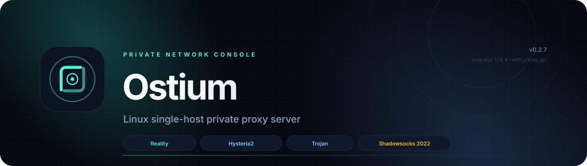

<div align="center">



### Linux 单机私人代理服务端

**Django 控制面 · sing-box 数据面 · 标准订阅 · Aurora Console**

[](https://github.com/ThzxxArt/Ostium/actions/workflows/ci.yml)
[](https://github.com/ThzxxArt/Ostium/actions/workflows/ui.yml)
[](https://www.python.org/)
[](https://www.djangoproject.com/)
[](https://github.com/ThzxxArt/Ostium/blob/main/LICENSE)

</div>

## Ostium Server

Ostium 0.2.1 是一个 **Linux 单机、单管理员、私人代理服务端**：

- VLESS Reality、Hysteria2、Trojan、Shadowsocks 2022；
- Base64 / Clash-Mihomo / sing-box / 纯 URI 四种标准订阅；
- Django 管理面、Aurora Console、TOTP、审计、配额、证书、备份、Prometheus；
- 无客户端、无 TUN、无 SPA、无 Node 运行时。

## 安装

完整服务端推荐使用一键在线安装器（包含 systemd/Caddy/Docker 部署资产）：

```bash
curl -fsSL https://raw.githubusercontent.com/ThzxxArt/Ostium/main/install.sh \
  | sudo bash -s -- --domain vpn.example.com --with-caddy
```

从 PyPI 安装 Python 包（仅代码与 `ostium` 命令，不含部署资产）：

```bash
pip install ostium-ctl==0.2.1
ostium help
```

## 文档

- [中文 README](https://github.com/ThzxxArt/Ostium/blob/main/README.md)
- [从零部署中文教程](https://github.com/ThzxxArt/Ostium/blob/main/docs/tutorials/from-zero.md)
- [安装](https://github.com/ThzxxArt/Ostium/blob/main/docs/installation.md)
- [订阅](https://github.com/ThzxxArt/Ostium/blob/main/docs/subscriptions.md)
- [安全](https://github.com/ThzxxArt/Ostium/blob/main/docs/security.md)
- [PyPI 发布](https://github.com/ThzxxArt/Ostium/blob/main/docs/operations/publishing.md)

## 许可证

AGPL-3.0-or-later。内置/分发的 sing-box 为未修改的上游二进制，遵循 GPL-3.0。
